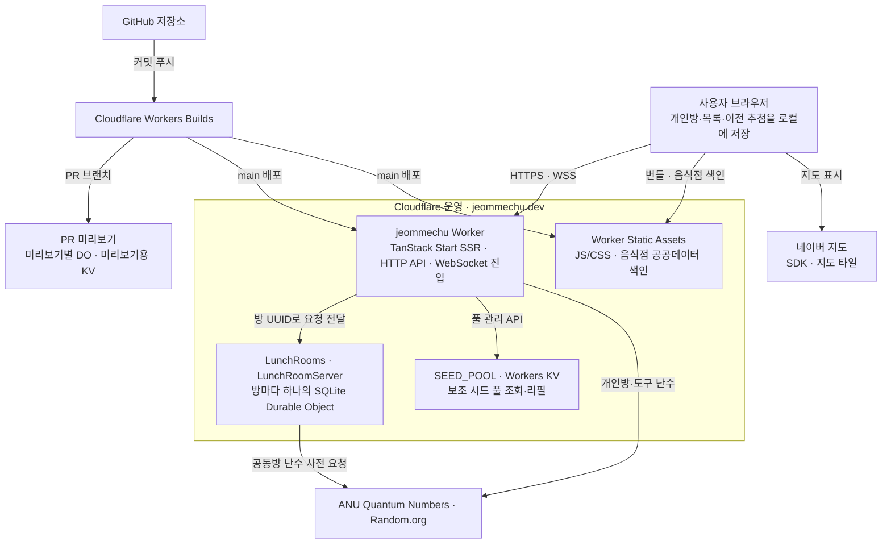

# 점메추 · Jeommechu

친구를 링크로 초대해 점심 메뉴나 모임 활동 후보를 모으고, 룰렛이나 슬롯머신으로 함께 정하는 웹 서비스입니다. [공동방 만들기](https://jeommechu.dev/create) · [혼자 추첨](https://jeommechu.dev/solo)

## 주요 기능

- **공동 추첨.** 방장이 후보를 준비하고 링크를 공유하면 참가자는 닉네임으로 입장합니다. 방장은 후보 추천을 받아 마감하고, 참가자들은 같은 회차와 결과를 보며 채팅하고 좋아요·싫어요를 남깁니다.
- **룰렛과 슬롯머신.** 버튼을 누르면 가속하고 손을 떼면 감속합니다. 정지 전에 다시 누르면 같은 회차에서 가속하면서 당첨 후보를 다시 뽑습니다. 중복 제외, 집중 화면, 선택형 효과음을 지원합니다.
- **후보 준비.** 직접 입력하거나 기본·개인 목록을 불러올 수 있습니다. 주변 음식점 검색에서 네이버 지도와 전국 일반음식점 공공데이터를 사용해 업소나 업종을 후보로 추가합니다. 위치 권한을 거부하면 선정릉역에서 시작합니다.
- **기록과 복귀.** 당첨 내역에서 후보 변경 전 기록까지 볼 수 있습니다. 공동방은 생성 후 24시간 동안 재입장할 수 있으며, 방장이 종료한 뒤에도 기존 참가자는 원래 만료 전까지 기록을 조회하고 TXT로 내보낼 수 있습니다.
- **혼자 추첨.** 활성 방은 탭에 저장하며 이전 추첨과 개인 후보 목록은 같은 브라우저에서 다시 열 수 있습니다.

## 아키텍처

React·TanStack Start 앱을 Cloudflare Workers에서 실행하고, 공동방은 방마다 하나의 SQLite 기반 Durable Object가 관리합니다. 브라우저는 PartySocket으로 방에 연결하며, 확정된 결과와 회전 데이터를 PixiJS 보드에서 표시합니다. 혼자 추첨과 공동방은 후보·추첨 규칙을 공유합니다.

| 문서 | 내용 |
| --- | --- |
| [C4 다이어그램](docs/architecture/c4.md) | 시스템 컨텍스트, 컨테이너, 공동방 컴포넌트, 재가속 코드 흐름 |
| [arc42 아키텍처](docs/architecture/arc42.md) | 런타임, 저장·권한 경계, 배포, 설계 결정, 품질 요구 |
| [공동방](docs/lunch-rooms.md) | 방 수명, WebSocket 계약, 충돌 처리와 결과 보관 |
| [운영 확인과 복구](docs/release-runbook.md) | 미리보기, 운영 확인, Worker 버전 대조와 롤백 |

## 인프라 맵



| 운영 항목 | 설정과 역할 |
| --- | --- |
| 공동방 저장 | `LunchRooms`의 각 객체가 방 상태·채팅·회차를 저장합니다. 생성 후 24시간이 지나면 방 데이터를 정리합니다. |
| 환경 분리 | 로컬 DO·KV는 `.wrangler/`에 저장합니다. PR 미리보기는 운영과 별도의 DO와 KV를 사용합니다. |
| 설정·인증 | [wrangler.jsonc](wrangler.jsonc)에서 Worker 바인딩과 마이그레이션을 관리합니다. 운영 난수 인증 키는 Worker secrets, 로컬 공유 설정은 Infisical의 `dev` 환경에서 관리합니다. |
| 관측 | Workers Observability와 트레이스를 사용합니다. 빌드 결과, 운영 트래픽의 활성 버전과 스모크 검사 절차는 [운영 런북](docs/release-runbook.md)에 있습니다. |

## 주요 경로

| 경로 | 기능 |
| --- | --- |
| `/` | 공동방·혼자 추첨 시작, 내 후보 목록 |
| `/create` | 방 정보 입력, 후보 준비, 공동방 생성 |
| `/lunch-room/<UUID>` | 공동 추첨, 채팅, 결과 피드백과 기록 |
| `/solo`, `/solo/<UUID>` | 개인 방 준비와 추첨 |
| `/lunch` | 홈으로 이동 |
| `/tools?tool=number`, `/tools?tool=lotto`, `/tools?tool=pension` | 랜덤 정수, 로또 6/45, 연금복권 720+ |

## 로컬 개발

Node.js 22.12 이상과 npm을 사용합니다.

```bash
npm ci
npm run dev:plain
```

[localhost:3000](http://localhost:3000)에서 접속합니다. 외부 설정을 추가하려면 `.env.example`을 `.env.local`로 복사하고 필요한 값을 채웁니다. `.dev.vars`를 사용할 경우 Cloudflare 로컬 런타임에서 그 파일이 우선합니다. Infisical로 키를 받으려면 CLI에 로그인한 뒤 `npm run dev`를 실행합니다.

| 환경 변수 | 용도 |
| --- | --- |
| `ANU_API_KEY` | 서버의 ANU Quantum Numbers 인증. 값이 없으면 ANU 호출을 건너뜁니다. |
| `RANDOM_ORG_API_KEY` | 서버의 Random.org JSON-RPC 인증. 값이 없으면 공개 HTTP API를 사용합니다. |
| `VITE_NAVER_MAPS_KEY_ID` | 네이버 지도 Web Dynamic Map의 공개 Client ID. 로컬에서는 Vite 설정으로, 운영에서는 Worker 런타임 설정으로도 제공할 수 있습니다. |

외부 난수가 준비되지 않으면 Web Crypto를 사용합니다. 주변 음식점의 이름·업종·좌표는 `public/nearby-restaurants/`에 배포된 색인에서 읽습니다. 데이터 생성 방식과 운영 검증 기록은 [주변 음식점 #10](https://github.com/acee90/random-number-generator/issues/10)에서 확인할 수 있습니다.

로컬 DO와 KV 저장소는 `.wrangler/` 아래에 있습니다. 공동방의 방장과 참가자를 독립적으로 확인하려면 서로 다른 브라우저 프로필을 사용합니다. Worker 바인딩을 바꾼 뒤에는 `npm run cf-typegen`으로 타입을 갱신합니다.

## 검사와 미리보기

```bash
npm test
npx tsc --noEmit
npm run build
npm run serve
```

- `npm run storybook`을 실행하면 [localhost:6006](http://localhost:6006/)에서 룰렛·슬롯·투표와 후보 편집 흐름을 확인할 수 있습니다. `npm run build-storybook`은 정적 미리보기를 빌드합니다.
- `npm run check:roulette`와 `npm run check:slot`은 실행 중인 앱을 Chrome으로 검사합니다. 주소를 지정하려면 `-- http://localhost:3000`을 붙입니다. Chrome 실행 경로는 `CHROME_PATH`로 지정할 수 있습니다.
- `npm run capture:home`은 실행 중인 로컬 앱의 홈 예시 화면을 갱신합니다. UI 변경 시 [AGENTS.md](AGENTS.md)의 반응형·입력 상태 검증 기준을 따릅니다.

## 배포와 운영

GitHub에 연결된 Cloudflare Workers Builds를 사용합니다. PR에서 브랜치 미리보기를 검증하고 `main`에 병합하면 운영 빌드와 배포가 실행됩니다. 직접 배포, 최초 Durable Object 마이그레이션, 활성 버전 확인은 [운영 런북](docs/release-runbook.md#배포와-최초-마이그레이션)을 참고하세요.

```bash
npm run check:release:web -- https://jeommechu.dev
npm run check:release:room -- --origin https://jeommechu.dev
```

웹 검사는 공개 경로의 메타데이터와 정적 자산을 확인합니다. 방 검사는 별도 시험 방에서 입장·채팅·공동 추첨·재접속·기록을 검증합니다.

## 개발 계획

작업 범위와 진행 상태는 [GitHub 로드맵 #7](https://github.com/acee90/random-number-generator/issues/7)과 연결된 이슈에서 관리합니다. [화면 흐름](docs/features/game-screen-lifecycle.md)과 [룰렛·슬롯 동작](docs/features/draw-view-modes.md)은 상세 설계 자료입니다.
