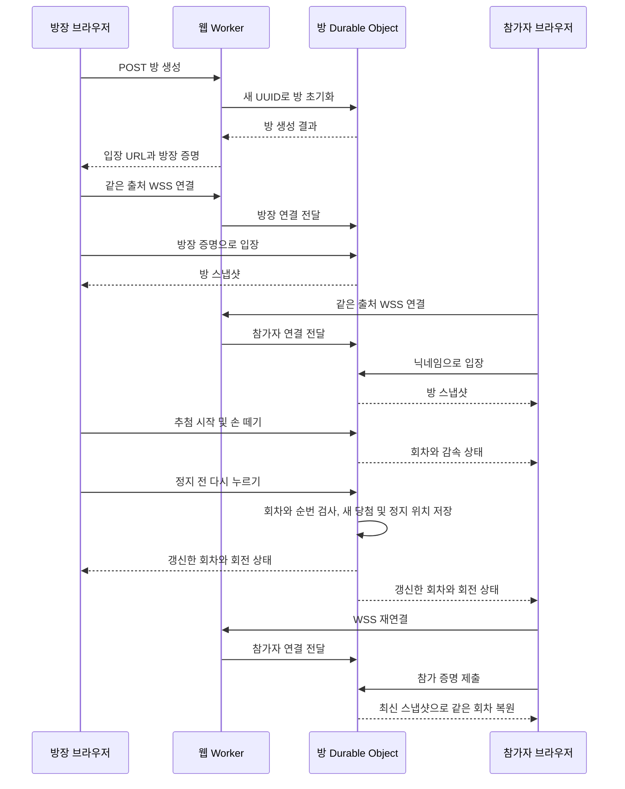

# 점메추 아키텍처 · arc42

2026-11-27 운영 배포를 확인한 main `8cd9daf` 기준이다. 구조를 빠르게 파악하려면 [C4 다이어그램](c4.md), 설치·검사 명령은 [README](../../README.md)를 참고한다. 개발 계획과 진행 상태는 [GitHub 로드맵 #7](https://github.com/acee90/random-number-generator/issues/7)에서 관리한다. [arc42 공식 템플릿](https://arc42.org/overview/)

## 1. 소개와 목표

점메추는 혼자 또는 초대 링크로 모인 사람들과 후보를 정하고, 룰렛·슬롯으로 결과를 공유하는 웹 서비스다. 음식점 인허가 자료에서 주변 업소나 업종을 후보로 가져올 수 있다. 기존 랜덤 숫자와 복권 번호 생성 도구는 직접 주소에서 제공한다.

| 이해관계자 | 기대 |
| --- | --- |
| 혼자 추첨 사용자 | 후보를 빠르게 준비해 추첨하고 같은 브라우저에서 기록이나 목록을 다시 사용한다. |
| 공동방 방장 | 후보와 회차를 관리하고 연결이 끊겨도 방장 권한을 복원한다. |
| 공동방 참가자 | 링크와 닉네임으로 입장해 방장과 같은 후보·회차·결과를 본다. |
| 개발·운영 담당자 | 변경을 미리보기에서 검증하고 운영 스모크 검사와 복구 절차를 재현한다. |

우선하는 품질 목표는 공동 결과의 일관성, 추첨 입력에 대한 즉시 반응, 키보드·좁은 화면에서의 사용성이다.

## 2. 제약

- 런타임은 Cloudflare Workers와 SQLite 기반 Durable Objects다. Vite 빌드와 로컬 런타임은 Cloudflare Vite 플러그인을 사용한다.
- 공동방 수명은 생성 후 24시간이다. 방당 활성 참가자 30명, 최근 메시지 100개, 확정 결과 20개와 현재 회차를 관리한다. 상수는 [lunchRoom.ts](../../src/lib/lunchRoom.ts)에 있다.
- 초대 링크와 닉네임으로 참가한다. 방장과 기존 참가자 권한을 복원하려면 해당 브라우저의 방별 증명이 필요하다.
- 네이버 지도에는 공개 Client ID와 서비스 URL 설정이 필요하다. 외부 난수 인증 키는 Worker에서 관리한다.

## 3. 컨텍스트와 범위

[C4 L1](c4.md#l1-시스템-컨텍스트)에서 사용자와 외부 의존성을 보여준다.

| 인터페이스 | 역할 |
| --- | --- |
| HTTPS 페이지와 서버 함수 | TanStack Start SSR, 도구 난수 요청, 혼자 추첨용 난수 사전 준비 |
| `/api/lunch/rooms` 및 방 하위 API | 방 생성, 입장 정보, 닉네임 확인, 종료된 방 기록 조회 |
| `/parties/lunch-rooms/<UUID>` | 같은 출처 WebSocket으로 입장, 상태 명령, 채팅 및 회차 동기화 |
| `/api/public-config` | 배포 환경에서 브라우저에 지도 Client ID 제공 |
| 네이버 지도와 배포된 공공데이터 | 브라우저에서 SDK·타일 로드. 음식점 조회와 반경 필터는 정적 색인을 사용하는 브라우저 로직 |
| ANU Quantum Numbers, Random.org | 서버가 외부 난수 요청. 가용성에 따라 Web Crypto 사용 |
| Google Tag Manager | 운영 빌드의 공통 페이지에서 태그 컨테이너 로드 |

## 4. 해결 전략

- **방별 상태 소유.** 방 UUID를 기준으로 하나의 Durable Object가 공동방을 관리한다. 서버가 변경 권한·현재 버전과 입력 순번을 검증하고 확정 상태를 배포한다.
- **도메인과 연출의 분리.** 방 명령과 추첨 규칙은 `roomGame.ts`, 회전 궤적은 `spinDrive.ts`에 둔다. UI는 확정 후보·당첨과 회전 매개변수를 받아 PixiJS 룰렛·슬롯으로 표시한다.
- **혼자 추첨의 브라우저 실행.** 공동방과 도메인 규칙을 재사용하고 탭에 방 상태를 저장한다. 외부 난수 사전 요청이 실패하거나 준비된 값이 없을 때도 Web Crypto로 진행할 수 있다.
- **정적 음식점 색인.** 원본 인허가 자료는 배포 전 지역별 파일로 변환한다. 브라우저는 위치에 해당하는 파일을 내려받아 거리와 업종을 계산한다.

## 5. 빌딩 블록

컨테이너 경계는 [C4 L2](c4.md#l2-컨테이너), 공동방 내부 책임은 [C4 L3](c4.md#l3-컴포넌트--공동방-durable-object)에 정리했다.

| 코드 | 책임 |
| --- | --- |
| [src/worker.ts](../../src/worker.ts), [src/server](../../src/server) | Worker 진입, 지도 설정·공동방 API·WebSocket 분기, SSR 전달 |
| [src/routes](../../src/routes), [src/components/features](../../src/components/features) | 페이지·후보 편집·추첨·채팅·기록·주변 음식점 검색 |
| [src/hooks](../../src/hooks) | 공동방 연결과 재동기화, 혼자 추첨 상태, 회전 입력 및 타임라인 연결 |
| [src/rooms/LunchRoomServer.ts](../../src/rooms/LunchRoomServer.ts) | 연결과 권한, 메시지 처리, 상태 저장, alarm과 배포 |
| [src/lib](../../src/lib) | 방·메시지 스키마 및 도메인 전이, 회전 모델, 개인 저장 |
| [src/services](../../src/services) | 난수 공급자 및 범위 변환, 음식점 색인 로딩 |
| [src/components/ui](../../src/components/ui), [src/styles.css](../../src/styles.css) | shadcn/ui 기반 공통 조작과 디자인 토큰 |

## 6. 런타임

### 공동방 생성, 재가속, 재접속

재가속은 같은 회차에서 당첨 후보를 다시 뽑는다. 정지 후에는 현재 결과에 대한 피드백을 받을 수 있다. 다음 회차 준비 또는 재추첨으로 넘어가면 이전 결과와 투표를 확정 기록으로 이동한다. 기록 화면은 후보 구성 변경을 기준으로 현재 목록과 이전 기록을 표시한다. [재가속 #105](https://github.com/acee90/random-number-generator/issues/105) · [당첨 내역 #102](https://github.com/acee90/random-number-generator/issues/102)

### 혼자 추첨과 주변 음식점

혼자 추첨은 후보를 준비하고 탭에 방을 생성한다. 외부 난수 묶음이 준비되어 있으면 브라우저의 새 난수와 섞어 추첨하고, 준비된 값이 없으면 Web Crypto를 사용한다. 회전과 결과는 같은 탭의 상태에 기록한다.

주변 음식점 창을 열면 브라우저 위치와 색인 로딩을 시작한다. 위치가 허용되면 받은 좌표를, 거부되면 선정릉역 좌표를 사용한다. 반경과 분류를 적용한 목록에서 업소 또는 업종을 후보로 추가하고 준비 화면에서 확정한다. [#10 운영 검증](https://github.com/acee90/random-number-generator/issues/10#issuecomment-7210829263)

## 7. 배포

| 환경 | 실행과 저장 |
| --- | --- |
| 로컬 | Vite 개발 서버와 Cloudflare 로컬 런타임. 로컬 DO·KV 상태는 `.wrangler/`에 저장한다. |
| PR 미리보기 | Cloudflare Workers Builds의 브랜치 미리보기. DO는 미리보기별로 분리하고 미리보기 전용 KV를 연결한다. |
| 운영 | `main` 병합 후 Workers Builds가 `jeommechu` Worker와 자산을 배포한다. 방별 DO와 운영 KV를 사용한다. |

Worker 바인딩과 최초 DO migration은 [wrangler.jsonc](../../wrangler.jsonc)에 선언한다. 배포 성공은 빌드 결과와 활성 Worker 트래픽 버전을 대조하고 기능을 검증한다. [운영 확인·복구 문서](../release-runbook.md)

## 8. 공통 개념

- **권한과 경계.** 방장은 방별 토큰으로 인증하고 서버에는 해시를 저장한다. 참가 링크와 공유 스냅샷에는 증명을 실어 보내지 않는다. 서버가 역할과 요청 출처를 검사한다.
- **저장과 수명.** 공동방은 DO 저장소를 사용한다. 명시적으로 방을 종료하면 기존 참가자는 원래 만료 전까지 기록을 조회할 수 있다. 만료 시 alarm 또는 다음 요청 처리 중 저장 상태를 삭제한다. 혼자 추첨의 활성 방은 `sessionStorage`, 이전 추첨과 개인 목록은 `localStorage`를 사용한다.
- **재시도와 호환성.** 주요 편집 명령은 요청 ID·ACK와 후보/조건 버전으로 중복 적용과 덮어쓰기를 방지한다. 재접속 시 최신 스냅샷을 받고 일부 채팅·투표 갱신은 개별 이벤트로 전달한다.
- **난수.** 초기 공동 추첨은 예약한 외부 난수 또는 서버 Web Crypto를 사용한다. 재가속 시 실행 주체의 Web Crypto로 다시 뽑는다. 범위 변환에는 rejection sampling을 사용하고 회차에 출처를 기록한다.
- **접근성.** 중요 조작은 키보드로 접근할 수 있는 DOM 컨트롤을 제공한다. 연출은 동작 줄이기 설정을 따르며 다이얼로그에서 돌아올 때 포커스를 복원한다.

## 9. 아키텍처 결정

| 채택한 결정 | 근거와 비용 |
| --- | --- |
| 객체 하나가 방 하나의 상태를 관리 | 권한·회차와 저장을 한 단위로 관리할 수 있다. 한 방으로 몰리는 메시지와 저장량은 해당 객체에서 처리해야 한다. [공동방 설계](../lunch-rooms.md) |
| 브라우저에 개인 데이터 보관 | 로그인 없이 목록과 이전 추첨을 다시 열 수 있다. 브라우저 저장소가 지워지거나 기기가 달라지면 같은 데이터에 접근할 수 없다. [후보 목록 #4](https://github.com/acee90/random-number-generator/issues/4) |
| 난수를 사전 요청하고 로컬 난수로 대체 | 외부 요청 지연을 회전 입력과 분리한다. 출처와 준비값 소비를 추적해야 한다. [난수 사전 준비 #92](https://github.com/acee90/random-number-generator/issues/92) |
| 공공데이터 색인을 정적 배포 | 실시간 음식점 검색 서비스 호출 없이 위치 조회가 가능하다. 자료를 최신으로 유지하려면 생성과 배포가 필요하다. [주변 음식점 #10](https://github.com/acee90/random-number-generator/issues/10) |

## 10. 품질 요구와 검증

| 시나리오 | 기대 결과 | 검증 수단 |
| --- | --- | --- |
| 회전 중 재접속, 정지 직전 재가속 | 동일 회차·당첨자를 공유하고 정지 전 입력만 반영 | `npm test`, `check:roulette`, `check:slot`, [운영 확인 #105](https://github.com/acee90/random-number-generator/issues/105) |
| 중복 요청, 오래된 목록으로 편집 | 같은 명령을 한 번만 적용하고 이전 버전 편집을 거절 | [공동방 테스트](../../tests/LunchRoomServer.test.ts) |
| 후보 변경 후 상세 기록 열고 복귀 | 이전 회차가 유지되고 체크 상태와 행 포커스가 복원 | [운영 확인 #102](https://github.com/acee90/random-number-generator/issues/102) |
| 위치 거부 후 음식점 검색 | 기본 위치에서 결과를 표시하고 후보 추가 가능 | [운영 확인 #10](https://github.com/acee90/random-number-generator/issues/10#issuecomment-7210829263) |
| 만료 또는 종료된 방 링크 열기 | 새 입장을 막고 정책에 따라 기록 또는 안내를 제공 | [공동방 테스트](../../tests/LunchRoomServer.test.ts), `check:release:room`의 종료·재입장 검사, [운영 런북](../release-runbook.md) |

## 11. 리스크와 기술 부채

| 관찰한 제약 | 추적 |
| --- | --- |
| 음식점 색인 기준일이 배포와 함께 고정된다. 정기 갱신 방식은 미결정이다. | [#10](https://github.com/acee90/random-number-generator/issues/10) |
| 만료 전 빈 방과 방장 부재의 자동 종료 정책은 미확정이다. 운영은 고정 24시간 만료를 적용한다. | [#50](https://github.com/acee90/random-number-generator/issues/50) |
| 초대 링크로 참가하는 모델에서 접근 제한·공개 목록을 추가하려면 권한과 노출 범위를 정해야 한다. | [#3](https://github.com/acee90/random-number-generator/issues/3) |

## 12. 용어

| 용어 | 의미 |
| --- | --- |
| 후보 구성 | 한 게임에 사용되는 후보 집합. 구성이 바뀌면 현재 게임 당첨 내역의 범위가 바뀐다. |
| 회차 | 추첨 시작부터 공표된 결과와 결과 피드백까지의 단위. 감속 중 재가속은 같은 회차다. |
| 스냅샷 | 연결·재연결 및 상태 갱신에 쓰는 서버의 방 상태 표현. |
| 마감 | 후보 준비를 완료하고 추첨 대기 화면으로 돌아가는 조작. |
| 시드 | 후보 선택에 예약해 두는 난수 묶음의 각 값. |
