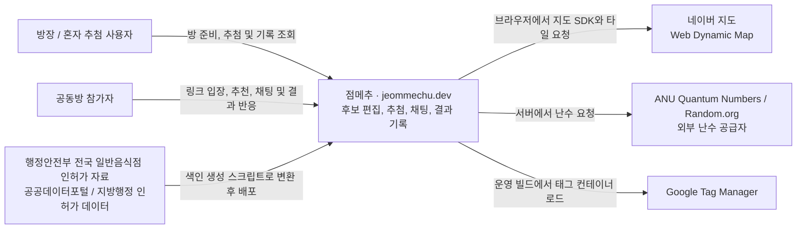
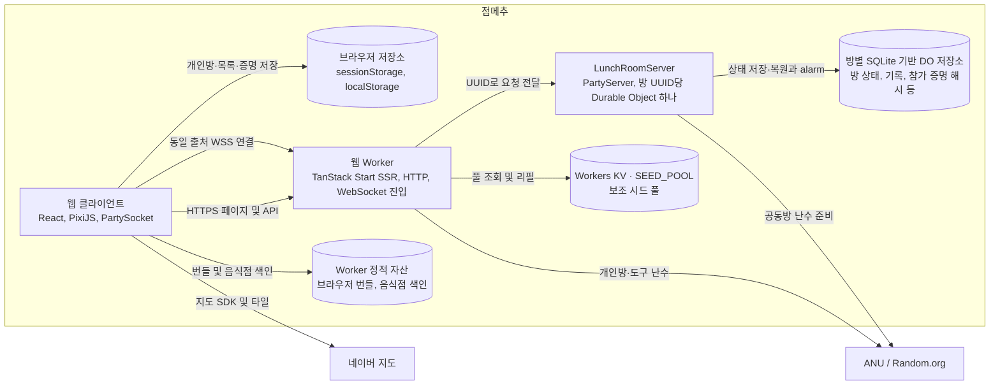
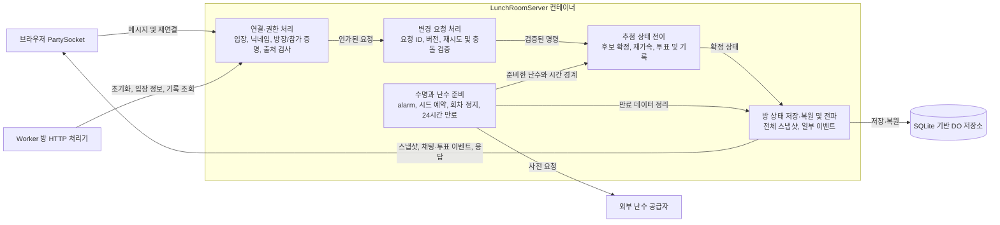
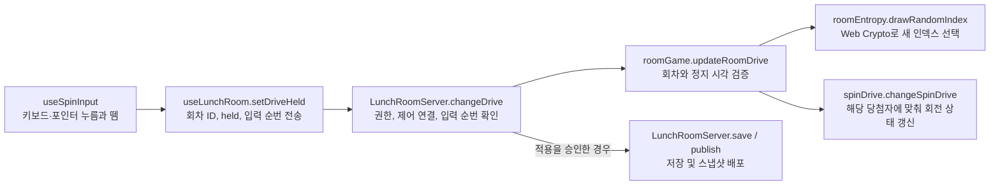

# 점메추 C4 아키텍처

운영 서비스의 구조를 2026-11-27 기준 main `8cd9daf`에서 확인했다. 주요 실행 흐름, 설계 결정, 품질 요구는 [arc42 문서](arc42.md)에 정리했다. 다이어그램의 화살표에는 요청 또는 데이터가 흐르는 방향을 표시한다. [C4 모델 공식 가이드](https://c4model.com/diagrams)

## L1 시스템 컨텍스트

점메추는 공동 추첨방, 혼자 추첨, 번호 생성 도구를 제공한다. 공동방에서 방장은 후보와 회차를 관리하고, 참가자는 초대 링크로 입장해 후보를 추천하거나 결과에 반응한다.

음식점 이름·업종·좌표는 배포된 공공데이터 색인에서 읽는다. 지도 SDK는 지도 표시와 조작을 담당한다. 외부 난수를 사용할 수 없으면 Web Crypto로 추첨한다.

## L2 컨테이너

브라우저, Worker, 방별 Durable Object는 서로 다른 실행 경계다. Durable Object 클래스와 정적 자산은 같은 Worker 프로젝트에서 함께 빌드·배포한다.

| 경계 | 책임과 코드 |
| --- | --- |
| 브라우저 | 화면·사용자 입력·회전 연출과 개인 상태. [routes](../../src/routes), [components/features](../../src/components/features), [hooks](../../src/hooks) |
| 웹 Worker | SSR과 서버 함수 실행, 방 HTTP 요청 검사 및 대상 객체로 연결. [worker.ts](../../src/worker.ts), [lunchRoomHttp.ts](../../src/server/lunchRoomHttp.ts) |
| 방별 Durable Object | 공동방 권한, 채팅, 후보 변경, 회차·당첨·투표, 재연결, 종료와 만료. [LunchRoomServer.ts](../../src/rooms/LunchRoomServer.ts) |
| 정적 자산 | 음식점 인허가 색인과 지역별 파일. [색인](../../public/nearby-restaurants/index.json), [생성 스크립트](../../scripts/prepare-nearby-restaurants.py) |

## L3 컴포넌트 — 공동방 Durable Object

그림의 박스는 한 클래스 내부의 책임과 호출하는 도메인 모듈을 나타낸다. 세부 HTTP 계약과 요청 버전 규칙은 [공동방 문서](../lunch-rooms.md#cloudflare-구성)를 참고한다.

## L4 코드 — 재가속 처리

이 흐름은 공동방에서 정지 직전 재가속을 요청할 때 서버가 적용하는 함수 수준의 의존성을 보여준다.

혼자 추첨에서는 [useSoloLunch](../../src/hooks/useSoloLunch.ts)가 같은 도메인 규칙을 브라우저에서 적용한다. [roomGame](../../src/lib/roomGame.ts) · [spinDrive](../../src/lib/spinDrive.ts) · [roomEntropy](../../src/services/roomEntropy.ts)
