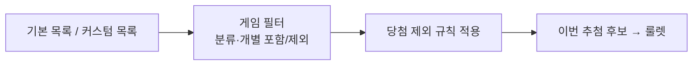

# 후보 목록 인터페이스 검토 — 2026-11-16

**후속 변경 취합 — 2026-11-16:** 승인된 후보 편집 단순화, 대기·결과·입장 화면 보완을 `feat/compact-room-waiting` 브랜치에서 함께 관리한다. 아래 단계별 검증 기록의 미커밋·미푸시는 해당 검증 당시 상태다. 현재 커밋·푸시 상태는 [lifecycle 이슈 #46](https://github.com/acee90/random-number-generator/issues/46)에서 관리하며 운영 배포와 구분한다. 최종 검증은 전체 48파일·1,424개 테스트, 타입·앱 빌드와 로컬 HTTP/WebSocket 34개 흐름 통과다.

기준: [후보 모델·공통 편집기 #4](https://github.com/acee90/random-number-generator/issues/4), [접수·마감 lifecycle #46](https://github.com/acee90/random-number-generator/issues/46), [공통 UI #44](https://github.com/acee90/random-number-generator/issues/44). 상위 [로드맵 #7](https://github.com/acee90/random-number-generator/issues/7)에 모두 연결되어 있다.

**상태: 초기 인터페이스 검토와 후속 로컬 구현 기록.** 최초 findings·검증·Block 판정은 수정 전 화면에 대한 기록으로 보존한다. 이후 사용자가 와이어프레임 확인과 구현 적용을 요청해 아래 수정 범위를 실제 방에 연결했다. 로컬 구현·검증을 완료했으며 운영 배포 전이다. 커밋·푸시와 진행 상태는 연결된 GitHub 이슈에서 관리하며, 최종 검증은 [lifecycle 문서 0절](game-screen-lifecycle.md#0-실제-구현-상태--2026-11-16-로컬)을 따른다.

## 후속 수정 상태

- 새 방은 빈 후보 만들기에서 `새로 작성 / 목록 불러오기`로 시작한다. 실제 기본 107곳과 같은 브라우저의 개인 저장 목록을 다이얼로그에서 사본으로 불러오고 공통 편집기로 이어진다. 개인 사본 저장·확인 후 삭제를 제공하며 현재 방과 기존 원본을 보존한다.
- 이름·선택 분류는 공통 Input으로 입력하고 기존 분류를 자동완성으로 제안한다. 자유 분류는 최대 24자, 빈 값은 `미분류`로 처리하며 기존 `확인 불가`는 유지한다. 방장 추가·행 편집과 참가자 추천에 같은 분류 계약을 적용했다.
- **목록 편집 / 게임 필터**는 후보 준비 화면 안의 별도 계층이다. 기본·커스텀 목록에 같은 분류·개별 포함/제외를 적용한다. 최신 사용자 결정에 따라 필터도 준비 화면에서만 변경한다. 대기의 후보·옵션 보기는 읽기 전용이며 변경은 후보 편집으로 돌아간다. 중복 제외는 게임 사이 바로 변경한다.
- 초기 HIGH였던 참가자 본인 추천 삭제에는 `내 추천을 삭제할까요?` 확인을 추가했다. 단계별 빈 상태 문구도 현재 가능한 행동에 맞췄다. 초기 Block을 현재 미해결 삭제 문제로 해석하지 않는다.
- 게임 필터의 후보 이름 검색은 구현했으며 검색 자체는 추첨 대상을 바꾸지 않는다. 새 추천·중복 의심·일괄 검수 보기는 아래 제안으로 남기며 구현 완료로 기록하지 않는다. 인당 추천 제한·추첨 무효 정책·Ready도 추가하지 않았다. 이번 후속 구현을 전체 플랫폼 접근성 재심사나 운영 승인으로 보지 않는다.

## 초기 검토 당시 Scope and coverage

초기 검토 범위는 당시 후보 준비 흐름의 추가 → 행 편집/포함 선택 → 추천 접수/검수 → 마감이다. 방장과 참가자의 빈 목록·요청 중·오류 상태를 소스로 확인하고, 실제 방장 화면을 597×716 및 320×716에서 확인했다. 기본 목록의 카테고리 선택과 개인 목록 편집기는 호환성 비교를 위한 소스 검토다. 브랜치나 diff의 변경 심사가 아니다.

스택은 React 19 / TanStack Start / Vite, Radix 기반 shadcn 스타일 `src/components/ui/`, Tailwind 4와 기능별 CSS다. `src/styles.css`가 색상 토큰, `src/components/ui/primitives.css`가 공통 입력·버튼 상태를 정의한다. 프로젝트의 스코어시트 스타일과 한국어 문구를 유지한다.

읽은 프로젝트 기준: `AGENTS.md`, `CLAUDE.md`, README의 공통 UI·Storybook 설명, `docs/features/candidate-list-reset.md`, `docs/features/game-screen-lifecycle.md`, `.storybook/preview.tsx`. 별도 `CONTRIBUTING.md`·`CODING_STANDARDS.md`·디자인 시스템 문서·인터페이스 ADR은 찾지 못했다.

`better-interface`와 소유 스킬 6개를 사용했다. 접근성은 focus-and-keyboard/forms/hit-areas, 레이아웃은 해당 SKILL의 원칙, 문구는 patterns, 타이포는 details-and-accessibility/spacing-and-sizing, 색상은 contrast/token-naming, UI는 surfaces/icons 지침을 적용했다.

| Domain | Evidence inspected | Result |
| --- | --- | --- |
| Accessibility | `RoomLifecyclePanel.tsx` 입력 이름·비활성·오류/초안 보존, 실제 AX 이름·역할·상태, 이름→분류 Tab 이동과 포커스 표시 | 확인한 범위에서 추가 finding 없음. 전체 제출/삭제 키보드 흐름·실제 스크린리더는 Not verified |
| Layout | `RoomLifecyclePanel.tsx:517`, `:614`, `room-lifecycle.css:401`, `:434`, 597/320px 실제 후보 행·스크롤 | MEDIUM 1개. 가로 넘침은 재현되지 않음 |
| Writing | 방장 추가·참가자 추천·본인 삭제·단계별 빈 목록·실패/충돌 문구, `CandidateListEditor.tsx:345` 비교 | HIGH 1개, MEDIUM 2개 |
| Typography | `room-lifecycle.css:415`, `primitives.css:86`, 실제 입력 계산 스타일 | 분류 12px/이름 16px 차이를 UI 공통 원인에 통합. 실제 iOS 확대는 Not verified |
| Colors | `styles.css` 토큰, 공통/분류 입력 CSS, 현재 분류 경계 계산 스타일 | Clear: 확인한 텍스트 대비는 통과. 낮은 분류 경계만으로 1.4.11 실패를 단정하지 않음 |
| UI | 공통 Input/Button과 별도 select/체크박스, 기본 목록/개인 편집기 표현 비교 | MEDIUM 1개. 타이포의 같은 원인을 이 행에 통합 |

## 초기 검토 당시 Findings

위치는 검토 당시 소스의 행 번호다. 이후 수정으로 현재 행 번호와 다를 수 있다. 현재 보완 상태는 위 후속 수정 절을 따른다.

| Severity | Domain | Location | Before | After | Why |
| --- | --- | --- | --- | --- | --- |
| HIGH | Writing | `src/components/features/RoomLifecyclePanel.tsx:762`, `src/rooms/LunchRoomServer.ts:640` | 참가자 `삭제`는 일반 ghost 버튼에서 바로 `removeCandidate`를 전송한다. 서버는 후보와 해당 제외 내역 ID를 즉시 제거하며 확인/실행 취소가 없다 | 최소 보완은 기존 AlertDialog로 `내 추천을 삭제할까요?` 확인. 잦은 정리를 지원할 때는 동일 ID·소유자·제외 내역을 복원하는 실행 취소를 설계 | 공유 후보의 삭제에 확인·실행 취소·구별되는 파괴적 처리가 없는 escalation trigger. 이름 재입력은 원래 ID/제외 내역 복원이 아니다. 방장 초안 삭제에는 전체 변경 취소가 있으므로 이 finding에 포함하지 않음 |
| MEDIUM | Layout | `src/components/features/RoomLifecyclePanel.tsx:548`, `:614`; 비교 `src/components/features/LunchPicker.tsx:70` | 방 준비에는 개별 포함 체크와 전체 행 나열만 있다. 실제 107개 목록에서 분류 일괄 선택·검색·검수 범위 좁히기가 없다 | 공통 목록에 `이번 추첨에 넣을 분류`와 검색/검수 보기를 제공한다. 전체·포함·제외 수를 유지하고 마감으로 기존 대기에 진입 | 기존 기본 목록에서 가능한 분류별 빠른 선택이 실제 방의 통합 편집 흐름에서는 빠져 있다. 100개 이상을 하나씩 확인해야 하는 반복 비용이 큼 |
| MEDIUM | Writing | `src/components/features/RoomLifecyclePanel.tsx:241`, `:331`, `src/rooms/LunchRoomServer.ts:633`; 비교 `src/components/features/CandidateListEditor.tsx:350` | 추가 폼은 이름만 받으며 방장/참가자의 새 후보를 모두 `확인 불가`로 저장한다. 개인 목록에는 `분류 (선택)` 입력이 있다 | 추가와 행 편집에 같은 `후보 이름` + `분류(선택)` 입력을 사용한다. 미입력은 `미분류`로 표시하고 기존 분류 자동완성 제공 | 추가 뒤 다시 찾아 분류해야 하며, 미입력과 실제 확인되지 않은 정보가 섞인다. UI만 바꾸기 전에 고정 분류 서버 계약도 맞춰야 함 |
| MEDIUM | UI | `src/components/features/RoomLifecyclePanel.tsx:617`, `:647`, `src/components/features/room-lifecycle.css:415`; 비교 `src/components/ui/primitives.css:86` | 이름은 공통 Input, 분류는 12px/34px 높이의 별도 native select다. 포함 체크는 기본 파란색이고 기존 목록에는 프로젝트 accent가 적용된다 | 기존 Input 기반 공통 분류 자동완성을 추가·편집·추천에서 재사용한다. 체크박스는 기존 프로젝트 스타일로 통일한다. select를 유지할 때는 기존 NativeSelect를 우선 재사용 | 한 행에서 크기·경계·비활성/오류 표현이 달라짐. 실제 계산값 이름 16px/44px, 분류 12px/34px. native HTML이나 shadcn 미사용 자체는 결함이 아님 |
| MEDIUM | Writing | `src/components/features/RoomLifecyclePanel.tsx:700`, `:715`, `:780` | 참가자 빈 목록은 단계와 무관하게 `첫 후보를 추천해 주세요.`다. editing에는 추천 폼이 없고 reviewing에는 비활성이다 | collecting은 현재 문구 유지. editing은 `방장이 후보를 준비하고 있습니다.`, reviewing은 `접수가 종료됐습니다. 방장이 후보를 추가하거나 접수를 다시 열 수 있습니다.` | 빈 화면이 현재 할 수 없는 행동을 권한다. 단계별 다음 행동을 정확히 안내해야 함 |

## 사용자 방향: 목록 편집과 게임 필터를 별도 계층으로 분리

기본 목록과 커스텀 목록 모두 같은 입력 계약을 가진 **게임 필터**에 전달한다. 목록 편집은 후보 추가·이름/분류 수정·삭제·저장을 담당하며, 필터는 원본을 보존한 채 이번 게임에 쓸 후보를 계산한다. 두 기능은 후보 준비 화면 안에서 별도 계층으로 구분한다. 기존 검토안에서 필터를 목록 원본 수정과 섞거나 대기에서 바로 수정하도록 한 부분은 최신 사용자 결정으로 정정한다.



필터 선택/수동 제외는 게임 조건으로 관리하고 목록의 이름·분류·후보 ID·개인 저장본을 덮어쓰지 않는다. 새로 불러온 기본·개인 목록 사본은 전체 포함으로 시작하며 원본의 게임별 제외 상태를 가져오지 않는다. 기존 방의 `included=false`는 호환 처리하지만 게임 필터 변경을 개인 원본에 자동 저장하지 않는다. 필터 초기화는 당첨 제외 내역 초기화와 구별하며, 분류 조건을 다시 켜도 개별 제외가 풀리지 않도록 한다.

추가되는 것은 조건과 UI 계층이며 별도 공유 게임 단계는 아니다. 필터는 후보 준비/편집 화면에서만 변경한다. 대기는 실제 추첨 후보 수와 읽기 전용 후보·옵션 보기를 제공하고, 후보나 필터 변경이 필요하면 후보 편집으로 돌아간다. 같은 목록과 필터로 반복할 때는 편집·마감을 다시 요구하지 않는다. 중복 제외는 대기에서도 바로 변경한다.

필터 조건은 게임 사이에 재사용하고, 추첨 시작 시 조건과 최종 후보를 회차 사본에 고정한다. 게임 도중 조건 변경은 잠그며 이후 변경은 과거 결과/기록에 영향을 주지 않는다. 필터 결과가 0개라면 필터 초기화와 포함 조건 조정으로 복구할 수 있어야 한다.

## 출처와 분류를 독립적으로 다루기

기본 목록·직접 입력·참가자 추천은 **같은 후보 목록/행**을 사용한다. 출처는 `기본 목록 / 직접 추가 / OO님 추천`처럼 보조 정보로 표시한다. 출처에 따라 편집 화면이나 카테고리 의미를 바꾸지 않는다.

| 목록 상태 | 분류 UI 기준 |
| --- | --- |
| 기본 목록처럼 분류가 채워져 있음 | `이번 추첨에 넣을 분류` 표시 |
| 직접 만든 목록에도 분류가 있음 | 같은 조작·같은 포함/제외 규칙 적용 |
| 기본·직접·추천이 섞임 | 전체 목록에서 분류를 모아 표시. 출처와 독립적으로 동작 |
| 분류가 전혀 없음/유용한 구분이 없음 | 의미 없는 음식 분류 칩을 늘어놓지 않음. 분류 입력은 선택 사항으로 유지 |

분류 입력은 공통 Input과 플랫폼 자동완성으로 연결했다. 자유 분류를 허용하고 서버·저장 모델에 선택 분류 최대 24자와 미입력 `미분류` 계약을 적용했다. 기존 카탈로그의 `확인 불가`는 덮어쓰지 않는다. 한글 조합 Enter는 후보 추가와 충돌하지 않게 처리한다. 실제 모바일 IME·스크린리더 확인은 별도 검증 범위로 남긴다.

### 추첨 조건과 검수 보기

- `이번 추첨에 넣을 분류`: 준비 화면의 별도 게임 필터 계층에서 바꾸는 **추첨 조건**이다. 분류 선택은 목록 원본을 바꾸지 않고 실제 추첨 후보 수와 포함/제외 사유를 갱신한다. 대기에서 바꾸려면 후보 편집으로 돌아간다.
- 후보 이름 검색: 게임 필터의 후보별 선택에서 구현한 **행의 보기 범위**다. 이름 검색만으로 추첨 포함 상태나 총 추첨 후보 수를 바꾸지 않는다.
- `새 추천`·`중복 의심`·`미분류`·일괄 검수 보기: **아직 구현하지 않은 제안**이다. 추첨 조건과 구별하고 이 보기만으로 추첨 대상을 바꾸지 않는다. 보기 초기화와 항상 보이는 총 추첨 후보 수를 제공한다.
- 분류를 좁혔을 때 다른 분류/미분류 후보는 원본 목록에서 사라지지 않는다. `분류 조건으로 제외`와 제외 수를 표시하고 전체 보기로 돌아올 수 있어야 한다. `전체`가 기본값이며 미분류 포함 여부도 명시적으로 선택할 수 있다.
- 분류 조건·개별 수동 제외·당첨 자동 제외를 독립적으로 유지한다. 분류를 다시 켰다고 수동 제외나 당첨 제외가 풀려서는 안 된다. 분류는 후보 ID를 바꾸지 않는다.
- 대기/룰렛에는 실제 확정된 후보만 전달한다. 접수 중 새 추천이 현재 분류 조건에 맞지 않으면 해당 이유를 보여 주고 최종 후보 수를 갱신한다.

### 검수 부담 줄이기

첫 개선은 일괄 승인 단계 신설보다 **새 추천과 중복 의심을 모아서 보는 기능**으로 제안한다. 이름의 유니코드 정규화·앞뒤/반복 공백을 비교해 중복 가능성을 표시하되 자동 병합/삭제/제외하지 않는다. 이름이 같은 서로 다른 지점을 보존한다는 #4의 기존 계약을 유지한다. 같은 원본 후보 ID를 재추가하는 경우는 이름 중복과 구분한다.

같은 이름 항목을 여러 개 유지하면 후보별 확률은 같더라도 그 이름의 합산 당첨 가능성은 커진다는 점을 검수에서 알릴 수 있다. 기본 목록에도 중복·분류 오류가 있을 수 있으므로 검수 기능을 참가자 추천에만 제한하지 않는다.

인당 추천 개수 제한, 자유 분류 생성 권한, 이상한 당첨의 무효/재추첨은 **정책 검토 항목**으로 남긴다. 특정 숫자나 자동 무효를 이번 검토에서 확정하지 않는다. 재추첨을 도입한다면 기존 당첨 제외 내역과 기록을 유지/복구하는 별도 계약이 필요하다. 기존 결과→대기→명시 추첨 흐름을 임의로 바꾸지 않는다.

### 초기 선행 계약과 후속 상태

초기 검토 당시 고정 11개 분류·이름만 전달하던 추천 계약은 자유/선택 분류·미분류를 지원하도록 생성 이후 편집·추천·회차·복원 모델에 맞췄다. 목록 원본과 게임 필터 상태도 분리했다. 새 빈 방 생성과 기본 목록의 명시적 불러오기 계약은 [후보 만들기 문서](candidate-setup-flow.md)를 따른다.

1. 선택 분류·자유 분류·미분류와 기존 `확인 불가`를 구분하며 안정 ID·소유자·회차 사본을 유지한다.
2. 기본·커스텀·혼합 목록에 같은 필터를 적용한다. 변경은 준비 화면에 한정하며 필터와 당첨 제외·과거 기록·개인 원본을 분리한다.
3. 접수 종료/마감의 권한·버전 충돌·실패 시 초안 보존과 0개 차단·1개 확정 계약을 유지한다.
4. #44의 공통 입력·버튼·확인창을 사용하고 본인 추천 삭제는 확인을 받는다. 실제 IME·스크린리더·200% 확대·모바일 기기의 포괄 검증은 로컬 자동 테스트 통과와 구분한다.
5. 후보 이름 검색은 게임 필터에 연결했다. 중복 의심·일괄 검수 보기·추천 제한 정책과 실제 XLSX는 미구현 후속 범위다. 기존 이슈에서 범위와 완료 기준을 관리하며 이 문서만으로 새 범위를 확정하지 않는다.

## 초기 검토 당시 Verification

확인한 항목:

- `npm test -- tests/LunchRoomPage.test.tsx tests/RoomPagePreview.test.tsx tests/roomCandidateSelection.test.ts --reporter=dot --maxWorkers=4`: **3파일·97개 통과**. 기존 동작의 회귀 결과이며 제안 기능 구현을 증명하지 않는다.
- 실제 localhost 방의 후보 편집을 597×716에서 관찰: 첫 관찰은 전체/추첨 107개, 분류 선택지 11개, 추가 필드는 이름만 존재. 후보 이름에서 Tab으로 분류에 이동하면 `:focus-visible`이고 `rgb(82,116,39) solid 3px` outline 표시.
- 320×716 임시 viewport: 문서 scrollWidth 320px로 가로 넘침 없음. 후보 행은 분류를 다음 줄로 이동. 이름 입력 174×44px, 분류 174×34px, 삭제 44×44px. 체크는 18px이지만 이격을 포함한 크기 예외를 검토했으며 크기만으로 AA 실패를 보고하지 않았다. 확인 뒤 viewport를 기본값으로 복원했다.
- 텍스트 대비 계산: `--muted #646b5e` / 행 `#f7f9f2` **5.198:1**, `--ink #272b24` / 흰 입력 **14.410:1**로 통과. 공통 입력 경계 `#8b967d` / 흰 내부 **3.108:1**, ring `#527427` / 흰 배경 **5.404:1**. native 분류 경계 `#d8decd` / 흰 내부 **1.377:1**지만 화살표 등 식별 단서가 있어 이 수치만으로 접근성 실패를 단정하지 않았다. 실제 경계 계산 스타일은 선언값과 일치했다.
- 사용자 작업 중인 방의 후보·분류·단계는 리뷰에서 제출/삭제/마감하지 않았다. 관찰 중 공유 목록은 바뀔 수 있으므로 107개는 첫 관찰 시점의 값이다.

**Not verified:** 실제 VoiceOver/기타 스크린리더, 브라우저 자체 200% 확대, RTL, 실제 iOS/Android 입력/키보드, 라이브 참가자의 삭제·추천·실패 상태 조작. 빈/오류/요청 중 상태와 삭제 경로는 소스·기존 자동 테스트로 검토했으며 실제 브라우저에서 재현했다고 기록하지 않는다. 추첨 모션·전체 채팅·운영 배포는 범위 밖이다. 이 초기 검토 시점에는 제안한 자동완성/검수/분류 조건 UI가 미구현이었다. 이후 자동완성·게임 필터와 삭제 확인은 로컬에 연결했으며 검수 보기는 제안으로 남았다.

## 초기 검토 당시 Verdict

**당시 판정: Block.** 수정 전 참가자 추천 삭제의 확인/복구 부재 HIGH 1개와 MEDIUM 4개를 기록했다. 이후 본인 추천 삭제 확인·공통 분류 입력·분류/개별 게임 필터·단계별 빈 상태를 보완했다. 이 역사적 판정을 현재 미해결 HIGH로 보지 않는다. 최신 구현 전체에 대한 별도 인터페이스 재심사·미검증 플랫폼·운영 승인을 의미하지 않으며 최종 기능 검증은 lifecycle 문서 0절과 관련 이슈에서 관리한다.


## 후보 편집 단순화 레퍼런스 — 2026-11-16 검토 제안

관련: [후보 목록 #4](https://github.com/acee90/random-number-generator/issues/4), [화면 lifecycle #46](https://github.com/acee90/random-number-generator/issues/46), [로드맵 #7](https://github.com/acee90/random-number-generator/issues/7). 아래는 사용자 요청으로 조사한 **재설계 제안**이며 구현 범위 확정이나 새 UI 적용 완료를 뜻하지 않는다. 편집의 중복 제외 옵션 제거와 대기 화면 압축은 별도의 현재 로컬 보완이다.

### 확인한 실제 레퍼런스

| 서비스 | 확인한 입력·부가 기능 구조 | 가져올 부분 |
| --- | --- | --- |
| [Wheel of Names](https://wheelofnames.com/) | 기본은 Entries의 여러 줄 텍스트 입력. Advanced는 별도 선택이고 Customize/Open/Save는 상단 도구에 있다. 공식 본문도 이름 입력 후 돌리기를 기본 사용법으로 설명한다. 브라우저에서 기본 편집기의 텍스트 영역과 Advanced 꺼짐을 관찰했다. | 후보 이름 입력에 집중하는 기본 화면, 여러 줄 추가, 고급 속성은 필요할 때 노출 |
| [Picker Wheel](https://pickerwheel.com/#how-to-use-this-spinner?) | Enter/+ 개별 입력과 여러 줄 붙여넣기. 실제 브라우저에서 샘플 이름 3개를 붙여넣어 추가했다. Weight/Label/Color를 켜야 보조 필드가 나타나고, File에 저장/불러오기, More에 검색/정렬/삭제 도구를 모은다. | 보조 속성을 기본 입력과 분리, 메뉴로 묶은 파일 작업, 후보의 짧은 행 편집 |
| [StrawPoll 생성 화면](https://strawpoll.com/create/) | 공식 페이지를 추출해 Answer Options, Paste answers, Add option, Add description or image, Show advanced settings를 확인했다. 브라우저의 실제 레이아웃/제출 조작은 검증하지 않았다. | 짧은 옵션 목록과 일괄 붙여넣기, 선택적인 보조 입력/고급 설정 |

[Wheel of Names 화면](../../output/candidate-editor-references/wheel-of-names.jpg), [Picker Wheel 샘플 입력 화면](../../output/candidate-editor-references/picker-wheel.jpg)을 남겼다. Picker Wheel은 여러 모드·도구 자체가 많으므로 전체 화면을 복제하는 기준으로 삼지 않는다. StrawPoll은 투표 작성 도구이므로 후보 추가 패턴만 참고하며, 존재하지 않는 `/wheel/` 경로를 룰렛 서비스 근거로 사용하지 않는다.

### 현재 복잡함과 제안 구조

현재는 모든 후보가 이름·분류 Input인 상태로 시작하고, 목록 편집/게임 필터 전환·추가 폼·변경 적용/취소·개인 저장·불러오기·추천 접수·마감이 한 화면에 겹친다. 행당 큰 입력 두 개와 안내문이 쌓여 실제 후보를 확인하기 전에 해야 할 선택이 많다.

제안하는 기본 화면은 **이름 한 줄 입력 + 간결한 후보 행 목록 + 분류 태그 + 마감**이다.

```text
후보 편집                           ⋯
[후보 이름 입력…                 +]
[전체] [한식] [일식] [미분류]   필터
비빔밥                 한식   ⋯
카레                   미분류 ⋯
후보 12개                [마감]
```

- **기본 추가는 이름만:** 분류는 선택 태그/행 상세에서 수정하고 미입력은 미분류로 둔다. 여러 개 추가는 여러 줄 붙여넣기로 따로 연다.
- **후보는 일반 행으로:** 평상시 이름·분류 태그를 표시하고 이름/편집 버튼을 선택한 행만 입력 상태로 바꾼다. 분류·등록자·삭제는 해당 행의 상세나 메뉴에서 다룬다.
- **필터는 같은 목록 위의 도구로:** 별도 목록 편집/게임 필터 모드와 두 벌의 후보 목록을 줄인다. 분류 조건과 개별 제외는 원본 삭제와 계속 분리하며, 화면 탐색용 검색과 추첨 조건도 구별한다.
- **목록 관련 작업은 ⋯로 묶기:** 불러오기·내 목록에 저장·여러 개 추가·전체 비우기를 한 메뉴에 둔다. 첫 빈 화면의 큰 새로 작성/목록 불러오기 경로는 유지한다.
- **주요 완료 행동은 마감:** 마감이 저장과 대기 이동을 맡는다. 별도 변경 적용/취소를 항상 병렬로 보이는 대신 초안 저장 상태와 되돌리기/나가기를 맥락에 맞게 제공하는 안을 와이어프레임에서 검토한다. 추천 접수는 편집의 보조 행동으로 유지한다.

위 구조는 레퍼런스를 바탕으로 한 설계 판단이다. 모든 기존 후보를 텍스트 영역 하나로 다시 파싱하면 안정된 ID·분류·추천자·당첨 제외 연결을 손상할 수 있으므로, 여러 줄 입력은 **추가** 경로로 우선 제한하고 기존 행은 기존 ID를 유지한다. 자동 병합·중복 삭제·자동 서버 저장 정책은 이번 조사에서 추가하지 않는다.

### 다음 검토의 완료 기준

단순화 와이어프레임에서 빈 목록·기본/커스텀 혼합·참가자 추천·긴 목록·분류/개별 제외·미적용 초안·충돌/저장 실패를 확인한다. 기본 화면의 후보 추가/수정/마감이 추가 단계 없이 가능해야 하며, 메뉴로 이동한 기능의 키보드 접근·복구 경로를 유지해야 한다. 기존 목록/필터/당첨 제외·개인 저장본·회차 사본 계약을 보존한 뒤 구현 범위를 확정한다. 새 구현 착수 전후의 범위·검증 상태는 #4/#46에서 갱신한다.

## 단순화 와이어프레임 작성 — 2026-11-16

사용자 요청으로 [조작 가능한 후보 편집 시안](../wireframes/candidate-editor-simple.html)을 작성했다. 방장·참가자 화면을 나란히 보며, 좁은 화면에서는 세로로 이어진다. 작성 당시에는 서비스 적용을 검토했고, 이후 사용자 승인으로 아래 실제 구현에 연결했다. 시안과 서비스 검증 상태를 구분하며 진행은 [#4](https://github.com/acee90/random-number-generator/issues/4), [#46](https://github.com/acee90/random-number-generator/issues/46), [상위 #7](https://github.com/acee90/random-number-generator/issues/7)에서 관리한다.

- 기본 화면은 이름 한 줄 추가·텍스트 후보 행·분류 태그·추천받기/마감이다. 이름을 누르면 그 행만 편집하고, 분류 태그는 자유 입력·자동완성 창을 연다.
- 필터는 같은 목록 위에서 펼친다. 분류 선택·개별 포함/제외는 후보 원본과 분리하며, 화면 찾기 검색은 필터를 닫을 때 해제해 숨은 검색 조건을 남기지 않는다.
- 목록 작업은 ⋯에 모았다. 불러오기 다이얼로그·교체 확인·여러 줄 추가·개인 사본 저장·전체 비우기·변경 취소를 확인할 수 있다. 미추가 입력과 초안을 취소 경로에서 보존한다. 개별 삭제는 되돌리기를 제공한다.
- 초안은 참가자에게 즉시 공유하지 않는다. 접수 열기/종료/마감의 모의 저장이 성공한 뒤 공유하고, 새 추천 도착 시 초안을 보존하며 최신 목록 확인을 요구한다. 종료한 참가자의 입력은 비활성화하되 재개 때 유지한다.
- 빈 목록·24개 긴 목록·다음 저장 실패·참가자 화면 표시 여부를 예시 설정에서 바꿀 수 있다. 마감 후 대기·간단한 결과 예시와 당첨 제외도 연결했다. 전체 당첨 제외와 실제 선택 0개를 구분한다. 편집에는 중복 제외 옵션을 두지 않는다.

확인한 범위: 스크립트 문법·정적 DOM 참조·JSDOM 스모크, 실제 브라우저의 추가/이름 수정/분류 입력/필터/검색/불러오기 교체 취소/개인 저장 취소/일괄 추가/추천 접수/충돌/종료·재개/마감, 키보드 Return·Escape와 초점 복귀를 확인했다. 320px 창의 iframe 288px와 1,024px 창의 iframe 992px에서 가로 넘침이 없고, 320px 분류 창도 화면 안에 들어왔다. 최종 브라우저 오류 로그 0개. 전체 당첨 제외·실제 선택 0개·저장 실패 재시도·빈 목록/긴 목록과 상태 복원은 임시 DOM 스모크에서도 확인했다.

캡처: [기본 화면](../wireframes/candidate-editor-simple.jpg), [필터 펼침](../wireframes/candidate-editor-simple-filter.jpg), [목록 메뉴](../wireframes/candidate-editor-simple-menu.jpg), [좁은 화면](../wireframes/candidate-editor-simple-mobile.jpg). 예시 데이터와 모의 저장/추첨을 사용하며 실제 방·서버·난수·개인 서비스 저장소에 연결하지 않았다. 실제 IME/스크린리더·어두운 테마 실렌더링·운영 동작은 이번 시안 확인으로 대체하지 않는다.

### 개별 후보 메뉴 위치 조정 — 2026-11-16

후속 피드백을 반영해 각 후보의 ⋯는 화면 중앙 다이얼로그 대신 버튼 옆 팝업으로 변경했다. 등록자·이번 추첨 포함/제외·후보 삭제를 표시하고, 바깥 클릭·Escape·포커스 이탈로 닫는다. 방향키/Home/End로 항목을 이동하고 Escape로 원래 버튼에 복귀한다. 이름 수정 중 키보드로 메뉴를 열어도 수정 내용을 저장하고 입력 상태를 종료하도록 보완했다. 목록 불러오기와 분류 편집 다이얼로그는 기존 흐름을 유지한다.

실제 브라우저에서 메뉴 위치·방향키·Escape 복귀·바깥 클릭·제외/복구·삭제/되돌리기·참가자 초안 비공유를 확인했다. 320px 창(iframe 288px)에서 가로 넘침이 없고 마지막 후보 메뉴는 위쪽으로 열린다. 임시 DOM 스모크에서 후보 전환·Tab 이탈·이름 편집 후 메뉴 열기·단계 전환을 확인했으며, 스크립트 문법/정적 DOM 검사와 최종 브라우저 오류 로그 0건을 확인했다. [후보 팝업](../wireframes/candidate-editor-simple-row-popup.jpg), [좁은 화면 팝업](../wireframes/candidate-editor-simple-row-popup-mobile.jpg). [#4](https://github.com/acee90/random-number-generator/issues/4)의 와이어프레임 검토 상태이며 서비스 구현·운영 배포 완료를 의미하지 않는다.

## 승인된 후보 편집 단순화 실제 구현 — 2026-11-16 로컬

사용자가 와이어프레임 적용을 승인해 실제 RoomLifecyclePanel에 RoomCandidateEditor를 연결했다. 진행은 [#4](https://github.com/acee90/random-number-generator/issues/4), lifecycle은 [#46](https://github.com/acee90/random-number-generator/issues/46), 공통 UI는 [#44](https://github.com/acee90/random-number-generator/issues/44), 상위 계획은 [#7](https://github.com/acee90/random-number-generator/issues/7)에서 관리한다. 이전 시안 검증과 구분하며 이번 변경은 로컬 미커밋·미푸시·미배포다.

- 이름 한 줄로 추가하고, 텍스트 이름을 누른 행만 편집한다. Enter로 확정하고 Escape로 원문·초점을 복원한다. 분류 태그는 선택적인 자유 입력·자동완성 다이얼로그를 연다.
- 후보 ⋯는 공통 Radix DropdownMenu로 버튼 옆에 열린다. 등록자·이번 추첨 포함/제외·삭제를 제공하고 삭제는 기존 ID·등록자·순서로 되돌린다. 후보 원본 삭제와 이번 추첨 제외는 다른 작업이다.
- 필터는 같은 목록 위에서 펼친다. 분류·개별 선택과 화면 검색을 구분하며 필터를 닫으면 검색만 해제한다. 검색 중 이름을 바꿔도 편집 행을 유지한다.
- 목록 ⋯에 불러오기·개인 사본 저장·여러 줄 추가·전체 비우기·변경 취소를 모았다. 여러 줄 입력은 기존 후보를 재해석하지 않고 추가만 한다. 미추가 이름도 저장 사본에 넣을 수 있고 저장 창 취소에서 원래 입력은 소비하지 않는다. 변경 취소·목록 교체 때 이전 삭제의 Undo를 비운다.
- 별도 변경 적용 버튼 없이 후보 ACK → 필터 ACK → 추천 접수 열기/종료 또는 마감을 따른다. 원격 변경 충돌·단계/접수 세션 변경·저장 실패·ACK 유실 재시도에서 기존 초안 보호를 유지한다. 충돌 시 공유 후보 조회와 최신 목록 확인 경로를 제공한다.
- 참가자는 이름 한 줄과 선택 분류 태그로 추천한다. 접수 종료/재개 때 미전송 입력을 유지한다. 대기는 계속 읽기 전용이며 중복 제외만 기존 제외 패널에서 조정한다. 320px에서 방 제목이 한 글자 폭으로 밀리지 않도록 상단 도구를 다음 줄로 옮겼다.

검증: 전체 43파일·1,349개 테스트(`npm test -- --maxWorkers=4`), 프로젝트 타입(기존 미추적 중첩 복사본·빌드 산출물만 임시 제외), 변경 코드 Biome·diff 검사, 앱/Storybook 빌드 통과. 기존 package-lock 내용의 기존 패키지 값은 유지하며 공식 DropdownMenu와 전이 의존 4개만 추가했다. 최초 고동시성 전체 테스트에서 긴 ledger 테스트 1개가 5초 제한에 걸려, 작업 수를 4로 제한한 전체 실행을 통과 기준으로 삼았다.

실제 localhost의 별도 검증 방과 IAB 방장/Chrome 참가자에서 빈 시작·직접 작성·Enter 추가/수정·분류 입력/초점 복귀·후보 팝업·제외/삭제/되돌리기·분류 필터/수동 제외 보존·검색 중 이름 수정·개인 저장 취소/미추가 입력 보존·여러 줄 추가·접수 저장·참가자 추천·접수 종료/재개 입력 보존·마감·대기 읽기 전용 후보 7개/추첨 5개·재편집을 확인했다. 320×716에서 긴 이름 편집과 메뉴가 가로로 넘치지 않고, 1,024×820에서도 팝업/불러오기 창을 확인했다. 최종 두 브라우저 오류 로그는 0개이며 임시 viewport를 복원하고 검증용 참가자 탭을 닫았다. 실제 난수 추첨·운영 배포·실기기 가상 키보드/스크린리더·어두운 테마는 이번 편집 UI 검증에 추가하지 않았다.

캡처: [실제 후보 팝업](../../output/candidate-editor-implementation/editor-popup-desktop.jpg), [320px 실제 화면](../../output/candidate-editor-implementation/editor-popup-320.jpg).

## 후속 UI 피드백 8건과 공통 포커스 검수 — 2026-11-16 로컬

사용자 브라우저 피드백에 따라 실제 UI를 보완했다. 기준은 [#4](https://github.com/acee90/random-number-generator/issues/4), 공통 포커스는 [#44](https://github.com/acee90/random-number-generator/issues/44), 채팅은 [#43](https://github.com/acee90/random-number-generator/issues/43), 접수 단계는 [#46](https://github.com/acee90/random-number-generator/issues/46), 상위 계획은 [#7](https://github.com/acee90/random-number-generator/issues/7)이다. 기존 스코어시트 스타일을 유지하며 better-ui와 better-accessibility 기준을 적용했다.

검수 범위는 **사이트 공통 포커스 선언과 요청한 후보·채팅 표면**이다. 앞선 흐름 검증을 사이트 전체 UI 전수 검수로 표현하지 않는다. 공통 Button/Input/Textarea/Select, Switch/Slider/ScrollArea/Sidebar/Sheet와 기능별 포커스 예외를 소스로 확인했고, 생성·입장·후보 편집·접수 스위치의 실제 포커스와 키보드를 확인했다. Sidebar/Slider/Sheet 전체 상호작용을 실제 화면에서 검수했다는 뜻은 아니다.

| Severity | Location | Before | After | Why |
| --- | --- | --- | --- | --- |
| MEDIUM | `src/styles.css:95`, 공통 primitives·Switch/Slider/ScrollArea/Sidebar/Sheet와 기능별 focus 예외 | 3px outline·3~4px 간격·shadow ring 혼재 | 공통 2px outline + 2px 간격, 겹친 shadow ring 제거. 스크롤/경계 영역은 안쪽 표시. 강제 색상은 Highlight | 포커스를 유지하며 과도한 외곽과 컴포넌트별 차이를 줄임 |
| MEDIUM | `src/components/features/room-candidate-editor.css:141` | 이름 글자 폭만 클릭 가능 | 이름 칸 전체 너비와 최소 44px 높이. 분류·⋯는 별도 버튼 유지 | 선택하기 쉽고 키보드의 이름 수정 경로도 유지 |
| MEDIUM | `src/components/features/RoomCandidateEditor.tsx:556`, RoomLifecyclePanel의 후보 추가·미추가 입력 저장 | 입력과 추가 결과가 떨어지고 새 항목은 끝에 추가 | 입력을 목록 바로 위에 배치하고 개별 추가는 맨 위 삽입. 추가됨 배지·안내 제공 | 추가 결과를 즉시 확인. 검색만 해제하며 분류 조건에 걸린 새 행은 분류 제외 상태로 잠시 표시 |
| MEDIUM | `src/components/features/RoomCandidateEditor.tsx:157` | 분류·개별 선택 적용 중이라는 추상 설명, 효과 없는 whitelist/stale ID에도 초기화 표시 | 필터 버튼에 선택/전체 수 표시. 현재 후보를 실제 제외하는 조건일 때만 outline 초기화 버튼 | 조건 효과와 초기화 필요성을 알 수 있음. 미래 분류에 의미 있는 명시 whitelist는 서버 payload에서 임의 정규화하지 않음 |
| LOW | RoomCandidateEditor의 이름·후보 관리 메뉴 | 매 행에 등록자 추천·제외 평문 반복 | 등록자는 ⋯에서 확인. 제외·분류 제외·당첨 제외는 아이콘과 짧은 배지 및 접근성 설명 | 반복 문구를 줄이며 색에만 의미를 맡기지 않음 |
| LOW | `src/components/features/RoomChatUnreadBadge.tsx:28`, `src/components/features/lunch-room.css:864` | 헤더·하단 이동 버튼의 새 메시지 문장 반복 | 숫자 배지(99+ 상한), 정확한 개수의 숨김 설명. 증가 때만 360ms 1회 모션 | 짧은 알림과 누적 개수를 유지. 초기/같은 값/감소는 모션 없음, reduced-motion에서는 정적 표시 |

접수 제어는 최신 사용자 결정으로 **후보 추천받기 스위치**로 바꿨다. ON은 저장 승인 후 collecting, OFF는 저장 승인 후 reviewing이며 후보 목록에 머문다. 다시 ON이면 새 intakeId로 재개한다. 초기 editing에서는 OFF다. checked는 실제 공유 단계에서 계산하고 실패하면 상태를 바꾸지 않는다. 마감은 별도 버튼이며 기존 후보 ACK → 필터 ACK → 단계 전환 순서를 유지한다. 중복 제외 스위치와는 별개다.

검증 결과: 전체 44파일·1,357개 테스트(`npm test -- --maxWorkers=2`), 프로젝트 타입(기존 중첩 복사본·빌드 산출물만 임시 제외), 앱/Storybook 빌드, 변경 코드 Biome·diff 검사 통과. 기존 Sidebar의 setter dependency 2건·Slider의 index key lint는 이번 포커스 변경 전부터 있던 항목으로 보존했고, 그 파일까지 lint 전체 통과했다고 기록하지 않는다. 107곳 전체를 반복 렌더하던 단계 전환 테스트가 병렬 실행에서 5초 제한에 걸려, 해당 검증 목적에 맞는 대표 12개로 줄이고 제한 시간을 늘리지 않았다.

실제 IAB 방장/Chrome 참가자와 별도 모바일 검증 방에서 확인했다. 이름 버튼은 597px에서 이름 칸 전체 433.86px×44px, 320px에서는 172.86px×44px로 표시됐다. 추가 입력의 다음 요소가 후보 목록이며 최신 후보가 첫 행에 생긴다. 제외 후 필터 수·초기화 버튼, 초기화 후 버튼 미노출, 반복 등록자 줄 제거와 상태 배지를 확인했다. 생성·입장 input과 키보드 스위치의 computed outline/offset은 2px/2px이며 input shadow는 없다. 기존 ring 선언 색의 주요 표면 대비는 3.94:1~5.40:1로 계산했다.

접힌 채팅에서 실제 수신 후 숫자 2→3 누적과 `room-unread-arrival`, 1회 실행을 관찰했고, 펼침 후 읽음 상태도 유지했다. 접수 ON/OFF와 참가자 미전송 입력 보존을 확인했다. Chrome의 실제 320×716에서 body scrollWidth=320, 후보 추가·스위치·목록 배치에 가로 넘침이 없었다. 임시 viewport를 복원하고 검증 탭을 닫았다. 앱에서 발생한 브라우저 오류는 없었으며 Chrome 자동완성 확장 프로그램의 DOM 삽입 예외 1건은 앱 오류와 구분했다.

판정: 확인한 요청 범위는 Approve. 실제 스크린리더·강제 색상 렌더링·OS reduced-motion 실렌더링·0.1배 애니메이션 재생은 미검증이며, 관련 CSS·접근성 설명과 정적 배지 보존을 소스/테스트로 확인했다. 이번 변경은 로컬 미커밋·미푸시·미배포다.

캡처: [597px 후보·접수·숫자 채팅 배지](../../output/ui-feedback-polish/editor-chat-badge-597.jpg), [입력 포커스](../../output/ui-feedback-polish/editor-focus-597.jpg), [실제 320px](../../output/ui-feedback-polish/editor-320.jpg).
