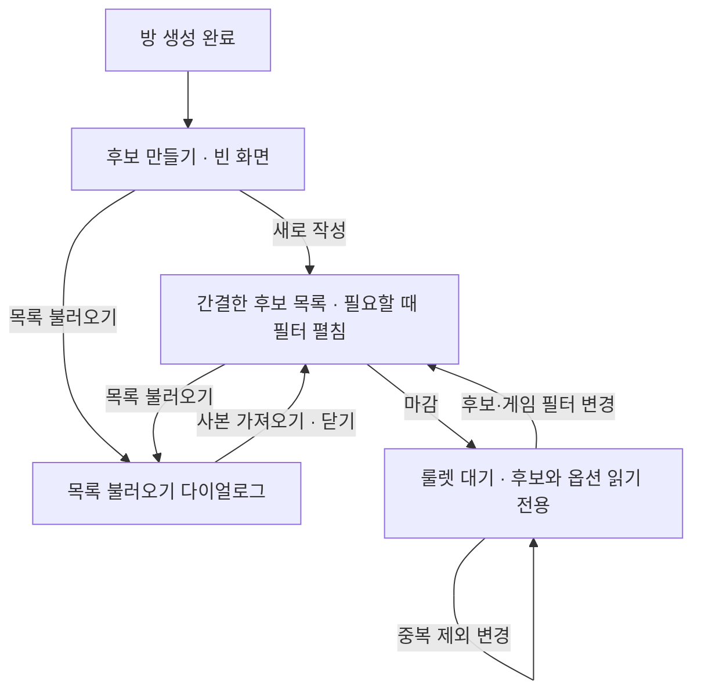

# 방 생성 후 후보 만들기 흐름 — 2026-11-16

**후속 변경 취합 — 2026-11-16:** 승인된 후보 편집 단순화, 대기·결과·입장 화면 보완을 `feat/compact-room-waiting` 브랜치에서 함께 관리한다. 아래 단계별 검증 기록의 미커밋·미푸시는 해당 검증 당시 상태다. 현재 커밋·푸시 상태는 [lifecycle 이슈 #46](https://github.com/acee90/random-number-generator/issues/46)에서 관리하며 운영 배포와 구분한다. 최종 검증은 전체 48파일·1,424개 테스트, 타입·앱 빌드와 로컬 HTTP/WebSocket 34개 흐름 통과다.

기준 이슈: [후보 목록 #4](https://github.com/acee90/random-number-generator/issues/4), [접수·마감 #46](https://github.com/acee90/random-number-generator/issues/46), [공통 UI #44](https://github.com/acee90/random-number-generator/issues/44). 진행 상태는 [상위 로드맵 #7](https://github.com/acee90/random-number-generator/issues/7)과 각 이슈에서 관리한다.

**현재 상태: 와이어프레임 확인 후 로컬 서비스 구현에 연결했다.** 새 방의 빈 시작, 직접 작성/목록 불러오기, 공통 편집기와 게임 필터, 같은 브라우저 개인 목록 저장·불러오기·삭제를 실제 방 흐름에 적용했다. 기본 구현은 [PR #51](https://github.com/acee90/random-number-generator/pull/51)로 main에 머지했다. 이번 대기 화면 압축과 승인된 후보 편집 단순화는 이후 후속 변경이며 운영 배포 전이다. 진행 상태는 연결된 GitHub 이슈에서 관리한다. 최종 검증 결과는 [lifecycle 문서 0절](game-screen-lifecycle.md#0-실제-구현-상태--2026-11-16-로컬)에 갱신한다. 아래 과거 시안 기록과 현재 서비스 상태를 구분한다.

## 사용자 방향

- 최초 흐름은 **방 생성 → 후보 만들기 → 룰렛 대기**로 한다.
- 방이 만들어지면 기본 static 목록을 자동으로 채우지 않고 **후보 0개인 빈 화면**에서 시작한다.
- 후보 만들기 첫 화면은 **새로 작성 / 목록 불러오기** 두 개의 큰 버튼으로 나눈다.
- **목록 불러오기**는 현재 빈 화면 또는 편집기 위에 다이얼로그로 연다. 별도 페이지로 이동하거나 공유 게임 단계를 바꾸지 않는다.
- 기본 목록도 **목록 불러오기** 안에서 명시적으로 선택한다. 커스텀 목록과 같은 편집·필터 흐름으로 이어진다.
- 후보 준비 화면 안에서 **목록 편집 / 게임 필터**를 별도 계층으로 구분한다. 대기의 후보·옵션 보기는 읽기 전용이며 목록이나 필터를 바꾸려면 후보 편집으로 돌아간다. 대기에서 바로 바꿀 수 있는 게임 조건은 중복 제외다.
- 대기에서는 후보 목록을 상단 `후보 보기` 팝업으로 모으고, 중복 제외 스위치와 제외 목록을 한 영역에 둔다. 중복 제외 변경은 대기·결과의 제외 패널에서만 제공하고 후보 편집에서는 생략한다. `후보 추천받기`는 후보 편집 화면에서만 표시한다.
- 방장·참가자 동시 시안으로 흐름을 확인한 뒤 사용자의 구현 적용 요청에 따라 서비스에 연결했다.

목록 편집은 원본 후보를 만드는 과정이고, 게임 필터는 준비된 원본에서 이번 추첨 후보를 고르는 별도 계층이다. 두 계층은 기본·커스텀 목록에 같은 규칙을 적용한다. 상세 구분은 [인터페이스 검토 문서](candidate-list-interface-review.md#사용자-방향-목록-편집과-게임-필터를-별도-계층으로-분리)를 따른다.

## 화면과 행동

| 화면 | 방장 | 참가자 |
| --- | --- | --- |
| 방 생성 완료 · 후보 없음 | 후보 0개와 `후보 만들기` 제목. `새로 작성` / `목록 불러오기` 큰 버튼을 표시 | `방장이 후보를 준비하고 있습니다` 안내. 작성·불러오기·마감 조작은 없음 |
| 새로 작성 | 이름 한 줄로 추가하고, 이름을 누르면 해당 행만 수정. 분류 태그와 후보 ⋯ 메뉴에서 분류·제외·삭제 | 방장이 준비 중임을 확인. 추천은 접수가 열렸을 때만 가능 |
| 목록 불러오기 다이얼로그 | 기존 빈 화면/편집기 위에서 기본 목록 또는 실제 개인 저장 목록을 선택. 사본을 가져온 뒤 공통 편집기로 복귀 | 기존 공유 화면 유지. 방장의 개인 다이얼로그·저장 목록 선택 과정은 공유하지 않음 |
| 후보 준비·편집 | 출처와 관계없이 같은 간결한 목록. 필요할 때 필터를 펼쳐 같은 행의 추첨 포함 범위를 고르고 준비가 끝나면 마감 | 적용된 공유 후보·필터 상태 조회. 방장의 미적용 초안은 확정 목록처럼 표시하지 않음 |
| 룰렛 대기 | 큰 룰렛과 제외 목록 안의 중복 제외 스위치. 후보는 상단 읽기 전용 팝업으로 조회하고 본문 목록은 생략. 시작 또는 후보 편집으로 이동하며 추천 접수는 편집에서 시작 | 같은 룰렛·중복 제외 상태·제외 목록과 상단 후보 팝업 조회. 편집·옵션 변경·시작은 방장 권한 |

첫 빈 화면에는 사용할 후보가 없으므로 룰렛을 보여 주거나 추첨을 시작하지 않는다. 작성 경로와 불러오기 경로를 고르는 두 버튼이 주된 행동이다.

`목록 불러오기`는 실제 기본 음식점 107곳과 같은 브라우저·같은 주소에 저장한 개인 목록을 보여준다. 빈 초안에서는 선택 즉시 사본을 가져와 닫는다. 후보나 아직 추가하지 않은 입력이 있는 초안을 교체할 때만 교체 확인을 받는다. 별도 필수 미리보기·확정 페이지는 없다. 불러온 후보는 새 ID와 전체 포함 상태로 시작하며 원본 저장본의 게임별 제외 상태를 가져오지 않는다.

기본 화면은 이름 한 줄 추가와 텍스트 후보 행이다. 이름을 누르면 그 행만 Input으로 바꾸고 Enter로 확정·Escape로 복원한다. 분류 태그는 선택적인 자유 입력·자동완성 다이얼로그를 연다. 후보 ⋯는 버튼 옆 팝업으로 등록자·이번 추첨 포함/제외·삭제를 제공하며 삭제는 되돌릴 수 있다. 목록 ⋯는 불러오기·개인 사본 저장·여러 줄 추가·전체 비우기·변경 취소를 모은다. 여러 줄 입력은 기존 ID를 재해석하지 않고 새 후보만 추가한다.

필터는 같은 목록 위에서 분류 버튼·검색·행별 포함 체크를 펼친다. 이름 검색은 화면에서 찾는 기능이며 추첨 조건을 바꾸지 않는다. 필터를 닫으면 검색은 해제하고 분류·개별 제외는 유지한다. 필터와 후보 변경은 개인 초안으로 유지하고 `마감` 또는 `추천 접수 열기/종료`에서 저장한다. 별도 변경 적용 버튼은 두지 않는다. 후보 변경이 함께 있으면 후보 저장 ACK → 필터 저장 ACK → 단계 전환 순서를 지킨다. 필터만 저장할 때 원본 후보와 목록 버전은 그대로다. 저장 실패 시 마감하지 않고 남은 초안을 보존해 재시도하며, 공유 필터가 바뀐 경우에는 최신 조건을 확인하도록 안내한다.

## 전환과 보존 규칙

다이얼로그·팝업 열림과 필터 펼침·검색은 개인 UI 상태다. 새 공유 lifecycle 단계를 추가하지 않는다.

- **새로 작성:** 후보 0개에서 추가한다. 다른 목록으로 덮어쓰기 전에는 기존 후보·미추가 입력의 폐기를 확인한다.
- **불러오기 열기:** 배경의 후보·입력 초안·공유 목록·게임 단계를 유지한다. 배경 조작을 잠그고 다이얼로그 안으로 포커스를 옮긴다.
- **불러오기 선택:** 공통 편집기에 사본을 채운다. 기본 목록·개인 저장본은 덮어쓰지 않는다. 서버에 적용되기 전에는 개인 편집 초안이다.
- **초안 교체 확인:** 취소·Escape는 위 확인만 닫고 아래 불러오기 창과 기존 초안을 유지한다. 수락하면 사본을 채우고 두 다이얼로그를 닫아 편집기로 이어진다.
- **불러오기 닫기:** 취소·X·Escape는 기존 후보와 입력을 유지하고 원래 `목록 불러오기` 버튼으로 포커스를 돌린다.
- **내 목록에 저장:** 이름을 붙여 새 개인 사본으로 저장한다. 현재 방 적용과 별개이며 기존 개인 원본을 자동 덮어쓰지 않는다.
- **저장 목록 삭제:** 개인 목록 옆 삭제 버튼은 확인 후 그 저장 사본만 삭제한다. 현재 방·편집 초안·다른 개인 목록은 유지한다. 저장 한도에 도달했을 때 정리 후 재시도할 수 있다.
- **저장소 실패:** 읽기·쓰기·삭제 실패 시 원래 저장 내용과 편집 초안을 보존하고 오류·재시도를 제공한다. 저장 목록이 없어도 기본 목록 선택과 직접 작성은 가능하다.
- **후보 0개:** 작성·불러오기·추천 접수 등 복구 경로를 열어 두고 마감·추첨만 막는다. 필터로 0개가 됐다면 준비 화면에서 조건을 조정하거나 초기화한다.
- **적용 실패:** 현재 단계와 초안을 유지한다. 서버 승인 전에 참가자에게 새 목록이 확정된 것으로 표시하지 않는다.
- **첫 마감:** 미적용 후보를 저장한 뒤 룰렛 대기로 이동한다. 자동으로 추첨하지 않는다.

## 반복 게임과 추천 접수

최초 후보 만들기를 매 게임 반복하지 않는다. 이후에는 **대기 → 명시 추첨 → 결과 → 다음 게임 대기**를 유지한다. 같은 목록과 필터는 재사용한다. 대기에서는 후보·옵션 보기로 조건을 확인하며, 후보나 필터를 바꿀 때만 후보 편집에 다시 들어가 마감한다. 중복 제외는 게임 사이에 바로 바꿀 수 있다.

게임 필터는 기본·커스텀 목록에 같은 기능을 제공한다. 필터 변경·초기화는 원본·개인 저장본·당첨 제외·과거 결과를 변경하지 않는다. 필터 초기화와 당첨 제외 목록 초기화는 서로 다른 작업이다. 분류를 다시 켜도 개별 수동 제외는 유지한다.

참가자 추천은 선택 경로다. 후보 편집 화면의 **후보 추천받기 스위치**를 켜면 접수를 열고, 끄면 추천만 중지한 **접수 종료·목록 확인**에 머문다. 다시 켜면 기존 후보·개인 입력을 유지하고 새 접수 세션을 연다. **마감**은 별도 버튼으로 두며 접수 중/종료 후 모두 룰렛 대기로 이동한다. 스위치 변경 전 미적용 후보와 필터 저장을 승인받고, 실패하면 실제 접수 상태와 초안을 유지한다. 참가자는 접수 중 이름과 선택 분류로 추천하고 본인 추천을 확인 후 삭제한다. Ready나 추가 필수 승인 단계는 도입하지 않았다.

## 실제 연결 범위와 남은 범위

생성 HTTP 요청에서 기본 후보 선택을 생략하면 빈 `editing` 방을 만든다. 기존 샘플 ID를 명시하는 요청은 호환 경로로 유지한다. 방 안에서는 0개까지 저장할 수 있으며 마감은 분류·수동 선택 후 후보가 1개 이상이어야 한다. 당첨 제외만으로 0개가 된 상태는 마감해 대기로 복귀한 뒤 제외 설정을 바꿀 수 있다. 실제 추첨은 필터와 중복 제외를 적용한 유효 후보가 1개 이상이어야 한다. 1개도 같은 서버 확정·회차 기록 경로를 사용한다.

개인 목록은 서비스 전용 `jeommechu:candidate-lists:v1`에 최대 20개를 저장하며, 목록당 후보 개수는 제한하지 않는다. 브라우저 저장량은 개인 목록 전체 직렬화 기준 8MiB까지다. Storybook 시안 키와 구분하며 다른 기기·주소나 브라우저 데이터 삭제 뒤에는 자동 복원하지 않는다. 실제 XLSX 읽기·내보내기, 홈/solo 전체 라이브러리 연결, 중복 의심·일괄 검수 보기, Ready·확률 투표는 이번 구현에 추가하지 않았다. 게임 필터의 후보 이름 검색은 구현했으며 검색 자체는 추첨 대상을 바꾸지 않는다. 남은 범위와 완료 기준은 [후보 목록 #4](https://github.com/acee90/random-number-generator/issues/4)와 각 관련 이슈에서 관리한다.

## 현재 동작 확인 기준

- 새 방 직후 빈 후보 만들기와 두 큰 버튼이 표시되고 기본 목록은 자동 주입되지 않는다.
- 직접 작성과 다이얼로그 불러오기는 같은 편집기로 이어지며 첫 마감 후 룰렛 대기로 이동한다.
- 방장·참가자의 공유 단계와 권한이 일치하고 개인 초안·다이얼로그는 구분된다.
- 불러오기 취소·X·Escape와 교체 확인 취소에서 기존 초안과 포커스를 보존한다.
- 개인 저장·불러오기·삭제가 현재 방과 원본 사본을 구분하며 저장소 실패에서 기존 내용을 보존한다.
- 게임 필터는 후보 준비 화면에서만 변경한다. 대기의 후보·옵션 보기는 읽기 전용이며 변경은 후보 편집으로 연결한다.
- 필터·중복 제외·원본·과거 결과가 독립적이고 유효 후보 0개의 복구 경로가 유지된다.
- 같은 목록으로 반복할 때 초기 선택·추천 접수를 강제하지 않는다.
- 대기의 상단 후보 팝업은 전체/이번 포함 수·제외 사유·확률을 조회하며, 본문에 후보 목록을 반복하지 않는다. 중복 제외 스위치는 제외 목록과 함께 표시하고 추천 접수 버튼은 편집에서만 제공한다.

사용자 승인 후 단순화 와이어프레임을 실제 방 편집기에 로컬 적용했다. 공통 UI의 Radix DropdownMenu를 사용하며 후보·필터 ACK와 초안 보호 계약을 유지한다. 구현·검증 상태는 #4/#46에서 관리하고 운영 배포와 구분한다.

실제 최종 검증과 운영 배포 상태는 [lifecycle 구현 상태](game-screen-lifecycle.md#0-실제-구현-상태--2026-11-16-로컬)와 관련 이슈에서 구분해 기록한다.

## 과거 시안과 확인 기록

조작 가능한 시안 원본은 [candidate-setup-flow.html](../wireframes/candidate-setup-flow.html)이다. 아래는 실제 서비스 연결 전에 확인한 기록이다. 당시 시안은 서비스 3000 포트의 방/후보 데이터를 변경하지 않았다. 시안의 기본·팀·번호 목록은 예제 데이터다. 당시 대기 화면에서 필터를 수정했던 배치는 이후 사용자 결정에 따라 후보 준비 화면 안으로 옮겼으며, 아래 기록을 최신 서비스 검증으로 보지 않는다.

### 이전 시안 확인 — 목록 선택 화면 방식

아래는 불러오기를 별도 선택 화면으로 표시했던 이전 시안의 확인 기록이다. 브라우저 확인은 visualize 렌더러의 로컬 8768 포트를 사용했다. 이 기록으로 최신 다이얼로그 동작·초점 복원을 검증했다고 보지 않는다.

- 직접 작성: 빈 편집기와 후보 0개 마감 잠금, 이름·분류 입력 후 마감에서 미추가 입력까지 반영해 대기 1개로 이동하는 경로 확인.
- 불러오기: 기본 목록 예시 6개와 저장한 커스텀 목록 예시 4개가 같은 편집기 → 마감 → 대기로 이어지는 경로 확인. 교체 확인 취소와 선택 화면 돌아가기 후 기존 `비빔밥` 초안 유지 확인.
- 역할/접수: 방장 추천 접수 열기 → 참가자 `카레/일식` 추가 → 본인 추천 삭제·실행 취소 → 접수 종료 → 마감 뒤 양쪽 후보 수 7개 일치 확인. 최초 방장 개인 초안은 공유 목록과 분리.
- 필터: 기본 예시 전체 6개에서 한식 해제 후 실제 추첨만 5개로 변경, 전체 6개 유지. 모든 분류 해제 시 추첨 0개·시작 비활성, 필터 초기화 후 6개 복구 확인. 체크박스의 키보드 포커스 유지 확인.
- 반복: 결과 예시 → 다음 게임 대기에서 같은 목록 재사용, 초기 작성 선택 강제 없음 확인.
- `render.py --check`의 스크립트 문법·리터럴 참조·정적 DOM 참조 검사와 `git diff --check` 통과.

실제 렌더링 확인 너비는 브라우저가 제공한 1280×720이다. viewport 변경 기능을 요청했으나 이 미리보기 탭에는 반영되지 않아 **320px 실제 렌더링은 미검증**으로 남긴다. 반응형 스타일은 포함했으며 실제 모바일/IME·스크린리더·어두운 테마는 별도 확인이 필요하다. 시안의 목록과 추첨은 예시 동작이고, 실제 개인 저장소·서버·난수 API·XLSX 연결은 없다.

### 과거 시안 확인 — 불러오기 다이얼로그 방식

와이어프레임을 실제 브라우저에서 확인했을 당시 기록이다. 이 확인 단계에서는 서비스 구현/API 변경을 하지 않았다. 이후 사용자가 구현 적용을 요청해 위 로컬 서비스 흐름에 연결했다.

- 기존 편집 화면에서 불러오기 창을 연 뒤 Escape·닫기(X)로 복귀했을 때 모든 입력값과 참가자 화면 내용이 동일함을 비교 확인했다. 포커스는 원래 `목록 불러오기` 버튼으로 돌아왔다.
- 별도 검증용 로컬 8769 포트에서 빈 화면 → 다이얼로그 → 기본 목록 선택 시 확인 단계를 추가하지 않고 편집기 6개로 이동, 열린 다이얼로그 0개와 후보 이름 입력 초점 확인.
- 후보 6개와 미추가 입력이 있는 상태에서 커스텀 목록을 선택하면 교체 확인을 표시한다. Escape는 위 교체 확인만 닫고 아래 불러오기 창을 유지한다. 취소 후 미추가 `작성 중 초안` 입력값도 유지됨을 확인했다.
- 교체 확인 수락 시 두 다이얼로그가 모두 닫히고 커스텀 목록 4개를 공통 편집기에 채우며 첫 추가 입력에 포커스를 옮긴다.
- 다이얼로그 초기 초점은 첫 목록 카드이며, 이름/설명이 AX에 표시된다. 이 변경은 방장 개인 UI로 처리하여 공유 준비 단계는 그대로 유지했다.
- 스크립트 문법·정적 DOM 참조·diff 검사 통과, 최종 브라우저 오류 로그 0개. [다이얼로그 화면 캡처](../wireframes/candidate-setup-load-dialog.jpg)를 남겼다.

이전과 같이 320px 실제 렌더링·실제 모바일/IME·스크린리더는 미검증이다. 사용자 브라우저의 서비스 방이나 작업 중인 초안을 교체하지 않고, 수락/실제 교체 경로는 별도 시안에서 확인했다.

### 후속 후보 편집 단순화 시안 — 2026-11-16

최신 사용자 요청에 따라 [candidate-editor-simple.html](../wireframes/candidate-editor-simple.html)에서 후보 편집을 단순화했다. 이 후속 시안은 이름 한 줄 추가, 텍스트 행에서 선택한 후보만 편집, 분류 태그, 같은 목록 위의 필터, ⋯ 목록 작업과 단일 마감 행동을 보여 준다. 최초 빈 방의 새로 작성/불러오기 경로와 불러오기 다이얼로그·사본/초안 보존은 유지한다. 방장/참가자 동시 보기, 추천 접수·종료·재개·마감과 대기도 조작할 수 있다.

이 시안은 사용자 승인 후 실제 방 편집기에 로컬 적용했다. 시안 작성 당시의 범위·확인 결과와 캡처는 [인터페이스 검토의 최신 시안 기록](candidate-list-interface-review.md#단순화-와이어프레임-작성--2026-11-16), 진행 상태는 기존 [#4](https://github.com/acee90/random-number-generator/issues/4)와 [#46](https://github.com/acee90/random-number-generator/issues/46)을 따른다.
