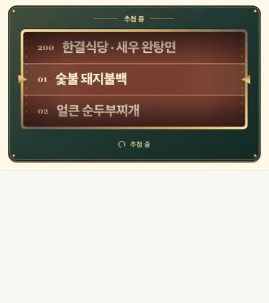

# 후보가 많은 방의 추첨 보기

룰렛은 후보가 118개 이상이면 원판에 이름을 표시할 공간이 부족하다. 슬롯머신은 후보 수와 관계없이 가운데 한 줄을 크게 보여 준다. 개인방과 공동방에서 사용할 수 있으며, 카드 뽑기는 후속 시안으로 관리한다. 개발 범위와 배포 상태는 [추첨 보기 #11](https://github.com/acee90/random-number-generator/issues/11)과 [로드맵 #7](https://github.com/acee90/random-number-generator/issues/7)에서 확인할 수 있다. [룰렛 라벨 계산](../../src/components/features/picnic/layout.ts)

## 방에서 사용하기

1. 새 개인방과 공동방은 **슬롯머신**으로 시작한다. 대기·결과 화면 제목 옆의 ‘추첨 보기’ 콤보박스에서 룰렛을 선택할 수 있다. 개인방에서는 본인이, 공동방에서는 방장이 선택하며 참가자에게도 같은 보기가 표시된다.
2. 화살표로 앞뒤 후보를 미리 본다. 상단의 **후보**를 누르면 방장은 후보 편집 화면으로 이동하고 참가자는 읽기 전용 목록을 펼친다.
3. **슬롯 돌리기**를 누르면 릴이 가속했다가 마지막 몇 칸에서 감속한다. 황동 포인터가 가리키는 가운데 줄에 당첨 이름과 번호가 멈춘다. 남은 후보가 하나면 ‘마지막 후보 확정’으로 진행한다.
4. 당첨 메뉴가 멈추면 투표가 열린다. 방장이 **대기화면으로 이동**을 누르면 투표를 보관하고 다음 추첨을 기다린다. **바로 다시 뽑기**를 누르면 투표를 보관한 뒤 같은 후보 조건으로 새 회차를 시작한다. 추첨할 후보가 없으면 다시 뽑기는 비활성화된다.

## 회차와 연출

- 보기를 바꿀 때 방의 리비전을 확인하고 저장한다. 추첨 준비와 회전이 끝나면 선택을 다시 연다. 결과에서 바꾼 보기는 모든 참가자와 다음 회차에 적용된다. 지난 기록에는 시작 당시의 보기, 당첨자, 투표가 남는다.
- 난수 요청 직전에 보기 버전, 필터·당첨 제외를 적용한 후보, 확률과 투표권자를 고정한다. 슬롯은 회차에 기록된 당첨 인덱스와 서버 시각을 받아 표시한다. 기존 방이나 기록에서 보기 버전을 알 수 없으면 룰렛으로 연다. [공통 게임 상태](../../src/lib/roomGame.ts) · [보기 버전](../../src/lib/drawView.ts)
- 후보가 둘 이상이면 릴은 4초에 98칸을 이동한다. 처음 0.48초 동안 가속하고, 이후 1.76초 동안 초당 약 39칸의 최고 속도를 유지한다. 2.24초부터 감속해 마지막 몇 후보의 이름이 보이고, 당첨 줄을 0.1칸 지나갔다가 중앙에 멈춘다. 18칸짜리 구간을 반복해 29개 행으로 그린다. 방에 늦게 들어와도 같은 회차의 경과 시각에서 이어진다. [릴의 위치와 속도](../../src/components/features/slot/motion.ts)
- 슬롯머신은 룰렛과 같은 PixiJS 렌더러로 본체, 릴의 후보 번호와 이름, 당첨선, 버튼을 그린다. 회전할 때는 글자와 금속 눈금이 함께 움직인다. 키보드 조작과 결과 안내는 기존 HTML 버튼과 제목이 담당한다. 강제 색상 모드이거나 캔버스를 사용할 수 없으면 같은 배치의 HTML 화면이 표시된다.
- 당첨 이름이 두 줄을 넘으면 릴의 세 줄 공간을 사용해 전체 이름과 번호를 표시한다. 동작 줄이기 설정에서는 릴이 정지한 채 같은 공개 시각을 기다리고, 결과와 투표가 즉시 표시된다.
- 대기 화면부터 릴 아래에 투표 공간을 확보한다. 결과가 공개되면 그 자리에 투표가 340ms 동안 나타나며 기기와 추첨 버튼의 위치가 유지된다. 지나가는 행은 스크린 리더가 읽지 않게 한다. 투표·재접속·기록 조회는 같은 회차를 사용한다. [슬롯머신](../../src/components/features/slot/SlotMachine.tsx) · [투표를 포함한 게임 보드](../../src/components/features/RoomGameStage.tsx)

## 브라우저 확인

로컬 서버를 실행한 뒤 `npm run check:slot -- http://localhost:3000`으로 캔버스의 후보 글자와 회전, 키보드 조작, 공동방 재입장과 투표를 확인할 수 있다. [320px 대기](../../output/slot-pixi/idle-320.png) · [597px 대기](../../output/slot-pixi/idle-597.png) · [데스크톱 회전](../../output/slot-pixi/spinning-1280.png) · [80자 당첨 이름](../../output/slot-pixi/long-winner-320.png)

| 상황 | 확인한 동작 |
| --- | --- |
| 공동방, 후보 200개 | 방장과 참가자가 슬롯머신으로 시작한다. 추첨 도중 재입장하거나 늦게 입장해도 같은 후보가 가운데에 멈춘다. 두 사람의 투표가 집계되며, 방장이 다음 회차에서 선택한 룰렛도 참가자에게 반영된다. |
| 개인방, 80자 이름과 마지막 후보 | 실제 방 만들기부터 마지막 후보 확정, 추첨 중 새로고침, 이름 전문, 투표, 다음 게임과 지난 기록을 확인했다. 중복 없이 추첨했을 때 남은 후보가 0개가 되면 시작 버튼이 잠긴다. |
| 캔버스와 탭 복귀 | 후보 118개 시안에서 캔버스를 끄고 회전 중 탭을 정지시켰다. 공개 시각이 지나 돌아오면 당첨 결과와 투표가 열렸다. 강제 색상과 동작 줄이기에서도 당첨 이름을 읽고 투표할 수 있다. |
| 룰렛, 후보 60개 | 597px·646px·1280px에서는 번호 배지가 원판 외곽을 따라 정렬되고 이름은 배지 안쪽에 놓인다. 320px에서는 외곽에 번호 60개를 표시한다. [646px 룰렛](../../output/wheel-rim-labels/wheel-60-646.png) · [320px 룰렛](../../output/wheel-rim-labels/wheel-60-320.png) |
| 320px·597px·646px·1280px | 보기 선택기와 후보 버튼의 기본 크기는 104×44px다. 슬롯 결과의 두 버튼은 한 줄에 표시되며, 대기화면으로 이동하면 추첨 버튼에 포커스가 돌아간다. |

[320px 슬롯 결과](../../output/room-result-actions/slot-result-320.png) · [597px 결과에서 보기 변경](../../output/room-result-actions/result-view-picker-597.png) · [646px 슬롯 결과](../../output/room-result-actions/slot-result-646.png) · [1280px 공동방](../../output/room-result-actions/slot-result-1280.png)

## 카드 뽑기 시안

저장소에서 `npm run storybook`을 실행하고 ‘시안 → 추첨 보기’를 연다. 슬롯머신은 실제 보드를 사용한다. 카드 시안은 맨 위의 후보 한 장을 넘겨 보고, ‘카드 한 장 뽑기’를 누르면 카드 뒷면을 섞은 뒤 결과 티켓을 펼친다. 200개 예제에서 기본 당첨은 18번 ‘명란 크림 우동’으로 고정해 두 연출을 비교할 수 있다. [슬롯머신 미리보기](http://127.0.0.1:6006/iframe.html?id=draw-view-modes--rolling&viewMode=story) · [카드 뽑기 미리보기](http://127.0.0.1:6006/iframe.html?id=draw-view-modes--cards&viewMode=story) · [320px 카드 시안](../wireframes/draw-views/cards-320.png)

카드 구현의 선행 작업은 회차별 보기 저장과 공통 추첨·투표 흐름이다. 채택하면 후보 0·1·6·117·118·200개, 중복 이름과 긴 이름, 공동방 재접속과 투표 공개 시각을 같은 기준으로 검증한다. [공통 추첨 화면 #58](https://github.com/acee90/random-number-generator/issues/58) · [회차·제외 #46](https://github.com/acee90/random-number-generator/issues/46) · [게임 보드 #90](https://github.com/acee90/random-number-generator/issues/90)
