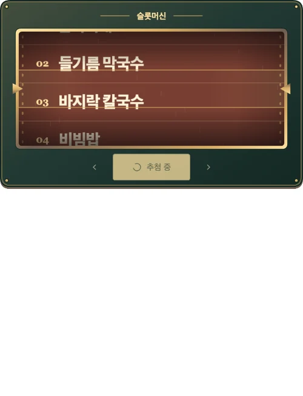
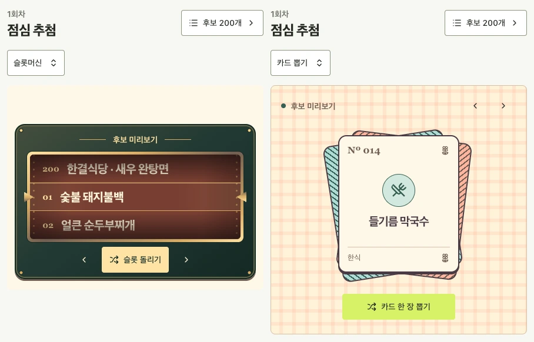

# 후보가 많은 방의 추첨 보기

룰렛은 후보가 118개 이상이면 원판에 이름을 표시할 공간이 부족하다. 슬롯머신은 후보 수와 관계없이 가운데 한 줄을 크게 보여 준다. 개인방과 공동방에서 사용할 수 있으며, 카드 뽑기는 후속 시안으로 관리한다. 개발 범위와 배포 상태는 [추첨 보기 #11](https://github.com/acee90/random-number-generator/issues/11)과 [로드맵 #7](https://github.com/acee90/random-number-generator/issues/7)에서 확인할 수 있다. [룰렛 라벨 계산](../../src/components/features/picnic/layout.ts)

## 방에서 사용하기

1. 새 개인방과 공동방은 **슬롯머신**으로 시작한다. 게임 보드 왼쪽 위의 ‘추첨 보기’에서 룰렛으로 바꿀 수 있다. 개인방에서는 본인이, 공동방에서는 방장이 선택하며 참가자에게도 같은 보기가 표시된다.
2. 화살표로 앞뒤 후보를 미리 본다. 상단의 **후보**를 누르면 방장은 후보 편집 화면으로 이동하고 참가자는 읽기 전용 목록을 펼친다.
3. **슬롯 돌리기**를 누르면 릴이 가속했다가 마지막 몇 칸에서 감속한다. 황동 포인터가 가리키는 가운데 줄에 당첨 이름과 번호가 멈춘다. 남은 후보가 하나면 ‘마지막 후보 확정’으로 진행한다.
4. 당첨 메뉴에서 릴이 멈추면 방장의 추첨 버튼 자리에 **대기화면으로 이동**과 **바로 다시 뽑기**가 나란히 표시된다. 두 동작 모두 이번 투표를 보관한다. 추첨할 후보가 없으면 다시 뽑기는 비활성화된다. **좋아요·싫어요** 투표는 슬롯머신 아래에서 할 수 있다.

보드의 **당첨 내역**을 열면 현재 후보로 추첨한 결과가 최신순으로 보인다. 후보 구성이나 필터가 바뀌면 현재 게임의 기록이 새로 시작된다. 이전 기록이 있으면 제목 옆에 **이전 게임 포함** 체크박스가 나타난다. 체크하면 이전 당첨과 후보 변경이 같은 목록에 추가된다. 예를 들어 김치찌개를 된장찌개로 바꾸면 두 추첨 사이에 **후보 변경 · 김치찌개 → 된장찌개**가 표시된다. 이전 혼자 추첨도 시각순으로 볼 수 있다. 상세 기록에서 돌아오면 체크 상태가 유지되고, 보드에서 당첨 내역을 다시 열면 현재 게임부터 보여 준다. 예전 기록에 편집 시각이 없으면 변경 행에는 시각을 표시하지 않는다.

당첨 행에는 이름과 시각, 확인 가능한 회차가 표시된다. 최근 20회는 행을 눌러 상세 기록을 열 수 있다. 당첨으로 제외된 후보는 **중복 없이 추첨** 옆의 **제외 N**에서 확인한다. 방장이 제외 목록을 초기화한 뒤에도 당첨 기록은 이어진다. [당첨 내역 #102](https://github.com/acee90/random-number-generator/issues/102) · [모바일 변경 기록](../../output/room-win-history/all-slot-320.png) · [데스크톱 위치](../../output/room-win-history/current-1150.png) · [여러 회차가 쌓인 목록](../../output/room-win-history/many-slot-597.png)

## 회차와 연출

- 보기를 바꿀 때 방의 리비전을 확인하고 저장한다. 추첨 준비와 회전이 끝나면 선택을 다시 연다. 결과에서 바꾼 보기는 모든 참가자와 다음 회차에 적용된다. 지난 기록에는 시작 당시의 보기, 당첨자, 투표가 남는다.
- 난수 요청 직전에 보기 버전, 필터·당첨 제외를 적용한 후보, 확률과 투표권자를 고정한다. 슬롯은 회차에 기록된 당첨 인덱스와 서버 시각을 받아 표시한다. 기존 방이나 기록에서 보기 버전을 알 수 없으면 룰렛으로 연다. [공통 게임 상태](../../src/lib/roomGame.ts) · [보기 버전](../../src/lib/drawView.ts)
- 후보가 둘 이상이면 릴은 4초에 98칸을 이동한다. 처음 0.48초 동안 가속하고, 이후 1.76초 동안 초당 약 39칸의 최고 속도를 유지한다. 2.24초부터 감속해 마지막 몇 후보의 이름이 보이고, 당첨 줄을 0.1칸 지나갔다가 중앙에 멈춘다. 18칸짜리 구간을 반복해 29개 행으로 그린다. 방에 늦게 들어와도 같은 회차의 경과 시각에서 이어진다. [릴의 위치와 속도](../../src/components/features/slot/motion.ts)
- 대기부터 투표까지 하나의 PixiJS 캔버스에 본체, 릴, 조작 버튼, 투표창을 그린다. 정지한 뒤에도 당첨 후보의 위아래 줄과 포인터가 보인다. 가운데 줄에서 이름이 두 줄을 넘을 때는 투표창 상단에서 전체 이름을 읽을 수 있다.
- 대기할 때부터 본체 아래에 투표 공간을 확보한다. 당첨 시각이 되면 그 자리에 투표창이 260ms에 걸쳐 나타난다. 동작 줄이기 설정에서는 릴이 정지한 채 공개 시각을 기다리고 투표가 즉시 표시된다. [슬롯머신](../../src/components/features/slot/SlotMachine.tsx) · [릴과 투표 렌더링](../../src/components/features/slot/useSlotReel.ts)
- 키보드로 후보 이동, 추첨, 투표, 다음 회차를 조작할 수 있다. 스크린 리더에는 릴이 멈춘 뒤 당첨 이름을 안내한다. 강제 색상 모드이거나 캔버스를 사용할 수 없으면 같은 위치의 HTML 버튼과 제목을 사용한다. [게임 보드](../../src/components/features/RoomGameStage.tsx)

## 브라우저 확인

로컬 서버를 실행한 뒤 `npm run check:slot -- http://localhost:3000`으로 대기부터 결과까지의 캔버스, 정지한 릴, 하단 투표, 키보드 조작과 공동방 재입장을 확인할 수 있다. [320px에서 80자 당첨 이름](../../output/slot-result-continuity/result-320.png) · [597px에서 한 표 집계 후](../../output/slot-result-continuity/voted-597.png) · [데스크톱 결과](../../output/slot-result-continuity/result-1280.png)

| 상황 | 확인한 동작 |
| --- | --- |
| 공동방, 후보 200개 | 방장과 참가자가 슬롯머신으로 시작한다. 추첨 도중 재입장하거나 늦게 입장해도 같은 후보가 가운데에 멈춘다. 두 사람의 투표가 집계되며, 방장이 다음 회차에서 선택한 룰렛도 참가자에게 반영된다. |
| 개인방, 80자 이름과 마지막 후보 | 실제 방 만들기부터 마지막 후보 확정, 추첨 중 새로고침, 이름 전문, 투표, 다음 게임과 지난 기록을 확인했다. 중복 없이 추첨했을 때 남은 후보가 0개가 되면 시작 버튼이 잠긴다. |
| 캔버스와 탭 복귀 | 후보 118개 시안에서 캔버스를 끄고 회전 중 탭을 정지시켰다. 공개 시각이 지나 돌아오면 당첨 결과와 투표가 열렸다. 강제 색상과 동작 줄이기에서도 당첨 이름을 읽고 투표할 수 있다. |
| 룰렛, 후보 60개 | 597px·646px·1280px에서는 번호 배지가 원판 외곽을 따라 정렬되고 이름은 배지 안쪽에 놓인다. 320px에서는 외곽에 번호 60개를 표시한다. [646px 룰렛](../../output/wheel-rim-labels/wheel-60-646.png) · [320px 룰렛](../../output/wheel-rim-labels/wheel-60-320.png) |
| 슬롯머신, 320px·597px·1150px·1280px | 당첨 전후 릴과 조작부의 위치 변화는 0px였다. 방장의 두 회차 버튼은 릴 바로 아래에 나란히 표시됐고 투표는 본체 아래에서 열렸다. 대기화면으로 돌아가면 추첨 버튼에 포커스가 복귀했다. |

## 카드 뽑기 시안

저장소에서 `npm run storybook`을 실행하고 ‘시안 → 추첨 보기’를 연다. 슬롯머신은 실제 보드를 사용한다. 카드 시안은 맨 위의 후보 한 장을 넘겨 보고, ‘카드 한 장 뽑기’를 누르면 카드 뒷면을 섞은 뒤 결과 티켓을 펼친다. 200개 예제에서 기본 당첨은 18번 ‘명란 크림 우동’으로 고정해 두 연출을 비교할 수 있다. [슬롯머신 미리보기](http://127.0.0.1:6006/iframe.html?id=draw-view-modes--rolling&viewMode=story) · [카드 뽑기 미리보기](http://127.0.0.1:6006/iframe.html?id=draw-view-modes--cards&viewMode=story) · [320px 카드 시안](../wireframes/draw-views/cards-320.png)

카드 구현의 선행 작업은 회차별 보기 저장과 공통 추첨·투표 흐름이다. 채택하면 후보 0·1·6·117·118·200개, 중복 이름과 긴 이름, 공동방 재접속과 투표 공개 시각을 같은 기준으로 검증한다. [공통 추첨 화면 #58](https://github.com/acee90/random-number-generator/issues/58) · [회차·제외 #46](https://github.com/acee90/random-number-generator/issues/46) · [게임 보드 #90](https://github.com/acee90/random-number-generator/issues/90)
