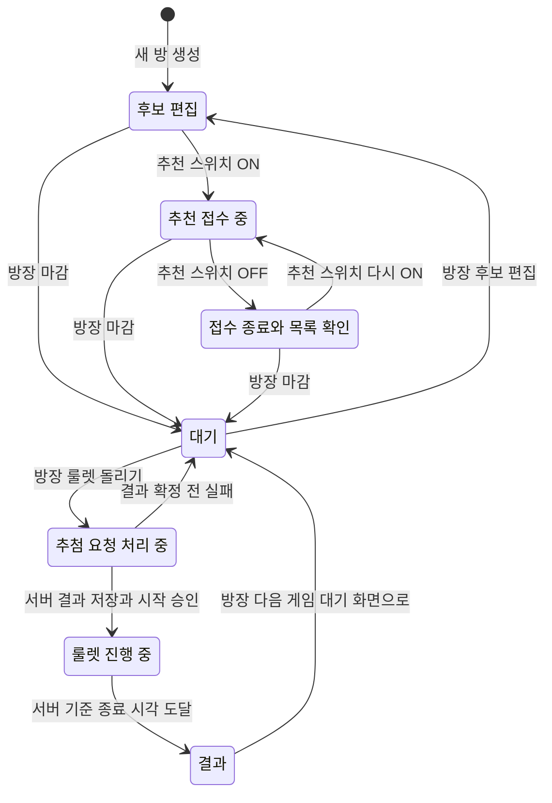

# 게임 화면 lifecycle과 로직 점검

**후속 변경 취합 — 2026-11-16:** 승인된 후보 편집 단순화, 대기·결과·입장 화면 보완을 `feat/compact-room-waiting` 브랜치에서 함께 관리한다. 아래 단계별 검증 기록의 미커밋·미푸시는 해당 검증 당시 상태다. 현재 커밋·푸시 상태는 [lifecycle 이슈 #46](https://github.com/acee90/random-number-generator/issues/46)에서 관리하며 운영 배포와 구분한다. 최종 검증은 전체 48파일·1,424개 테스트, 타입·앱 빌드와 로컬 HTTP/WebSocket 34개 흐름 통과다.

기준 이슈: [#46](https://github.com/acee90/random-number-generator/issues/46). 상위 로드맵: [#7](https://github.com/acee90/random-number-generator/issues/7). 후보 모델·편집은 [#4](https://github.com/acee90/random-number-generator/issues/4), 결과 피드백은 [#20](https://github.com/acee90/random-number-generator/issues/20), 확률 투표는 [#5](https://github.com/acee90/random-number-generator/issues/5), 공통 UI는 [#44](https://github.com/acee90/random-number-generator/issues/44), 파일 교체는 [#9](https://github.com/acee90/random-number-generator/issues/9)에서 관리한다.

편집·접수·대기·추첨·결과는 **같은 방 URL 안에서 바뀌는 주화면**이다. 새 방은 편집에서 시작하고 첫 마감 뒤 룰렛 대기를 표시한다. 화면을 바꿀 때마다 방·참가자·채팅·연결을 새로 만들지 않는다. 방장은 필요할 때만 추천을 받고, 마감하면 바로 대기로 돌아와 명시적으로 추첨한다.

2026-11-15 기준으로 사용자와 합의한 UI 흐름, 구현 전 권장 계약, 미결정 정책을 구분한다. 실제 서비스 코드 `4075386`과 당시 시안을 감사해 **시안 문제 4건을 재현했다.** 이후 사용자가 추가한 **OFF 추첨 시 제외 목록 교체·초기화 전 확인·룰렛 옆 제외 목록**은 아래 최신 동작 기준으로 반영한다. 기존 감사 자료를 새 정책의 검증 완료나 문제 해결 기록으로 보지 않는다. 실제 방 클라이언트·서버 연결은 아래 로컬 구현에 포함한다. 최대 인원 부하·실제 모바일 기기·운영 반영은 별도 검증 대상이다. 진행 상태는 GitHub 이슈가 기준이다.

## 0. 실제 구현 상태 — 2026-11-16 로컬

기획 커밋 `c965505` 이후 실제 방 연결과 승인된 후보 만들기 흐름을 구현해 [PR #51](https://github.com/acee90/random-number-generator/pull/51)을 main에 머지했다. 이번 대기 화면 압축과 승인된 후보 편집 단순화는 그 뒤의 후속 변경이며 운영 배포 전이다. 운영 배포 검증과 진행 상태는 연결된 GitHub 이슈에서 관리한다. 아래의 `4075386` 코드 감사와 HTML 시안 재현은 당시 기록이며, 현재 화면 기준은 이 절과 [#46](https://github.com/acee90/random-number-generator/issues/46)을 따른다.

**결과·당첨 제외 내역 보완 — 2026-11-16 로컬 구현·검증 완료:** [#46](https://github.com/acee90/random-number-generator/issues/46)과 [#20](https://github.com/acee90/random-number-generator/issues/20)에 연결한 후속 변경이다. 당첨 이름을 크게 강조하고 투표 버튼·집계 공간을 넓혔다. 방장도 추첨 시작 명단에 있으면 현재 결과에 한 번 투표하며, 본인 투표 처리 중에는 대기 복귀 버튼을 잠근다. 후보 필터의 개별 제외는 후보 보기에서 사유로 확인하고, 당첨 제외 패널에는 차수·시각을 갖춘 당첨 내역만 최근순 행으로 표시한다. 행이 많으면 제한된 높이 안에서 키보드·포인터로 스크롤한다. 성공 추첨 수와 당첨 메타데이터를 저장해 기록 20개 제한 뒤에도 차수를 이어 간다. 전체 47파일·1,398개 테스트, 타입 검사, 앱·Storybook 빌드, 로컬 HTTP/WebSocket 흐름 33개를 통과했다. 실제 브라우저에서 방장·참가자 투표와 대기 복귀, 597/320px 결과 배치, 200개 내역의 키보드 스크롤을 확인했다. 화면 증거: [결과](../../output/result-exclusion-polish/result-597.jpg), [방장](../../output/result-exclusion-polish/result-host-wide.jpg), [200개 내역](../../output/result-exclusion-polish/ledger-200.jpg). 장기 방에서 오래된 추첨 요청 ID가 재사용돼도 기록 중복 없이 기존 재시도로 처리하도록 보완하고 회귀 3개를 추가했다. 최종 HTTP/WebSocket 검증에는 ON/OFF 성공의 차수·당첨 메타데이터와 초기화 시 차수 보존도 포함했다. 변경 파일의 Biome·diff 검사도 통과했으며 기존 공통 UI lint 항목은 이전 검수 기록에 남겨 두었다. 로컬 미커밋·미푸시·미배포이며 운영에는 반영하지 않았다. 아래의 이전 검증 기록과 이번 결과를 구분한다.

**최신 UI 피드백 보완 — 2026-11-16:** 추천 제어를 후보 추천받기 스위치로 변경했다. ON은 collecting, OFF는 접수만 중지한 reviewing이며 초기 editing에서는 OFF다. 마감은 별도 유지한다. 후보·필터 저장 승인 전에 checked를 낙관 변경하지 않는다. 입력과 개별 새 후보를 목록 상단에 붙이고 이름 클릭 영역·상태 배지·실제 효과가 있는 필터 초기화를 정리했다. 채팅은 숫자 배지와 새 수신 시 1회 모션, 포커스는 공통 2px/2px로 보완했다. 전체 44파일·1,357개 테스트, 타입·앱/Storybook 빌드와 실제 597/320px 확인을 완료했다. 검수 범위·한계·lint 기존 항목은 [후속 UI 검수 기록](candidate-list-interface-review.md#후속-ui-피드백-8건과-공통-포커스-검수--2026-11-16-로컬)을 따른다. 로컬 미커밋·미푸시·미배포다.

**후보 편집 단순화 실제 구현 — 2026-11-16:** 승인된 [와이어프레임](../wireframes/candidate-editor-simple.html)을 RoomCandidateEditor와 공통 Radix DropdownMenu로 연결했다. 이름 한 줄 추가·선택 행 이름 편집·분류 태그·버튼 옆 후보 팝업·삭제 되돌리기, 같은 목록의 필터/검색, 목록 ⋯ 작업을 제공한다. 별도 변경 적용 버튼 없이 후보 ACK → 필터 ACK → 접수 전환/마감을 따른다. 참가자 추천도 이름 한 줄과 선택 분류 태그로 정리했다. 검색 중 이름이 달라져도 편집 행을 유지하고, 변경 취소·목록 교체 때 오래된 Undo를 비운다. 전체 43파일·1,349개 테스트, 프로젝트 타입·Biome/diff·앱/Storybook 빌드가 통과했다. 실제 방장/참가자 두 브라우저에서 작성·추천·접수 종료/재개·마감·읽기 전용 대기·재편집을 확인했고 320px/1,024px와 최종 오류 0건을 확인했다. 자세한 범위와 한계는 [실제 구현 기록](candidate-list-interface-review.md#승인된-후보-편집-단순화-실제-구현--2026-11-16-로컬)을 따른다. 이번 변경은 미커밋·미푸시·미배포다.

**대기 화면 압축 보완 로컬 검증 — 2026-11-16:** 전체 42파일·1,338개 테스트, 프로젝트 타입, 변경 코드 Biome·diff, 앱/Storybook 빌드를 통과했다. 후보 팝업·제외 패널 스위치·역할/진행 중 잠금·결과 보존·편집 옵션 미노출을 검증했다. 마감은 분류/수동 선택 후 후보가 있으면 허용하고, 당첨 제외로 실제 0개인 경우는 대기로 돌아가 설정을 바꿀 수 있게 분리했다. 실제 추첨의 0개 차단은 유지한다. 브라우저에서 597×716 후보 팝업과 Escape 초점 복귀, 편집의 게임 옵션 제거를 확인했다. 별도 검증 방의 실제 1회 확정 후 결과→대기 0개→편집→마감→대기 0개→스위치 OFF로 후보 복귀/제외 내역 보존도 확인했다. 최종 브라우저 오류 로그는 0개다. 320px 크기 요청은 숨김 검증 탭에 적용되지 않아 실제 320px 렌더링은 이번 확인 완료로 기록하지 않는다. [대기 화면](../../output/compact-room-waiting/waiting-597.jpg)·[편집 화면](../../output/compact-room-waiting/editing-current.jpg)을 남겼다. 이번 보완은 로컬 미커밋·미푸시·미배포이며 PR #51 완료 기록과 구분한다. 이후 승인된 전체 편집 단순화는 아래 최신 구현 기록을 따른다. 이전 PR #51의 검증 기록과 이번 후속 UI 검증을 구분한다.

이번 보완에서는 후보 편집 화면의 중복 제외 옵션도 제거한다. 중복 제외 변경은 대기·결과의 제외 패널에서만 제공한다. 후속 레퍼런스·와이어프레임 검토와 사용자 승인 후 아래의 간결한 실제 편집기에 연결했다.

- 서버 `status`는 `editing / waiting / collecting / reviewing / fetching / drawing / result / closed`를 구분한다. 결과에서는 직접 시작할 수 없고 `next`로 대기 복귀 후 별도 시작한다.
- 새 방은 후보 0개의 `후보 만들기`에서 시작한다. 큰 `새로 작성 / 목록 불러오기` 버튼을 제공하며 기본 107곳도 명시적으로 불러온다. 직접 작성·기본·개인 목록은 같은 준비 편집기로 이어지고 마감해야 룰렛 대기로 간다.
- 준비 화면은 이름 한 줄 추가·텍스트 행·분류 태그·후보 ⋯ 팝업을 기본으로 표시한다. 필터를 펼치면 같은 목록에서 분류·개별 포함/제외를 고른다. 게임 필터도 준비 화면(`editing / collecting / reviewing`)에서만 변경한다. 대기의 `후보 보기 / 옵션 보기`는 읽기 전용이며 변경하려면 후보 편집으로 돌아간다. 대기에서 바로 바꾸는 게임 조건은 중복 제외다. 방 이름은 우상단 톱니바퀴 `방 설정`으로 분리한다. 후보 편집 화면에는 중복 제외 옵션을 표시하지 않고, 대기·결과의 룰렛 옆 제외 목록 안 스위치에서만 조정한다. 좁은 화면에서는 같은 제외 영역을 룰렛 아래로 옮기며 참가자는 상태만 조회한다.
- 대기 화면에는 후보 이름 목록을 따로 펼치지 않고 상단 `후보 보기` 팝업에 모은다. 전체 후보 수·이번 추첨 포함 수·제외 사유·등록자·확률을 읽기 전용으로 확인한다. 대기에서 `후보 추천받기`는 표시하지 않으며, `후보 편집`으로 들어간 뒤 추천 접수를 시작한다.
- 목록 불러오기는 방장 개인 다이얼로그다. 현재 초안을 유지하고 사본을 선택하며 기존 후보·미추가 입력이 있으면 교체 확인을 받는다. 서비스 전용 브라우저 저장소의 실제 개인 목록을 저장·불러오기·확인 후 삭제하며, 개인 원본과 현재 방·초안을 구분한다. 저장소 실패에서 기존 내용과 초안을 보존한다.
- 후보 원본과 `gameFilter`의 분류·개별 제외를 구분하고 후보 ID·등록자 ID를 보존한다. 기존 `included=false` 저장본은 호환 처리한다. 새로 불러온 사본은 전체 포함으로 시작한다. 참가자는 접수 중 이름·선택 분류로 추천하고 본인 후보를 확인 후 삭제하며, 방장은 전체 편집한다. 추천 승인 단계를 새로 추가하지 않았다.
- 후보 배열을 포함한 `room-edit`는 editing/collecting/reviewing에만 허용한다. 제목만 바꾸는 요청은 방 설정에서 게임 사이에 허용하며 후보·ledger·회차·단계·목록 버전을 변경하지 않는다. 후보 편집은 결과에서 명시 대기 복귀 후 진입한다. 중복 제외 옵션은 대기·결과의 제외 패널에서 후보 초안과 독립적으로 변경한다.
- `listVersion`은 후보 변경, `revision`은 후보·단계·추첨 조건 변경을 검사한다. 필터만 바꾸면 원본 후보와 `listVersion`을 유지하고 `revision`을 갱신한다. 제목만 적용하면 후보를 보내지 않는다. 오래된 목록 초안은 거절하고 보존한다. 재접수마다 새 `intakeId`를 발급해 이전 접수의 늦은 요청을 거절한다.
- 신규 변경 명령은 참가자·요청 ID와 payload fingerprint로 중복을 제거하고 저장 뒤 `ack {requestId}`를 보낸다. ACK 유실 시 자동 재전송하지 않으며 동일 내용의 명시 재시도는 같은 ID를 재사용한다. 버전 없는 이전 `candidates` 명령은 새로고침 안내와 함께 거절한다.
- 성공한 결과·회차 옵션 사본·제외 ledger를 함께 저장한다. OFF 성공은 이번 당첨자 1개로 교체, ON 성공은 누적한다. 실패·취소는 이전 ledger 유지, 결과→대기와 기록 20개 절단은 ledger를 변경하지 않는다. 진행 중 공개 ledger는 이전 목록/빈 목록으로 마스킹한다.
- 당첨 제외 패널은 후보별 차수·공통 결과 공개 시각을 최근 추첨순으로 보여준다. `drawCount`는 성공한 추첨 수, `exclusionRecords`는 현재 제외 후보의 당첨 정보를 보관한다. OFF 성공은 이번 당첨 1개로 ID와 메타데이터를 함께 교체하며, 수동 초기화는 둘만 비우고 추첨 수·현재 결과·과거 기록·후보 필터는 유지한다. 이전 저장본의 불완전한 차수는 ‘기록 N번째’, 찾을 수 없는 차수·시각은 ‘이전 추첨 / 시각 정보 없음’으로 표시한다.
- 결과 피드백은 방장과 일반 참가자 모두 추첨 시작 당시 명단에 있으면 공개된 현재 결과에 1회 제출한다. 승인한 표는 변경·취소할 수 없다. 방장은 본인 표가 처리 중일 때 대기 복귀를 기다리고, 승인이나 실패가 확인된 뒤 다시 이동할 수 있다. 다른 탭의 대기 복귀와 표가 경합하면 서버가 처리한 순서를 따른다.
- 난수/결과 저장 실패는 대기로 복구하고, 결과 피드백 저장 실패도 기존 회차로 복원한다. 알람 저장 실패가 추첨 작업이나 이미 저장한 명령의 ACK를 막지 않는다. 기존 `waiting + draw` 저장본은 `result`, 중단된 `fetching`은 재시작 때 대기로 복원한다.
- 방 생성에서 후보 선택을 생략하면 빈 `editing`으로 시작한다. 기존 샘플 ID 명시 요청은 호환 경로로 유지한다. 방 안 편집은 0개 저장 가능하다. 마감은 분류·수동 선택 후보가 1개 이상이면 허용하며, 당첨 제외로 실제 추첨 후보가 0개여도 대기로 복귀해 제외 설정을 조정할 수 있다. 실제 추첨은 당첨 제외까지 적용한 후보가 1개 이상이어야 하며, 1개도 같은 서버 난수·기록 경로로 확정한다.
- 현재 후보 개수 상한은 없다. 이름 80자·선택 분류 24자와 제어문자·미짝 surrogate 거절은 유지한다. 방 생성/전체 후보 편집 요청은 256KiB, 서버 스냅샷 메시지와 SQLite 저장 행은 8MiB까지이며 서버는 연결 정보와 저장 메타데이터를 위한 여유를 남긴다. 따라서 실사용 가능한 후보 수는 이름·메뉴·등록자 정보와 누적 추첨 기록의 크기에 따라 달라진다. 개인 목록은 최대 20개, 전체 직렬화 8MiB다. 후보/옵션 등 lifecycle 변경 성공 요청은 방당 2,000개까지 중복 방지 자료를 보관하고 소진 시 새 방을 안내한다. 긴 후보가 룰렛 라벨을 읽기 어렵게 만들면 라벨만 렌더링하지 않는다. 이 정책과 검증은 [후보 목록 #4](https://github.com/acee90/random-number-generator/issues/4), [lifecycle #46](https://github.com/acee90/random-number-generator/issues/46)에서 관리하며 [Cloudflare SQLite 저장 한도](https://developers.cloudflare.com/durable-objects/platform/limits/)를 따른다.

**최신 main 통합 후 검증 — 2026-11-16:** 닉네임 확인·낙관 채팅·동일 알람 예약 최적화(#48)와 신규 방 동북아 힌트(#49)를 보존해 통합했다. 알람 예약 실패 시 기존 ACK·난수 진행 보장도 유지한다. 통합 상태에서 전체 42개 파일·1,329개 테스트, 프로젝트 타입·변경 코드 Biome·앱/Storybook 빌드가 통과했다. 실제 localhost HTTP/WebSocket 33개 검사·추첨 2회·공개 스냅샷 117개 인증 정보 미노출·소켓 종료도 확인했다. 운영 배포 상태는 연결된 GitHub 이슈에서 별도로 관리한다.

**후보 준비 구현 시 로컬 검증 — 2026-11-16:** `npm test -- --reporter=dot --maxWorkers=4`에서 41개 파일·1,303개 테스트가 통과했다. 프로젝트 타입 검사, 변경 코드 Biome·diff 검사, 앱 빌드와 Storybook 빌드(39개 예제)도 통과했다. 타입 검사에서는 기존 미추적 복사본과 빌드 산출물만 임시 설정으로 제외했으며 프로젝트 설정·복사본·기존 package-lock 변경은 건드리지 않았다. 편집 단계 전용 필터, 후보 ACK → 필터 ACK → 마감, 저장 실패·승인 응답 유실 재시도·실제 공유 필터 충돌·기존 포함 상태 호환·삭제된 필터 ID 정리를 회귀 검증했다.

실제 `scripts/release-room-check.mjs --origin http://127.0.0.1:3000` 연동에서 33개 검사·폐기용 방 1개·실제 추첨 2회가 통과했고, 공개 스냅샷 116개에 인증 증명이 노출되지 않음을 확인했다. 빈 방·편집 단계 필터·참가자 변경 거절·대기/결과에서 직접 필터 명령 거절·원본/버전/회차/제외 내역 보존을 포함한다.

실제 로컬 앱 브라우저에서 빈 후보 만들기, 선택 분류 직접 입력, 개인 사본 저장, 불러오기 다이얼로그와 취소/교체 확인, 저장 목록 사본 불러오기, 편집 안의 분류 버튼·후보 검색·필터, 후보와 필터를 함께 마감해 룰렛 대기 진입, 대기의 필터 미노출·후보 보기 읽기 전용, 편집 재진입 후 조건 보존을 확인했다. 최종 브라우저 오류 로그는 0개다. [빈 시작 화면](../../output/candidate-setup-implementation/empty.jpg)과 [편집 전용 필터 화면](../../output/candidate-setup-implementation/filter-editor.jpg)을 남겼다. 이번 브라우저 확인은 도구가 제공한 데스크톱 화면이며 320px 실제 렌더링·실제 모바일 키보드/IME·스크린리더·최대 인원 부하·운영 배포 검증을 대신하지 않는다. 최신 변경은 로컬 구현·검증 완료 상태이며 운영 배포 전이다. 커밋·푸시와 진행 상태는 연결된 GitHub 이슈에서 관리한다. 아래는 이전 lifecycle 구현의 검증 기록이다.

이전 로컬 검증 기록 — 2026-11-15: 전체 39개 테스트 파일·1,231개 테스트, 프로젝트 타입 검사, 변경 코드의 Biome, 앱/Storybook 빌드(38개 예제)가 통과했다. 타입 검사는 기존 미추적 `random-number-generator/` 복사본만 임시 설정으로 제외했으며 프로젝트 설정이나 복사본은 변경하지 않았다. `scripts/release-room-check.mjs --origin http://127.0.0.1:3000`에서 HTTP/WebSocket 28항목·실제 추첨 2회, 공개 스냅샷 103개의 민감정보 미노출을 확인했다. 실제 Chrome 두 컨텍스트(1440px 방장/390px 참가자·320px 추가 확인)에서 새 방 편집 시작·첫 마감·조회 메뉴 분리/읽기 전용·명시 편집 재진입·포커스 복귀 등 25항목과 런타임 오류 0개를 확인했다. 긴 후보 접수에서는 입력을 목록 앞에, 단계 버튼을 한 세트로 고정해 스크롤 비용을 줄였다. 실제 iOS/Android의 가상 키보드/IME와 최대 인원 부하는 미검증이다. 이후 페이지 내 직접 편집으로 바꾸고, 초안·마감 저장 순서·원격 추천 동기화·조회와 편집 초안 분리 등 7개 회귀를 추가했다. 사용자 지정 665×716 화면에서 직접 입력, 조회 팝업 후 초안 유지, 변경 취소 확인과 원본 복귀를 확인했다. 이후 방 이름·추첨 옵션을 우상단 방 설정으로 분리하고 후보 초안 독립성·게임 사이 제목 변경·저장 실패/충돌·ACK 유실 재시도 등 15개 회귀를 추가했다. 같은 화면에서 설정 초안을 취소해도 후보 초안이 유지되고 각 원본으로 독립 복귀하는 것을 확인했다.

HTML 와이어프레임은 기획 비교 자료로 보존했다. 실제 React/서버 구현에서는 역사적 F1·F2·F4 경로를 회귀 검증했고, F3의 Ready는 도입하지 않았다. 확률 up/down·Ready·홈/solo 전체 개인 저장 라이브러리 연결·실제 Excel은 후속 범위다. 같은 브라우저의 개인 목록 저장·불러오기·삭제는 이번 방 준비 흐름에 연결했다. 최대 30명 부하·실제 모바일 가상 키보드/IME·운영 검증은 로컬 브라우저/테스트 통과와 구분한다.

이전 PR #51의 2026-11-16 변경: 중복 제외는 방 설정에서 제거하고 준비·대기 화면의 **이번 게임 옵션**, 결과 화면의 **다음 게임 옵션**으로 옮겼다. 이후 이번 압축 보완에서는 대기·결과의 스위치를 제외 목록 안으로 통합하고 편집 화면의 게임 옵션 블록은 제거했다. 방 설정은 방 이름만 다룬다. 참가자는 게임 옵션을 조회하며, 방장은 추첨 처리·진행 중을 제외하고 변경한다. 옵션 선택은 다음 게임에도 유지되며, OFF 추첨의 제외 목록 교체와 초기화 확인 규칙은 그대로 적용한다. 설정 분리·역할별 권한·진행 중 잠금·후보 0개 복구·초안 및 결과 보존 회귀 7개를 추가했고, 실제 브라우저에서 방 설정 내 체크박스 0개와 독립 게임 옵션 표시를 확인했다.

## 1. 합의한 흐름과 아직 결정할 부분

| 구분 | 내용 |
| --- | --- |
| 합의한 UI | 편집 화면의 **후보 추천받기 스위치 ON**으로 접수, **OFF**로 접수만 중지하고 목록 확인. 다시 ON으로 재개. **마감**은 별도 유지 |
| 합의한 마감 | 접수 중이든 접수 종료 후든 즉시 대기 화면으로 이동. 자동 추첨이나 추가 투표 화면 없음 |
| 합의한 반복 | 대기 → 명시 추첨 → 결과 → ‘다음 게임 대기 화면으로’ → 대기. 결과에서 직접 재추첨하지 않음 |
| 합의한 화면 | 접수·목록 확인은 목록 중심, 대기·추첨은 큰 룰렛 중심, 결과는 당첨 결과 중심. 대기 후보 목록은 상단 ‘후보 보기’ 팝업으로 모으고 본문에는 반복하지 않음 |
| 합의한 최초 화면 | 방 생성 → 빈 후보 만들기에서 큰 `새로 작성 / 목록 불러오기` 선택 → 공통 편집과 마감 → 룰렛 대기. 기본 목록도 불러오기에서 선택. 이후 같은 목록의 반복은 초기 준비를 강제하지 않음 |
| 합의한 관리 | 대기 후보·옵션 보기는 조회 전용. 후보·게임 필터 변경은 준비 화면에서 수행하고, 방 이름은 우상단 방 설정, 중복 제외는 대기·결과 제외 목록의 스위치로만 제공하고 후보 편집에서는 생략. 대기의 게임 조건 중 중복 제외는 바로 변경 가능. 참가자는 조회만 가능 |
| 합의한 후보 구조 | 준비 화면 안의 목록 편집과 게임 필터를 별도 계층으로 분리. 기본·커스텀 목록에 같은 필터를 적용하고 원본을 보존. 대기에서 필터를 변경하려면 후보 편집으로 돌아가며 별도 공유 lifecycle 단계는 추가하지 않음 |
| 합의한 제외 규칙 | ON 추첨 성공은 당첨 후보 누적, OFF 추첨 성공은 기존 제외 목록을 이번 당첨 후보 1개로 교체. OFF 토글만으로 초기화하지 않음 |
| 합의한 초기화 확인 | 기존 제외 목록이 있는 OFF 추첨 시작과 수동 ‘제외 목록 초기화’는 확인 후 실행. 취소는 상태 유지 |
| 검토 중 | 접수 종료 화면 안의 확률 up/down, 표 예산·이월·재투표, Ready 도입·대상·무효화, 후보 승인/수정 범위 |
| 합의한 서버 계약 | 서버 권한·버전 검증, 접수/마감 원자 처리, 요청 중복 제거, 추첨 조건 사본·당첨 내역 영속화 |

접수 제어는 처음 버튼 흐름으로 구현한 뒤 2026-11-16 후속 사용자 결정으로 ON/OFF 스위치로 변경했다. 공유 editing/collecting/reviewing 단계와 저장·마감 계약은 유지한다. 별도 ‘함께 준비 열기’·자동 투표 단계·결과 즉시 재추첨은 도입하지 않는다.

2026-11-16 후보 준비 흐름은 [후보 만들기 문서](candidate-setup-flow.md)와 [목록/필터 계층 문서](candidate-list-interface-review.md#사용자-방향-목록-편집과-게임-필터를-별도-계층으로-분리)에 맞춰 로컬에 연결했다. 빈 방 생성·공통 이름/선택 분류 입력·실제 기본/개인 목록 불러오기·개인 사본 저장과 삭제를 포함한다. 서비스 저장소는 Storybook 예제와 분리한다.

최신 사용자 결정에 따라 **게임 필터도 후보 준비/편집 화면에서만 변경**한다. 대기의 후보·옵션 보기는 읽기 전용이고 변경하려면 후보 편집으로 돌아간다. 목록 편집과 필터는 같은 준비 화면 안의 서로 다른 계층이며, 목록·필터를 유지해 반복할 때는 편집/마감을 다시 요구하지 않는다. 이전 시안의 대기 내 필터 조작은 현재 동작 기준에서 제외한다.

## 2. 전체 상태 흐름

위 도식은 화면에서 제공하는 이동 경로다. 서버는 기존 대기 상태의 접수 시작 명령을 호환 처리하지만, 대기 UI에는 접수 시작 버튼을 노출하지 않는다.

어느 단계에서든 만료·종료는 모든 새 작업을 차단한다. 초기 입장 실패는 방 입장 화면에서 처리한다. 네트워크 재연결은 위 업무 단계를 다른 단계로 바꾸는 사건이 아니라 **현재 단계 위의 연결 상태**다.

OFF로 시작할 때는 초기화 확인 없이 바로 추첨한다. OFF 결과는 자동 제외 목록에 추가하지 않는다. 결과 화면의 ON↔OFF 전환은 기존 목록을 유지하고, OFF로 다음 대기에 넘어갈 때 비운다. 결과 화면에서 ON으로 바꾸면 그 회차 당첨만 즉시 추가하고, OFF로 다음 게임에 넘어간 뒤에는 과거 결과를 다시 넣지 않는다. 관련 동작 수정과 검증 상태는 [#69](https://github.com/acee90/random-number-generator/issues/69)에서 관리한다.

| 개념 | 저장·표현 방식 | 예 |
| --- | --- | --- |
| 공유 게임 단계 | 서버가 결정하는 단일 `phase` | 대기, 접수, 목록 확인, 추첨, 결과 |
| 연결 상태 | 각 클라이언트의 상태 | 연결 중, 연결됨, 재연결, 종료 |
| 요청 처리 상태 | 현재 화면에서 작업 잠금·진행 표시 | 마감 중, 후보 적용 중, 시작 요청 중, 대기 복귀 중 |
| 개인 UI | 방 단계와 분리 | 다이얼로그 열림, 편집 초안, 미전송 추천·채팅, 스크롤·포커스 |

`후보 추가 가능`은 별도 영구 옵션으로 저장하기보다 **접수 단계인지에서 파생**하는 것을 권장한다. `phase=접수 중`인데 등록 불가 같은 모순을 줄인다. 시안의 `locked / collect / review / drawing / result` 명칭은 서버 프로토콜로 확정한 이름이 아니다.

## 3. 화면별 기능과 가능한 작업

### 3.1 대기 화면

큰 룰렛과 중복 제외 스위치·제외 목록을 함께 보여준다. PC에서는 이 제외 영역을 룰렛 옆에 두고, 좁은 화면에서는 아래로 내려 룰렛 크기를 유지한다. 별도의 이번 후보 목록과 게임 옵션 블록은 두지 않는다. 상단 ‘후보 보기’ 팝업에서 전체 후보·이번 추첨 포함 수·등록자·제외 사유·확률을, ‘옵션 보기’에서 적용 조건을 조회한다. 둘 다 방장·참가자에게 읽기 전용이며 후보나 게임 필터를 바꾸려면 후보 편집으로 돌아간다. 추천 접수도 편집 화면의 ‘후보 추천받기’에서만 시작한다. 방 이름은 독립된 우상단 톱니바퀴 ‘방 설정’에서 다룬다.

| 방장 | 참가자 |
| --- | --- |
| 룰렛 돌리기, 별도 후보 편집 단계 진입, 후보·옵션 보기/방 설정, 제외 목록 안의 중복 제외 변경·내역 초기화 | 같은 후보·룰렛·옵션·제외 목록 조회, 방장 시작 대기. Ready를 채택하면 내 준비/취소 |

- 추천이 필요하면 ‘후보 편집’으로 이동한 뒤 ‘후보 추천받기’ 스위치를 켠다. 접수 화면으로 이동할 뿐 후보를 비우지 않는다.
- ‘룰렛 돌리기’는 현재 유효 후보와 확정 조건으로 시작한다. 중복 요청을 잠그고 서버 승인을 기다린다.
- 기존 제외 목록이 있고 중복 제외가 OFF면 먼저 초기화 확인을 받는다. ‘초기화하고 돌리기’만 추첨을 시작하고 ‘취소’는 아무것도 바꾸지 않는다. 제외 목록이 비어 있으면 불필요한 확인은 생략한다.
- ON은 ‘당첨 제외 내역’, OFF는 ‘저장된 당첨 내역’과 개수를 표시한다. OFF의 목록은 현재 추첨을 막지 않으며 다시 ON일 때 적용될 내역이다. 각 행은 후보 이름·차수·시각을 표시하고, 내역이 많으면 제한된 높이 안에서 스크롤한다. 빈 목록은 ‘당첨 제외 내역이 없습니다.’로 안내한다. 후보 필터의 개별 제외는 이 패널에 반복하지 않고 ‘후보 보기’에서 ‘후보 필터에서 제외’ 사유로 확인한다.
- 후보 0개: 추첨을 막고 당첨 제외 목록 초기화·중복 제외 해제·후보 편집 경로를 제공한다. 추천 접수는 후보 편집으로 들어간 뒤 시작한다. 분류·수동 제외 조건을 바꾸거나 필터를 초기화하려면 후보 편집으로 이동한다. 자동 제외 옵션을 꺼도 수동 제외를 우회하지 않는다.
- 후보 1개: ‘마지막 후보 확정’을 사용한다. 100% 선택의 서버 기록 방식을 일반 난수 추첨과 함께 확정해야 한다.
- Ready는 대기 화면 진입을 막지 않는다. 채택 시 **확인한 조건 버전**에 대해 실제 시작만 제어한다.
- 같은 목록으로 반복할 때 접수·목록 확인·마감을 매번 다시 요구하지 않는다.

### 3.1.1 최초 편집·편집 재진입 화면

새 방은 후보 0개의 `editing`으로 생성한다. 첫 화면의 큰 **새로 작성 / 목록 불러오기**에서 작성 경로를 선택한다. 기본 목록은 자동 주입하지 않는다. 목록 불러오기는 현재 화면 위 개인 다이얼로그이며 기본 107곳과 실제 개인 저장본의 사본을 같은 편집기로 가져온다. 후보 원본과 게임 필터를 검토하는 목록 중심 화면이며 룰렛 시작 버튼이나 중복 제외 옵션은 없다. 방장은 페이지의 후보를 바로 수정하고 **마감**으로 대기에 진입하거나 **후보 추천받기 스위치 ON**으로 참가자 접수를 연다. 실제 포함 후보가 0개면 편집·접수·복구는 가능하지만 마감은 막는다. 참가자는 방장의 편집 중 안내와 조회를 제공받으며 추천은 접수가 열린 뒤 가능하다.

기존 대기에서는 별도 **후보 편집**을 눌러 같은 단계로 다시 들어간다. `intake.action=edit`는 대기에서만 허용하고 `intakeId=null`, 현재 결과 없음으로 진입한다. 조회 팝업을 열기만 해서는 이 전환을 수행하지 않는다. 결과에서는 먼저 명시 대기 복귀가 필요하다.

호스트 준비 화면은 간결한 한 벌의 후보 목록을 표시한다. 이름 한 줄로 추가하고 이름을 누르면 해당 행만 수정한다. 선택 분류 태그는 입력 다이얼로그, 후보 ⋯는 버튼 옆 등록자·포함/제외·삭제 팝업을 연다. 삭제는 되돌릴 수 있고 목록 ⋯에는 불러오기·개인 저장·여러 줄 추가·전체 비우기·변경 취소를 모은다. 필요할 때 필터를 펼쳐 같은 목록에서 분류·개별 포함 여부를 변경한다. 원본 후보 목록은 한 벌이고 필터 변경으로 덮어쓰지 않는다. 방 이름은 우상단 방 설정으로 분리하고, 중복 제외는 편집에서 표시하지 않으며 마감 후 대기·결과 제외 패널에서 변경한다. 별도 **변경 적용** 버튼은 두지 않는다. **마감·접수 전환**은 미적용 후보와 아직 추가 버튼을 누르지 않은 입력을 먼저 저장하고, 게임 필터 변경을 적용한 뒤 단계 전환을 요청한다. 각 승인을 순서대로 확인하며 모두 승인된 뒤에만 이동한다. 실패하면 초안과 현재 단계를 유지한다. **변경 취소 / 최신 후보 불러오기**는 미적용 내용을 버리기 전 확인한다. 깨끗한 후보 필드는 새 추천에 맞춰 동기화하고, 수정 중인 후보는 충돌을 표시해 보존한다. 제목만 수정 중이면 새 추천은 유지하며 후보 배열을 재전송하지 않는다. 다른 방장 연결이 단계를 바꾸면 초안을 보존하고 적용을 잠근다. 후보/옵션 조회 팝업을 열어도 이 초안을 초기화하지 않는다.

### 3.2 후보 추천 접수 화면

후보 목록·등록자·내 후보·현재 포함 수와 추천 입력을 보여준다. 룰렛을 작게 함께 배치하지 않는다.

| 방장 | 참가자 |
| --- | --- |
| 전체 후보 추가·정리, 후보 편집, **추천 스위치 OFF / 마감** | 후보 추천·추가, 접수 중 자기 후보 삭제. 다른 사람의 후보·전체 옵션 변경 불가 |

- ‘접수 종료’: 참가자 등록·자기 후보 변경을 닫고 **같은 목록 화면에 머문다.**
- ‘마감’: 접수 종료를 먼저 누르지 않아도 **현재 목록을 확정하고 즉시 대기로 이동**한다.
- 실제 포함 후보가 0개면 마감만 차단한다. 접수 종료와 복구 경로는 남긴다.
- 입력 중인 추천은 개인 초안이다. ‘추천하기’의 승인 전에는 입력을 비우거나 공유 후보로 확정하지 않는다.
- 후보 이름이 같다는 이유만으로 자동 병합하지 않는다. 참가자 이름이 바뀌어도 소유자는 참가자 ID로 판단한다.
- 입력 길이·후보 수·중복 전송 한도는 서버에서도 검증해야 한다. 시안의 20개 한도는 서비스 계약이 아니다.

### 3.3 접수 종료와 목록 확인 화면

접수 중의 목록을 유지하고 ‘접수 종료·목록 확인 중’을 표시한다. 참가자에게 입력이 사라진 이유와 방장 확인 중임을 알려준다.

| 방장 | 참가자 |
| --- | --- |
| 최종 후보 정리, **추천 스위치 ON / 마감**, 후보 편집 | 목록 조회, 방장 마감 대기. 검토안에서는 확률 투표 사용 시 up/down 가능 |

- 추천 스위치 ON으로 재개: 기존 후보·당첨 내역·수동 제외·개인 미전송 입력을 유지하며 접수를 재개한다.
- ‘마감’: 당시 후보·표·확률을 고정하고 즉시 대기로 이동한다. 별도 투표 화면을 자동으로 열지 않는다.
- 참가자는 자기 후보도 추가·수정·삭제하지 못한다. 확률 투표를 허용하는 것과 후보 편집 권한은 구분한다.
- 확률 투표는 이 화면 안에 배치한 **시안 제안**이다. 방장 후보 수정과 동시에 들어온 표의 버전·초기화 단위는 미확정이다.
- 참가자가 입력하던 추천은 보관한다. 다시 접수가 열리더라도 자동 등록하지 않고 사용자가 제출하게 한다.

### 3.4 추첨 요청 처리와 룰렛 진행 화면

시작 요청 직후에는 대기 화면의 시작 버튼을 잠그고 ‘추첨 준비 중’을 표시한다. 이는 새 입력 페이지가 아니다. 서버가 결과·조건·시각을 저장한 후 모든 사용자가 같은 룰렛을 진행한다.

| 방장 | 참가자 |
| --- | --- |
| 진행 확인·후보/옵션 읽기·기존 채팅 | 같은 진행 확인·읽기·기존 채팅 |

- 후보 등록·편집·접수 전환·표·중복 제외·복원·재시작은 잠근다. 방장도 우회할 수 없다.
- 채팅·핑·접속 정보 갱신은 난수 취득을 기다리는 동안에도 응답해야 한다.
- 결과가 저장되기 전 실패하면 대기로 돌아가고 후보·당첨 내역·기록을 소비하지 않는다.
- 결과가 이미 저장된 뒤 ACK가 유실되면 새 결과를 뽑지 않는다. 같은 요청 ID와 최신 스냅샷으로 기존 회차를 복원한다.
- 연출 종료는 로컬 타이머 한 번으로 판단하지 않는다. 서버 `startedAt + durationMs`와 시각 보정으로 새로고침·백그라운드·늦은 입장도 정렬한다.
- 회차를 시작할 때 중복 제외 옵션과 이전 제외 목록을 사본으로 고정한다. 성공 선택 확정 시 ON은 누적하고 OFF는 이번 당첨 후보 1개로 교체한다. 결과 화면에서 다음 게임 옵션을 바꿔도 이 회차의 처리 방식은 바뀌지 않는다.
- 공개 목록으로 당첨자가 미리 노출되지 않게 한다. ON 연출 중에는 회차 시작 전 제외 목록을, OFF 연출 중에는 ‘이전 제외 목록 초기화됨 · 새 내역은 결과 후 표시’라는 빈 목록을 보여준다. 새 당첨 후보는 결과 공개 전에는 목록에 표시하지 않는다.

### 3.5 결과 화면

당첨 이름을 가장 크게, 분류와 안내는 보조 정보로 표시한다. 같은 너비의 좋아요·싫어요 버튼과 넓은 집계 영역을 결과 아래에 배치하고, 방장의 ‘다음 게임 대기 화면으로’는 그 아래 별도 행동으로 둔다. 좁은 화면에서는 결과 영역을 전체 폭으로 쓰고 당첨 제외 내역을 아래로 옮긴다. 긴 당첨 이름은 잘라내지 않고 줄바꿈한다. 당시 확률 등 회차 정보는 기록 상세를 따르며 지난 결과는 이후 편집과 무관한 사본이다.

| 방장 | 참가자 |
| --- | --- |
| 결과 확인, 자격이 있으면 만족도 피드백, **다음 게임 대기 화면으로**, 후보 보기/방 설정, 중복 제외 변경·내역 초기화 | 결과 확인, 자격이 있으면 만족도 피드백, 방장 대기 전환 기다리기 |

- 대기 복귀 버튼은 추첨을 시작하지 않는다. 복귀 후 룰렛과 다음 후보를 확인하고 별도로 시작한다.
- 자동으로 결과를 닫지 않는다. 결과 만족도는 추첨 전 확률 투표와 별도이며 확률을 바꾸지 않는다.
- 결과 피드백은 추첨 시작 명단의 방장·일반 참가자가 공개된 현재 결과에 한 번 제출하고 변경·취소할 수 없다. 늦게 입장했거나 명단이 없는 이전 결과에는 새로 투표하지 못한다. 새 확률 투표에도 같은 규칙이 적용된다고 가정하지 않는다.
- 대기 복귀 시 결과 피드백을 종료하고 현재 결과와 표를 기록으로 보관한다. 방장 본인의 표가 처리 중이면 대기 복귀 버튼을 잠그고, 승인·실패가 확인되면 해제한다. 다른 방장 탭의 복귀와 마지막 표가 경합할 때의 처리 순서는 서버가 결정한다.
- **현재 결과의 당시 조건 / 다음 게임 옵션**을 구분해 표시한다. 다음 게임 옵션을 바꿔도 당첨자·당시 확률은 바뀌지 않는다.
- 성공 회차의 제외 목록 처리는 이미 확정됐으므로 대기 복귀 시 다시 누적하거나 초기화하지 않는다. ON/OFF의 기준은 현재 스위치가 아니라 그 회차에 저장한 옵션이다.
- 수동 ‘제외 목록 초기화’는 확인 후 제외 ID와 당첨 메타데이터만 비우며 성공 추첨 수·현재 결과 화면·기록·후보 필터는 유지한다. 추첨을 시작하지 않고, 이후 대기 복귀도 이미 처리한 당첨 후보를 재삽입하지 않는다.
- 결과의 후보·조건 관리에서는 중복 제외 빠른 변경·내역 초기화를 허용해 결과를 유지한다. 후보 편집은 명시 대기 복귀 후 편집 단계에서 수행하며 방 이름은 방 설정, 중복 제외는 결과의 제외 목록 안 스위치에서 다음 게임 조건으로 변경하며 현재 결과는 유지한다. 역사적 HTML 시안의 경로별 불일치는 실제 서버의 준비 단계 잠금으로 우회하지 못하게 한다.

### 3.6 공통 조회 팝업과 페이지 내 편집 초안

방 정보·초대 링크·연결 상태·참가자·채팅·지난 기록은 업무 단계와 별개로 유지한다. 접수나 추첨 때 소켓을 끊거나 다른 방 URL로 이동하지 않는다. 브라우저 뒤로 가기로 공유 게임 단계를 되돌리지 않는다.

‘후보 보기’는 모두 읽기 전용이며 후보 편집은 준비 단계 목록에서 직접 수행한다. 방 이름은 우상단 ‘방 설정’ 팝업에서, 중복 제외는 대기·결과의 제외 패널에서만 변경하며 참가자는 상태를 조회한다. 개인 다이얼로그 열기·닫기·초안·취소만으로 공유 상태를 바꾸지 않는다. 단계 전환 버튼은 메인에만 둔다.

방장 초안은 **편집 단계 진입 시의 기준 후보 버전**을 보관한다. 수정하지 않은 필드는 최신 공유 상태에 맞춰 갱신한다. 적용 전 공유 버전·권한·현재 단계가 달라졌으면 덮어쓰지 않고 초안을 유지해 차이를 확인하게 한다. 추첨이 시작되면 적용을 잠그고 이유를 표시한다. 방 이름(제목)만 바꾸는 요청은 후보 목록을 함께 재전송해 덮어쓰지 않는다.

초기화 확인은 옵션 편집과 구분한다. OFF 추첨 확인은 기존 제외 목록을 교체하고 추첨하는 행동이며, 수동 ‘제외 목록 초기화’ 확인은 목록만 비우는 행동이다. 두 확인 모두 취소할 수 있다. 시안은 확인할 때의 조건 signature를 보관하고, 확인 대기 중 조건이 바뀌어 signature가 일치하지 않으면 실행을 취소하고 다시 확인하도록 안내한다. 이전 확인 내용으로 추첨이나 초기화를 자동 실행하지 않는다. 실제 서비스에서는 권한·현재 단계·버전도 서버가 다시 검증해야 한다.

### 3.7 방장과 참가자 동시 비교 미리보기

로컬 `preview.html`은 **방장 화면과 참가자 화면을 동시에 표시**한다. 화면 하나씩 전환하는 캐러셀 대신 같은 모의 방의 접수·마감·후보·옵션·룰렛·결과가 두 역할에 어떻게 반영되는지 비교한다. 이 배치는 검토 화면이며 실제 서비스에서 두 역할을 한 사용자에게 함께 제공하는 UI가 아니다.

| 미리보기 폭 | 배치 |
| --- | --- |
| 760px 초과 | `.rw-role-comparison` 안에 방장/참가자 패널을 좌우 두 열로 표시 |
| 760px 이하 | 두 역할 패널을 상하로 표시 |
| 각 역할 패널의 내부 컨테이너가 560px 이하 | 그 역할의 룰렛과 제외 목록을 상하로 재배치. 전체 창 폭만으로 판단하지 않음 |

각 역할의 개인 다이얼로그와 확인창은 **해당 역할 패널만 가리는 미리보기용 overlay**와 `show()` 방식으로 연다. 방장 편집창을 유지한 채 참가자 패널에서 추천하거나, 초기화 확인창을 유지한 채 다른 역할의 작업으로 조건이 바뀌는 상황을 살펴볼 수 있다. 두 역할의 개인 열림 상태·초안은 분리하고 공유 단계·데이터만 모의로 동기화한다.

이 방식은 두 역할을 비교하기 위한 로컬 구성이다. 실제 서비스의 modal·배경 비활성화·포커스 트랩을 대체하지 않으며 브라우저 네이티브 동작이나 실제 모바일 QA를 완료한 것으로 보지 않는다. 같은 페이지의 두 패널 비교도 실제 두 기기·다중 WebSocket 연결 검증과 구분한다.

## 4. 명령과 전환 조건

아래는 로컬 구현의 명령 경계와 검토 중인 확장 조건이다. 확률 투표·Ready 관련 행은 도입 시 검증 기준이며 현재 기능이 아니다. 화면의 버튼 숨김만으로 권한·잠금을 대신하지 않는다.

| 명령 | 허용 상태와 주체 | 서버 확정 후 변화 | 실패·충돌 시 |
| --- | --- | --- | --- |
| 추천받기 | 편집·목록 확인·방장. 서버의 기존 대기 요청은 호환하되 대기 버튼은 없음 | 미적용 초안 승인 후 접수 시작, 새 접수 식별자 발급, 후보 유지 | 기존 단계·초안 유지·원인 안내 |
| 추천 제출/자기 후보 삭제 | 접수 중·참가자 또는 방장. 소유권 검증 | 후보 버전 갱신, 관련 표/준비 영향 적용 | 후보 불변·입력 보존 |
| 접수 종료 | 접수 중·방장 | 목록 확인 상태, 참가자 후보 변경 잠금 | 접수 상태 유지 |
| 다시 접수받기 | 목록 확인·방장 | 접수 재개, 새 접수 식별자. 기존 후보/초안 유지 | 목록 확인 유지 |
| 마감 | 편집·접수·목록 확인·방장, 유효 후보 ≥1 | 접수 잠금·후보/표/확률 사본 고정·대기, 한 번에 반영 | 마감 전 상태 유지·최신 후보 확인 |
| 확률 투표 | 목록 확인·허용된 참가자, 기능 사용 | 유효 표와 예상 확률 갱신 | 내 표 복구·마감/변경 이유 안내 |
| 편집 진입 | 대기·방장·조건 버전 일치 | editing·접수 잠금, 후보 유지 | 상태 불변·다시 확인 |
| 개인 편집 적용 | 방장·editing/collecting/reviewing·기준 후보 버전 일치 | 수정 필드만 반영, 필요한 조건 버전 갱신 | 초안 유지·자동 덮어쓰기 없음 |
| 게임 필터 적용 | 방장·editing/collecting/reviewing·조건 버전 일치 | 원본·목록 버전 유지, 분류/개별 제외와 조건 버전 갱신 | 초안·기존 조건 유지. 대기에서는 거절하고 후보 편집 안내 |
| 중복 제외 옵션 변경 | 방장·게임 사이, 추첨 요청 중 아님. UI는 대기·결과 제외 패널에서만 제공 | 다음 유효 후보·확률 갱신. 토글 자체로 제외 목록을 비우지 않음 | 기존 설정 유지 |
| 당첨 제외 목록 수동 초기화 | 방장·게임 사이·확인 승인, 추첨 요청 중 아님 | 제외 ID·당첨 메타데이터만 비움. 성공 추첨 수·후보 필터·후보 원본·기록·현재 화면 유지, 추첨 시작 없음 | 취소/실패는 내역 유지 |
| 준비/준비 취소 | 대기·Ready 채택 시 대상자 | 현재 확정 조건 버전에 대한 확인 | 대상/버전 변경 안내 |
| 룰렛 시작 | 대기·방장, 후보·조건 유효, 필요한 준비 충족. OFF이며 기존 제외 목록이 있으면 초기화 확인 승인 | 요청 잠금 → 회차 옵션 고정 → 결과와 제외 목록의 원자 확정 → 진행 시각 방송 | 취소/확정 전 실패는 기존 내역의 대기, 확정 후는 같은 회차 복원 |
| 결과 피드백 | 공개된 현재 결과·추첨 시작 명단의 방장 또는 일반 참가자 | 해당 회차에 첫 표를 추가하고 이후 변경·취소 금지 | 이미 종료/이미 제출이면 상태 재동기화 |
| 다음 게임 대기로 | 현재 결과·방장·해당 회차 ID. UI는 본인 표 처리 중 잠금 | 결과 피드백 종료·기록 보관·대기 후보 갱신, 자동 시작 없음 | 현재 결과 유지·중복 보관 없음 |
| 만료/종료 | 서버 | 새 공유 작업 차단, 종료 안내 | 이전 화면으로 쓰기 권한 복원 금지 |

추천 삭제 후에도 마감은 남은 **실제 포함 후보 수**로 판단한다. 저장 목록·템플릿의 원본 수와 다를 수 있다.

### 접수 종료와 동시에 요청이 들어오는 경우

1. 서버가 먼저 수락한 순서대로 후보·접수 상태를 처리한다. 종료/마감 뒤 요청은 거절하고 참가자의 입력을 보존한다.
2. 새 접수 식별자로 이전 접수의 늦은 요청을 구분한다. 재개방됐다는 이유만으로 오래된 추천을 자동 수락하지 않는다.
3. 마감은 방장이 확인한 후보 버전을 요구한다. 새 후보가 먼저 수락돼 버전이 달라지면 마감 충돌을 알리고 재확인한다.
4. 마감 전에 수락한 유효 표는 확정 사본에 포함하고 이후 표는 거절한다. 후보 버전과 표 상태를 같은 원자 작업으로 확정한다.
5. 재시도는 같은 요청 ID를 사용한다. 접수 종료·마감·시작·대기 복귀를 중복 수행하거나 회차를 두 번 만들지 않는다.

후보 버전과 모든 실시간 이벤트의 순서를 구분해야 한다. 참가자 표가 바뀔 때마다 관련 없는 개인 제목 편집까지 무조건 실패시키는 과도한 전역 버전 검증도 피한다.

## 5. 데이터와 반드시 유지할 조건

| 데이터 | 역할과 보존 조건 |
| --- | --- |
| 후보 원본 | 안정된 후보 ID·표시 이름·선택 분류·등록자 ID. 이름 수정·정렬로 ID나 소유자가 바뀌지 않음 |
| 게임 필터 | 분류 조건·개별 수동 제외를 원본과 분리. 준비 화면에서만 변경하며 초기화가 당첨 제외·개인 저장본·과거 결과를 바꾸지 않음 |
| 제외 기준 내역 | ON 성공은 이전 집합에 당첨 후보 추가, OFF 성공은 이번 당첨 후보 1개로 교체. 옵션 토글·화면 기록 절단·재접속만으로 변경하지 않음 |
| 성공 추첨 수 | `drawCount`와 `drawCountIsExact`. 성공 결과와 함께 1회 증가하며 제외 초기화·OFF 성공·화면 기록 절단으로 리셋하지 않음 |
| 당첨 메타데이터 | `exclusionRecords`에 후보 ID·회차 ID·차수·공통 결과 공개 시각을 보관. 제외 ID가 기준이며 기록 20개와 독립적으로 유지. 현재 제외 목록에 없는 정보를 표시하지 않음 |
| 준비 조건 | 유효 후보·규칙·확률·표의 확정 버전. Ready가 있으면 이 버전에 결합 |
| 회차 사본 | draw ID, 후보 ID/이름/순서, 당첨 위치, 표·가중치·실제 확률, 적용 규칙, 난수 출처, 시각·대상 명단 |
| 제외 처리 문맥 | 시안은 `drawContext { id, autoExclude, ledgerBefore, committed }`로 시작 옵션·이전 목록·처리 여부를 분리. 서버는 같은 draw ID의 결과·제외 처리를 한 번만 영속화 |
| 결과 피드백 | 회차 ID와 당시 명단의 참가자 ID에 결합. 방장 포함 1회이며 승인 후 변경·취소 불가. 확률 투표와 별도. 종료 후 변경 불가 |
| 개인 초안 | 공유 데이터와 분리. 취소·충돌·재연결·접수 종료 때 자동 제출/삭제하지 않음 |

필수 불변식:

1. 한 방의 공유 단계는 하나이며 접수 가능 여부는 그 단계에서 일관되게 도출된다.
2. 참가자가 방장 명령을 보내거나 남의 후보를 수정할 수 없다. 참가자 이름 문자열은 인증·소유권의 기준이 아니다.
3. 마감은 접수 종료·조건 고정·대기 전환을 한 번에 수행하고 추첨까지 이어서 실행하지 않는다.
4. 시작이 승인된 회차의 후보·확률·당첨 결과는 이후 편집·재시도·연출·재접속으로 바뀌지 않는다.
5. 성공 결과와 제외 기준 내역은 UI 이동에 의존하지 않고 함께 확정한다. 대기 복귀·결과 재수신·요청 재시도는 같은 회차를 다시 누적하거나 초기화하지 않는다.
6. OFF 토글만으로 내역을 지우지 않는다. OFF로 성공한 회차는 이전 제외 목록을 이번 당첨 후보 1개로 교체한다. ON으로 성공한 회차는 그 시점 내역에 당첨 후보를 누적한다.
7. 확인 취소·결과 확정 전 실패는 제외 목록을 바꾸지 않는다. 수동 초기화는 확인 뒤 내역만 비우고 수동 제외·후보 원본·과거 결과를 유지한다. 이후 대기 복귀는 이미 처리한 당첨 후보를 재삽입하지 않는다.
8. 보이는 과거 결과 20개 한도와 제외 기준 내역은 별개다. 화면 기록 절단만으로 내역을 바꾸지 않으며, OFF 추첨/수동 초기화로 제외 기준을 바꿔도 과거 결과를 지우지 않는다.
9. 표시 확률·룰렛 영역·서버 선택은 같은 확정 조건을 사용한다. 무표·동률·모두 down도 정의된 유효 분포를 만든다.
10. 같은 방 재설정으로 참가자·채팅·초대 링크·기존 24시간 만료 시각·개인 저장 원본을 임의로 바꾸지 않는다.

확률 투표의 현재 시안 수식 `max(1, 2 + up - down)`과 원표 유지 방식은 설명용이다. 서비스 수식·분포 검증·표 이월 정책을 승인한 것으로 보지 않는다.

### 중복 제외 목록의 최신 규칙과 확인

현재 규칙과 검증 상태는 [#69](https://github.com/acee90/random-number-generator/issues/69)에서 관리한다. 제외 목록은 현재 ON 주기에서 누적한 후보이며 모든 과거 결과의 전체 기록이 아니다. 현재 당첨을 포함한 실제 행 수와 표시 개수를 일치시킨다.

| 행동 | 제외 목록 변화 | 현재 결과/기록 |
| --- | --- | --- |
| 결과에서 OFF로 전환 | 유지, 다음 게임에 비울 예정임을 표시 | 원본 유지 |
| 결과에서 ON으로 전환 | 기존 내역 유지, 현재 당첨이 없으면 추가 | 원본 유지 |
| ON 추첨 성공 | 이번 당첨을 중복 없이 누적 | 같은 회차 결과와 원자적으로 저장 |
| OFF로 다음 대기 복귀 | 제외 ID·메타데이터 비움 | 결과를 기록에 보관 |
| 대기에서 OFF 추첨 시작 | 초기화 확인 없이 비우고 시작 | 현재 포함 후보 전체에서 추첨 |
| OFF 추첨 성공 | 빈 상태 유지, 당첨을 추가하지 않음 | 회차·난수·표·성공 수는 정상 보관 |
| 수동 제외 목록 초기화 | 별도 확인 후 빈 목록 | 후보 원본·필터·현재 결과·지난 기록 유지 |

예: ON으로 1·2 당첨 후 결과에서 OFF→ON을 오가면 `[1, 2]`를 유지한다. OFF로 다음 게임에 넘어가면 `[]`가 되고, OFF로 3 당첨 후에도 `[]`다. 이 결과에서 ON으로 켜면 `[3]`을 추가하며, OFF로 다음 게임을 넘긴 뒤 ON을 켜도 이미 보관한 3을 다시 추가하지 않는다.

회차 원본은 시작 시의 후보·옵션·확률·난수·표를 유지한다. 현재 결과에서 옵션 변경은 별도의 다음 게임 제외 목록만 변경하며 회차를 재추첨하거나 성공 수를 늘리지 않는다. 수동 초기화 뒤 ON 대기 복귀가 이미 처리한 당첨을 다시 넣지 않는다. 저장 실패에서는 명령 전 상태로 복원하며 재시도/재접속도 같은 기준을 따른다.

ON 연출 중에는 이전 제외 사본을 보여 새 당첨이 먼저 노출되지 않게 한다. OFF 연출은 시작 때 비운 목록을 유지한다. 결과 내역은 현재 당첨을 포함해 최근 추첨순 이름·N회차 당첨·시각으로 표시하며 OFF로 바꿔도 다음 게임 전까지 보존한다. 목록은 제한된 높이 안에서 스크롤하며 키보드 접근을 지원한다. 후보 필터의 개별 제외는 이 내역에 섞지 않고 후보 보기에서 설명한다. 초기화 행동은 방장만 가능하다.

새 방의 성공 수는 0이다. 성공 결과와 함께 `drawCount`·`roundNumber`를 저장하며 OFF도 회차 수는 증가한다. `exclusionRecords`는 ON의 제외 후보에만 대응한다. OFF 대기 복귀나 수동 초기화는 성공 수·현재/과거 회차 원본을 리셋하지 않는다.

이전 저장본은 남아 있는 고유 회차와 알려진 차수로만 보완한다. 20개 보관 한도로 더 오래된 회차가 사라졌을 가능성이 있고 정확한 누적 차수가 없으면 `drawCountIsExact=false`·`roundNumberIsExact=false`로 구분하고 ‘N회 추첨’ 대신 ‘기록 N번째’로 표시한다. 이 번호는 남은 기록 기준이라는 안내를 제공한다. 당첨 정보는 보관 회차에서 확인되는 경우에만 채우고, 찾을 수 없는 항목은 ‘이전 추첨 / 시각 정보 없음’으로 둔다. 현재 시각이나 현재 명단으로 과거 정보를 만들어 넣지 않는다. 모델 보완은 [roomDrawMetadata.ts](../../src/lib/roomDrawMetadata.ts), 조회·표시는 [roomExclusionHistory.ts](../../src/lib/roomExclusionHistory.ts)를 따른다.

## 6. 오류와 복구 화면

| 상황 | 사용자에게 보이는 상태 | 데이터·권한 처리 |
| --- | --- | --- |
| 초기 입장/닉네임 확인 | 입장 중 또는 거절 이유·수정/재시도 | 입장 승인 전 공유 명령 금지 |
| 마감·적용·시작·대기 복귀 ACK 지연 | 해당 화면 유지·중복 제출 잠금·확인 중 | 무작정 새 요청 ID로 재실행하지 않고 처리 결과 조회 |
| 연결 끊김 | 현재 단계와 재연결 안내 | 공유 명령 잠금, 개인 추천/편집/채팅 초안 보존 |
| 재접속 성공 | 최신 서버 상태로 복원 | 과거 요청을 맹목 재전송하지 않음. 현재 회차/요청 결과 확인 |
| OFF 초기화 확인 취소 | 기존 대기 화면 | 옵션·후보·제외 목록·기록 유지, 추첨 없음 |
| 추첨 확정 전 실패 | 대기 화면과 재시도 안내 | OFF 초기화를 승인했어도 이전 제외 목록·후보·기록 유지 |
| 추첨 확정 후 화면/ACK 유실 | 같은 회차 진행 또는 결과 복원 | 새 난수·새 회차를 만들지 않음 |
| 페이지 내 편집 중 원격 추천·마감·시작 | 개인 초안 유지, 충돌/적용 잠금 안내 | 공유 데이터 덮어쓰기 없음. 강제 모달/포커스 이동 없음 |
| 후보 소진 | 룰렛 시작 잠금, 복원/옵션 변경/추천받기 | 후보 0개를 임의의 당첨으로 처리하지 않음 |
| 방장 부재 | 현재 단계·방장 재접속 대기 | 자동 방장 승계를 추가하지 않음. 확정된 추첨은 서버 시각대로 완료 |
| 방 만료/종료 | 종료 안내·새 방 경로 | 만료 우선. 캐시된 화면으로 수정 권한 복원 금지 |

장시간 방장 부재의 추가 운영 정책, 확률 투표·Ready에서 새 참가자의 자격, 만료와 진행 완료가 겹친 경우의 표시·보관 정책은 해당 기능 구현 전에 정한다. 현재 결과 피드백은 위의 추첨 시작 명단 기준을 따른다.

## 7. 실제 재현한 시안의 허점

다음은 **새 제외 정책 반영 전 로컬 시안의 역사적 재현 결과**다. 감사 JSON은 당시 절차·값을 보존한다. 실제 서비스의 F1·F2·F4 경로는 이후 버전 검사·안정 ID·명시 대기 복귀로 보완하고 회귀 검증했다. F3의 Ready는 도입하지 않았다. 아래 표를 현재 미해결 버그 목록이나 운영 검증 결과로 읽지 않으며, 최신 로컬 상태와 검증 범위는 0절을 따른다.

| ID | 우선순위 | 재현 결과 | 필요한 보완·담당 이슈 |
| --- | --- | --- | --- |
| F1 · LC-AUDIT-01 | P1·데이터 소실 | 방장 편집창 열린 사이 참가자가 ‘우동’을 추가. 방장이 제목만 수정해 적용하면 후보가 5→4로 줄고 우동이 사라짐 | 기준 버전 충돌 검사·필드별 변경 적용·초안 보존. #4·#46 |
| F2 · LC-AUDIT-03 | P1·후보 정체성 | 1번 당첨 후 유효 후보 9개. 이름을 ‘1번 수정’으로 바꾸면 새 ID로 취급해 당첨 제외가 풀리며 10개로 복귀 | 이름 대신 안정된 ID로 편집·소유권/제외 보존. #4 |
| F3 · LC-AUDIT-02 | P1·Ready 채택 시 | 이미 준비 완료인 대기에서 중복 제외를 켜 유효 후보가 4→3으로 바뀌어도 시작 가능·준비 완료가 유지 | Ready를 확정 조건 버전에 결합. 자동 제외/복원의 재확인 예외 결정. #46 |
| F4 · LC-AUDIT-04 | P1·전환 불일치 | 결과에서 중복 제외 빠른 토글은 결과 유지. 같은 변경을 다이얼로그로 적용하면 결과 보관 후 대기로 자동 이동 | 같은 명령·결과 유지 규칙으로 통일, 명시 대기 복귀 경계 확정. #46 |

재현 근거는 [감사 결과 JSON](../../output/roulette-session-ux/lifecycle-audit.json)에 보관한다. 코드 근거: [시안](../../output/roulette-session-ux/roulette-session-wireframe.html)의 `resetDraft`, `apply-draft`, 이름 기반 후보 매칭, `restore`, 빠른 옵션 변경 처리.

당시 시안의 `archive()`는 표·결과 피드백·규칙·난수 출처를 포함한 완전한 사본이 아니며 기록이 무제한 누적됐다. 최신 제외 규칙에서는 회차 확정의 제외 처리를 보관과 분리해야 한다. 로컬 타이머·이름 기반 ID·DOM 전체 교체·모의 공유 상태를 서버 계약으로 가져오면 안 된다.

## 8. 구현 전 서비스 감사와 연결 기준 (기준 `4075386`)

구현 전 감사 기준 `4075386`의 `waiting`은 준비된 대기와 결과 피드백 중인 상태를 함께 표현했다. `beginDraw`는 기존 결과를 보관하고 다음 추첨을 시작할 수 있었으므로, **결과 → 명시 대기 복귀 → 시작**을 서버에서도 강제해야 했다. 아래는 당시 발견한 빈틈과 완료 기준이다. 확률 투표를 제외한 기본 lifecycle 연결 상태는 0절을 참고한다.

| 선행 항목 | 구현 전 근거 | 완료 기준 |
| --- | --- | --- |
| 단계·서버 권한 | `RoomSnapshot.status`에 접수/목록 확인/결과의 독립 구분 없음 | 우회 메시지에도 동일 권한·전환 조건 검증. 결과 상태 직접 시작 거절 |
| 원자적 마감·충돌 | 실제 서버는 명령 직렬 처리를 갖지만 새 접수/개인 편집 프로토콜은 없음 | 접수 종료/추천/표 경쟁·중복 마감·지연 ACK·재개방의 오래된 요청 검증 |
| 안정된 후보 모델 | 실제 메시지는 고정 샘플 후보 ID 선택 기반 | 임의 후보·소유자·수정·제외·회차 사본을 같은 ID로 처리 |
| 후보 1개 | 현재 후보 파서는 최소 2개 | 1개 최종 확정과 0개 차단의 서버/복원/기록 검증 |
| 기록·제외 기준 내역 | 실제 기록은 20개 제한, 새 제외 내역/회차 옵션 사본 모델 없음 | ON 누적·OFF 성공 시 교체·초기화 확인/취소·실패 복구·중복 확정·대기 복귀·기록 절단 검증 |
| 확률 투표 | 현재 실제 up/down은 결과 피드백, 선택 확률은 균등 | 새 투표/가중치 모델·최종 분포·표 자격을 별도로 검증 |

참조: [서버 명령 처리](../../src/rooms/LunchRoomServer.ts), [현재 방 모델과 한도](../../src/lib/lunchRoom.ts), [클라이언트 pending·재연결](../../src/hooks/useLunchRoom.ts). 기존 시작 요청 중복 제거·`pendingStartId`·직렬 처리·확정 시각은 재사용할 기반이다.

## 9. 최적화 점검

### 흐름과 화면

- 접수는 필요할 때만 열고, 접수 중 바로 마감도 허용해 불필요한 필수 단계를 줄였다.
- 결과 뒤 대기는 사용자가 요청한 명시적 경계다. 클릭 수를 줄이려고 결과에서 바로 재추첨하도록 되돌리지 않는다.
- 상태별 주화면과 분리된 후보/옵션 조회와 명시적인 편집 진입으로 중복 탭/편집 패널을 줄인다.
- 개인 조회/초안은 서버 방송 대상이 아니다. 단계 전환과 공유 후보 변경만 다른 참가자에게 반영한다.
- 제외 목록은 PC에서 룰렛 옆, 좁은 화면에서 아래에 표시한다. ON의 실제 제외와 OFF의 저장 내역을 구분하고, 새 당첨 후보가 연출 중 미리 공개되지 않게 한다.
- 당첨 이름·투표 버튼·집계에 충분한 공간을 주고 긴 이름은 줄바꿈한다. 당첨 제외는 차수·시각을 갖춘 행과 내부 스크롤로 제한하며 후보 필터 사유는 후보 보기로 모은다.
- 긴 후보 목록에서도 접수 종료·재개·마감 위치를 일관되게 유지한다. 모바일 키보드·IME 조합 중 원격 마감·44px 조작 영역·동작 줄이기·포커스 복귀를 확인해야 한다.
- 대기 본문에는 후보 이름 목록을 반복하지 않고 상단 후보 팝업으로 모은다. 룰렛 옆 제외 패널에 중복 제외 스위치를 통합하며 후보 편집 화면에서는 해당 옵션을 생략한다.

### 렌더·연결·저장

| 확인한 구조 | 평가·보완 |
| --- | --- |
| 실제 `WheelFace` memo와 시각 필드 기반 룰렛 타임라인 | 보존할 기반. 채팅/개인 모달로 룰렛 geometry·애니메이션을 재생성하지 않음 |
| 실제 활동 전송 15초 제한·채팅 750ms 제한 | 기존 제한을 보존하고 새 추천/투표 입력의 서버 한도를 별도 설계 |
| 실제 난수 취득 중 mutation queue 해제 | 채팅·핑이 난수 응답에 막히지 않는 장점 유지 |
| 실제 채팅/투표 변경 시 전체 저장·전체 스냅샷 방송 | 고빈도 후보/확률 투표를 추가하기 전 저장 횟수·전송 바이트·직렬화·렌더를 계측 |
| 시안은 개인 모달/투표에도 양 역할 전체 `innerHTML` 재생성 | 서비스 구현에 사용하지 않음. 커서·IME·스크롤·포커스·룰렛 애니메이션 재시작 위험 |
| 반복 확률 계산·역할별 deep clone | 공유 데이터 한 벌과 개인 UI 분리, 후보/표/규칙 버전이 바뀔 때만 도출 값 계산 |

근거: [룰렛](../../src/components/features/LunchWheel.tsx), [타임라인](../../src/hooks/useRoomTimeline.ts), [클라이언트](../../src/hooks/useLunchRoom.ts), [저장·publish](../../src/rooms/LunchRoomServer.ts).

처음부터 변경 이벤트 프로토콜을 과도하게 늘리지 않는다. 공통 스냅샷 계산·불변 기록 재사용부터 계측하고, 필요하면 순서 번호를 가진 변경 메시지와 재동기화용 전체 스냅샷을 분리한다. 최적화로 요청 ACK·기록 저장·마감 순서의 정확성을 약화시키지 않는다.

**판정:** 화면 흐름의 반복 비용은 정리됐고 기존 서비스에 재사용할 최적화가 있다. 새 접수/확률 투표를 포함한 성능 최적화는 부하·모바일 측정 전이므로 완료로 판정하지 않는다.

## 10. 정책 결정과 검증 기준

| 결정 ID | 미결정 내용 | 권장 검토 방향·연결 |
| --- | --- | --- |
| D1 | 확률 투표 시점·표 예산·방장 투표·이월 | 목록 확인 중 선택 투표와 마감 즉시 대기를 양립. 반복 게임의 원표 유지/초기화를 명시. #5 |
| D2 | 목록 확인 중 방장 수정과 참가자 표 | 후보 버전 변경 시 관련 표 무효화·재투표 안내. 영향 없는 이름/제목 변경 범위 구분. #4·#5 |
| D3 | Ready 채택·대상·재확인 | 기본 필수 아님. 채택 시 조건 버전·연결 끊김·퇴장·자동 제외/복원의 예외를 정의. #46 |
| D4 | 이전 로컬 구현은 접수 중 즉시 추가·확인 후 본인 삭제·최대 200개였다. 2026-11-22 후보 개수 상한을 제거했다. | 선택 자유 분류는 허용한다. 별도 승인 대기·본인 추천 이름 수정·인당 추천 제한은 추가하지 않았다. 현재는 요청·스냅샷·저장 바이트 한도만 적용한다. #4·#46 |
| D5 | 로컬 구현: 미래 조건 변경은 현재 결과 유지 | 명시 대기 복귀가 피드백 종료·기록 보관 경계다. #46 |
| D6 | 로컬 구현: 1개는 같은 난수/기록 경로, 만료 우선 | 확정 전 만료면 결과를 새로 저장하지 않고, 24시간 만료 시 저장 데이터를 삭제한다. #46 |
| D7 | 추천은 접수 중 입장자, 결과 피드백은 기존 회차 시작 명단 | 확률 투표·Ready의 새 참가자 자격은 미확정. #5·#46 |
| D8 | 로컬 구현은 빈 방 생성 → 새로 작성/목록 불러오기 → 마감 | 기존 샘플 ID 명시 요청을 호환 처리하며 0개 저장·복구와 유효 후보 1개 확정을 지원한다. #4·#46 |

서비스 연결의 필수 검증:

| 묶음 | 확인할 사례 |
| --- | --- |
| 정상 전환 | 빈 방→작성/불러오기→마감→대기, 대기→후보·필터 편집→마감, 대기→후보 편집→접수→직접 마감→대기, 접수→종료→재개→마감, 대기→추첨→결과→대기→별도 시작 |
| 권한·한도 | 각 단계의 방장/참가자 명령 허용·거절, 남의 후보 삭제, 미입장, 0/1/최대 후보 |
| 경쟁·중복 | 추천/삭제/표와 마감의 순서, 동시 방장 탭, 같은 요청 재전송, 과거 접수/회차 요청 |
| 초안 | 원격 추천 중 편집 적용, 제목만 변경, 후보 이름/순서 변경, 초안 취소·충돌·입력 보존, 불러오기/교체 확인의 취소와 포커스 복귀 |
| 목록·필터·개인 저장 | 기본/커스텀 공통 필터, 준비 화면에서만 변경, 대기 조회 전용, 필터 변경 시 원본/버전/당첨 제외/기록 보존, 저장·불러오기·삭제 및 저장소 실패에서 사본·초안 보존 |
| 추첨·복구 | 느린/실패 난수, ACK 유실, 새로고침·백그라운드·재접속·서버 복원·방 만료 |
| 결과 피드백 | 추첨 명단의 방장·참가자 1회 제출, 승인 후 변경·취소 차단, 늦은 입장/명단 없는 과거 결과 거절, 방장 표 처리 중 대기 복귀 잠금과 승인/실패 후 해제, 다른 탭 복귀와 표 경합, 확정 기록 읽기 전용 |
| 기록·제외 | ON 1·2·3→OFF 4→ON은 4만 제외, OFF 토글만 변경, 초기화 확인 취소·빈 목록 확인 생략·확정 전 실패, OFF 연속 당첨 교체, 수동 초기화와 결과/기록/성공 추첨 수 보존, 중복 결과/대기 복귀, 기록 20개 초과·이전 저장본의 불완전 차수/없는 시각, 후보 이름 수정, 결과 화면 미래 옵션 변경 |
| 제외 목록 표시 | ON 연출은 이전 사본·OFF 연출은 빈 목록, 결과 전 당첨자 비노출, 최근순 차수·시각과 긴 목록 내부 스크롤, OFF 저장 내역/후보 필터 사유/빈 상태 구분, PC 옆/모바일 아래 |
| 투표·Ready | 마감 경합, 무표/동률/모두 down, 이월, 새 참가자, 준비 후 옵션/복원/후보 변경 |
| 동시 역할 미리보기 | 좌우/상하 역할 패널, 각 패널 내부 560px 기준 룰렛/제외 목록 배치, 개인 overlay를 유지한 다른 역할 작업, 초기화 확인 중 조건 signature 변경과 재확인 안내 |
| 접근성 | 키보드만 사용, IME 조합·가상 키보드, 모달 열림 중 원격 전환, 320/390px·긴 이름·최대 후보. 미리보기용 overlay와 실제 서비스 modal 검증 구분 |

성능 검증은 실제 지원 한도 안에서 1/15/30명과 후보·기록이 적은 경우/최대인 경우를 비교한다. 추천·투표·채팅 동시 발생, 느린 ACK·재연결을 포함하고 명령별 전송 바이트·저장 횟수·서버 처리 시간·UI commit·입력 지연·연출 재시작 여부를 측정한다. 현재 구조의 기준값을 얻기 전 임의의 ‘최적화 완료’ 점수나 지연 목표를 만들지 않는다.

## 11. 자료와 후속 관리

- 초기 lifecycle UI 시안: [roulette-session-wireframe.html](../../output/roulette-session-ux/roulette-session-wireframe.html), 로컬 검토 주소 `http://127.0.0.1:8766/preview.html`.
- 로컬 미리보기는 방장/참가자 두 패널을 동시에 표시한다. 상세 배치와 개인 다이얼로그 범위는 [동시 비교 미리보기](#37-방장과-참가자-동시-비교-미리보기)를 따른다.
- 시안 문제 재현: [lifecycle-audit.json](../../output/roulette-session-ux/lifecycle-audit.json).
- UI 검토 연결 안내: [roulette-session-ux.md](roulette-session-ux.md).
- 현재 로컬 구현·운영 설명: [lunch-rooms.md](../lunch-rooms.md). 운영 배포 완료 여부는 GitHub 이슈에서 별도로 관리한다.

기본 후보/단계 연결과 F1/F2/F4의 실제 서비스 경로 회귀는 이번 로컬 구현에 포함한다. 방 준비 화면의 개인 목록 연결은 로컬 구현에 포함한다. 남은 후속 범위는 **#4 홈/solo 전체 개인 라이브러리 연결과 검수 정책·#9 실제 Excel → #5 확률 투표 정책/구현 → 필요 시 Ready → 최대 부하·실제 모바일·운영 검증**이다. 각 항목의 범위·완료 기준·선행 작업은 #46·#4·#5에 연결해 관리하며 로컬 문서만의 개발 계획으로 남기지 않는다.
