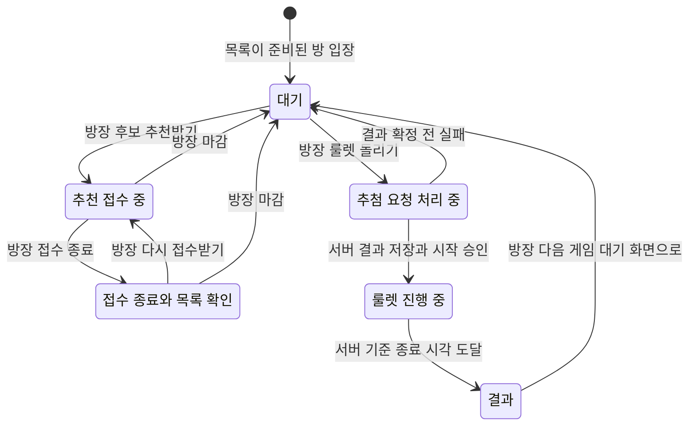

# 게임 화면 lifecycle과 로직 점검

기준 이슈: [#46](https://github.com/acee90/random-number-generator/issues/46). 상위 로드맵: [#7](https://github.com/acee90/random-number-generator/issues/7). 후보 모델·편집은 [#4](https://github.com/acee90/random-number-generator/issues/4), 확률 투표는 [#5](https://github.com/acee90/random-number-generator/issues/5), 파일 교체는 [#9](https://github.com/acee90/random-number-generator/issues/9)에서 관리한다.

접수·대기·추첨·결과는 **같은 방 URL 안에서 바뀌는 주화면**이다. 화면을 바꿀 때마다 방·참가자·채팅·연결을 새로 만들지 않는다. 방장은 필요할 때만 추천을 받고, 마감하면 바로 대기로 돌아와 명시적으로 추첨한다.

2026-11-15 기준으로 사용자와 합의한 UI 흐름, 구현 전 권장 계약, 미결정 정책을 구분한다. 실제 서비스 코드 `4075386`과 당시 시안을 감사해 **시안 문제 4건을 재현했다.** 이후 사용자가 추가한 **OFF 추첨 시 제외 목록 교체·초기화 전 확인·룰렛 옆 제외 목록**은 아래 최신 동작 기준으로 반영한다. 기존 감사 자료를 새 정책의 검증 완료나 문제 해결 기록으로 보지 않는다. 실제 서버 연결·다중 사용자 부하·모바일 검증이나 운영 반영을 완료한 상태는 아니다. 진행 상태는 GitHub 이슈가 기준이다.

## 1. 합의한 흐름과 아직 결정할 부분

| 구분 | 내용 |
| --- | --- |
| 합의한 UI | 대기에서 ‘후보 추천받기’ 버튼으로 접수 진입. 접수 중 ‘접수 종료 / 마감’, 접수 종료 후 ‘다시 접수받기 / 마감’ |
| 합의한 마감 | 접수 중이든 접수 종료 후든 즉시 대기 화면으로 이동. 자동 추첨이나 추가 투표 화면 없음 |
| 합의한 반복 | 대기 → 명시 추첨 → 결과 → ‘다음 게임 대기 화면으로’ → 대기. 결과에서 직접 재추첨하지 않음 |
| 합의한 화면 | 접수·목록 확인은 목록 중심, 대기·추첨은 큰 룰렛 중심, 결과는 당첨 결과 중심. 대기에는 이번 후보 이름 요약 표시 |
| 합의한 관리 | ‘후보·옵션 보기’ 단일 다이얼로그. 조회는 모두, 전체 편집은 방장. 게임 사이 중복 제외 옵션 변경 가능 |
| 합의한 제외 규칙 | ON 추첨 성공은 당첨 후보 누적, OFF 추첨 성공은 기존 제외 목록을 이번 당첨 후보 1개로 교체. OFF 토글만으로 초기화하지 않음 |
| 합의한 초기화 확인 | 기존 제외 목록이 있는 OFF 추첨 시작과 수동 ‘제외 목록 초기화’는 확인 후 실행. 취소는 상태 유지 |
| 검토 중 | 접수 종료 화면 안의 확률 up/down, 표 예산·이월·재투표, Ready 도입·대상·무효화, 후보 승인/수정 범위 |
| 구현 전 권장 계약 | 서버 권한·버전 검증, 접수/마감 원자 처리, 요청 중복 제거, 추첨 조건 사본·당첨 내역 영속화 |

이전의 접수 ON/OFF 스위치, 별도 ‘함께 준비 열기’, 마감 후 자동 투표 단계, 결과의 즉시 재추첨 제안은 사용하지 않는다. 중복 제외 옵션 자체의 ON/OFF는 유지한다.

## 2. 전체 상태 흐름

어느 단계에서든 만료·종료는 모든 새 작업을 차단한다. 초기 입장 실패는 방 입장 화면에서 처리한다. 네트워크 재연결은 위 업무 단계를 다른 단계로 바꾸는 사건이 아니라 **현재 단계 위의 연결 상태**다.

기존 제외 목록이 있는 상태에서 OFF로 시작할 때는 ‘제외 목록을 초기화하고 돌릴까요?’ 확인을 먼저 받는다. 이 확인은 개인 다이얼로그이며 새 공유 게임 단계가 아니다. 취소하면 대기·후보·제외 목록을 유지하고, 확인하면 기존 시작 검증을 다시 거쳐 요청 처리로 진입한다.

| 개념 | 저장·표현 방식 | 예 |
| --- | --- | --- |
| 공유 게임 단계 | 서버가 결정하는 단일 `phase` | 대기, 접수, 목록 확인, 추첨, 결과 |
| 연결 상태 | 각 클라이언트의 상태 | 연결 중, 연결됨, 재연결, 종료 |
| 요청 처리 상태 | 현재 화면에서 작업 잠금·진행 표시 | 마감 중, 후보 적용 중, 시작 요청 중, 대기 복귀 중 |
| 개인 UI | 방 단계와 분리 | 다이얼로그 열림, 편집 초안, 미전송 추천·채팅, 스크롤·포커스 |

`후보 추가 가능`은 별도 영구 옵션으로 저장하기보다 **접수 단계인지에서 파생**하는 것을 권장한다. `phase=접수 중`인데 등록 불가 같은 모순을 줄인다. 시안의 `locked / collect / review / drawing / result` 명칭은 서버 프로토콜로 확정한 이름이 아니다.

## 3. 화면별 기능과 가능한 작업

### 3.1 대기 화면

큰 룰렛, 이번 추첨 후보 이름·수, 중복 제외 상태와 제외 목록을 보여준다. PC에서는 제외 목록을 룰렛 옆에 두고, 좁은 화면에서는 아래로 내려 룰렛 크기를 유지한다. 후보 전체의 등록자·제외 사유·확률과 옵션은 ‘후보·옵션 보기’에서 확인한다.

| 방장 | 참가자 |
| --- | --- |
| 룰렛 돌리기, 후보 추천받기, 후보·옵션 조회/개인 편집, 중복 제외 변경·제외 목록 초기화 | 같은 후보·룰렛·옵션·제외 목록 조회, 방장 시작 대기. Ready를 채택하면 내 준비/취소 |

- ‘후보 추천받기’는 접수 화면으로 이동할 뿐 후보를 비우지 않는다.
- ‘룰렛 돌리기’는 현재 유효 후보와 확정 조건으로 시작한다. 중복 요청을 잠그고 서버 승인을 기다린다.
- 기존 제외 목록이 있고 중복 제외가 OFF면 먼저 초기화 확인을 받는다. ‘초기화하고 돌리기’만 추첨을 시작하고 ‘취소’는 아무것도 바꾸지 않는다. 제외 목록이 비어 있으면 불필요한 확인은 생략한다.
- ON은 ‘제외된 후보 N개’, OFF는 ‘중복 제외 꺼짐 · 저장된 후보 N개’로 표시한다. OFF의 목록은 현재 추첨을 막지 않으며 다시 ON일 때 적용될 내역이다. 수동 제외는 별도 목록으로 구분한다.
- 후보 0개: 추첨을 막고 제외 목록 초기화·중복 제외 해제·추천받기·목록 변경 경로를 제공한다. 수동 제외 때문에 0개인 경우 자동 제외 옵션을 꺼도 수동 제외를 우회하지 않는다.
- 후보 1개: ‘마지막 후보 확정’을 사용한다. 100% 선택의 서버 기록 방식을 일반 난수 추첨과 함께 확정해야 한다.
- Ready는 대기 화면 진입을 막지 않는다. 채택 시 **확인한 조건 버전**에 대해 실제 시작만 제어한다.
- 같은 목록으로 반복할 때 접수·목록 확인·마감을 매번 다시 요구하지 않는다.

### 3.2 후보 추천 접수 화면

후보 목록·등록자·내 후보·현재 포함 수와 추천 입력을 보여준다. 룰렛을 작게 함께 배치하지 않는다.

| 방장 | 참가자 |
| --- | --- |
| 전체 후보 추가·정리, 후보·옵션 편집, **접수 종료 / 마감** | 후보 추천·추가, 접수 중 자기 후보 삭제. 다른 사람의 후보·전체 옵션 변경 불가 |

- ‘접수 종료’: 참가자 등록·자기 후보 변경을 닫고 **같은 목록 화면에 머문다.**
- ‘마감’: 접수 종료를 먼저 누르지 않아도 **현재 목록을 확정하고 즉시 대기로 이동**한다.
- 실제 포함 후보가 0개면 마감만 차단한다. 접수 종료와 복구 경로는 남긴다.
- 입력 중인 추천은 개인 초안이다. ‘추천하기’의 승인 전에는 입력을 비우거나 공유 후보로 확정하지 않는다.
- 후보 이름이 같다는 이유만으로 자동 병합하지 않는다. 참가자 이름이 바뀌어도 소유자는 참가자 ID로 판단한다.
- 입력 길이·후보 수·중복 전송 한도는 서버에서도 검증해야 한다. 시안의 20개 한도는 서비스 계약이 아니다.

### 3.3 접수 종료와 목록 확인 화면

접수 중의 목록을 유지하고 ‘접수 종료·목록 확인 중’을 표시한다. 참가자에게 입력이 사라진 이유와 방장 확인 중임을 알려준다.

| 방장 | 참가자 |
| --- | --- |
| 최종 후보 정리, **다시 접수받기 / 마감**, 후보·옵션 편집 | 목록 조회, 방장 마감 대기. 검토안에서는 확률 투표 사용 시 up/down 가능 |

- ‘다시 접수받기’: 기존 후보·당첨 내역·수동 제외·개인 미전송 입력을 유지하며 접수를 재개한다.
- ‘마감’: 당시 후보·표·확률을 고정하고 즉시 대기로 이동한다. 별도 투표 화면을 자동으로 열지 않는다.
- 참가자는 자기 후보도 추가·수정·삭제하지 못한다. 확률 투표를 허용하는 것과 후보 편집 권한은 구분한다.
- 확률 투표는 이 화면 안에 배치한 **시안 제안**이다. 방장 후보 수정과 동시에 들어온 표의 버전·초기화 단위는 미확정이다.
- 참가자가 입력하던 추천은 보관한다. 다시 접수가 열리더라도 자동 등록하지 않고 사용자가 제출하게 한다.

### 3.4 추첨 요청 처리와 룰렛 진행 화면

시작 요청 직후에는 대기 화면의 시작 버튼을 잠그고 ‘추첨 준비 중’을 표시한다. 이는 새 입력 페이지가 아니다. 서버가 결과·조건·시각을 저장한 후 모든 사용자가 같은 룰렛을 진행한다.

| 방장 | 참가자 |
| --- | --- |
| 진행 확인·후보/옵션 읽기·기존 채팅 | 같은 진행 확인·읽기·기존 채팅 |

- 후보 등록·편집·접수 전환·표·중복 제외·복원·재시작은 잠근다. 방장도 우회할 수 없다.
- 채팅·핑·접속 정보 갱신은 난수 취득을 기다리는 동안에도 응답해야 한다.
- 결과가 저장되기 전 실패하면 대기로 돌아가고 후보·당첨 내역·기록을 소비하지 않는다.
- 결과가 이미 저장된 뒤 ACK가 유실되면 새 결과를 뽑지 않는다. 같은 요청 ID와 최신 스냅샷으로 기존 회차를 복원한다.
- 연출 종료는 로컬 타이머 한 번으로 판단하지 않는다. 서버 `startedAt + durationMs`와 시각 보정으로 새로고침·백그라운드·늦은 입장도 정렬한다.
- 회차를 시작할 때 중복 제외 옵션과 이전 제외 목록을 사본으로 고정한다. 성공 선택 확정 시 ON은 누적하고 OFF는 이번 당첨 후보 1개로 교체한다. 결과 화면에서 다음 게임 옵션을 바꿔도 이 회차의 처리 방식은 바뀌지 않는다.
- 공개 목록으로 당첨자가 미리 노출되지 않게 한다. ON 연출 중에는 회차 시작 전 제외 목록을, OFF 연출 중에는 ‘이전 제외 목록 초기화됨 · 새 내역은 결과 후 표시’라는 빈 목록을 보여준다. 새 당첨 후보는 결과 공개 전에는 목록에 표시하지 않는다.

### 3.5 결과 화면

당첨 후보·당시 확률·결과 피드백과 ‘다음 게임 대기 화면으로’를 보여준다. 지난 결과는 이후 편집과 무관한 사본이다.

| 방장 | 참가자 |
| --- | --- |
| 결과 확인, **다음 게임 대기 화면으로**, 다음 게임 옵션·후보 준비의 개인 편집, 중복 제외 변경 | 결과 확인, 자격이 있으면 만족도 피드백, 방장 대기 전환 기다리기 |

- 대기 복귀 버튼은 추첨을 시작하지 않는다. 복귀 후 룰렛과 다음 후보를 확인하고 별도로 시작한다.
- 자동으로 결과를 닫지 않는다. 결과 만족도는 추첨 전 확률 투표와 별도이며 확률을 바꾸지 않는다.
- 현재 서비스의 결과 피드백은 추첨 시작 명단의 일반 참가자만 한 번 제출하고 변경할 수 없다. 새 확률 투표에도 같은 규칙이 적용된다고 가정하지 않는다.
- 대기 복귀 시 결과 피드백을 종료하고 현재 결과를 기록으로 보관하는 계약을 권장한다. 마지막 표와 복귀의 처리 순서는 서버가 결정한다.
- **현재 결과의 당시 조건 / 다음 게임 옵션**을 구분해 표시한다. 다음 게임 옵션을 바꿔도 당첨자·당시 확률은 바뀌지 않는다.
- 성공 회차의 제외 목록 처리는 이미 확정됐으므로 대기 복귀 시 다시 누적하거나 초기화하지 않는다. ON/OFF의 기준은 현재 스위치가 아니라 그 회차에 저장한 옵션이다.
- 수동 ‘제외 목록 초기화’는 확인 후 내역만 비우며 현재 결과 화면과 기록을 유지한다. 추첨을 시작하지 않고, 이후 대기 복귀도 이미 처리한 당첨 후보를 재삽입하지 않는다.
- 결과를 명시적으로 닫기 전에는 빠른 옵션과 다이얼로그 적용 모두 결과 화면을 유지하는 방향을 권장한다. 현재 시안에는 경로별 불일치가 있다.

### 3.6 모든 화면의 공통 기능과 개인 다이얼로그

방 정보·초대 링크·연결 상태·참가자·채팅·지난 기록은 업무 단계와 별개로 유지한다. 접수나 추첨 때 소켓을 끊거나 다른 방 URL로 이동하지 않는다. 브라우저 뒤로 가기로 공유 게임 단계를 되돌리지 않는다.

‘후보·옵션 보기’는 모두에게 같은 진입점이다. 개인 다이얼로그 열기·닫기·초안·취소는 다른 사람의 화면이나 공유 상태를 바꾸지 않는다. 단계 전환 버튼은 메인에만 둔다.

방장 초안은 **열었을 때의 기준 후보 버전**을 보관한다. 적용 전 공유 버전·권한·현재 단계가 달라졌으면 덮어쓰지 않고 초안을 유지해 차이를 확인하게 한다. 추첨이 시작되면 적용을 잠그고 이유를 표시한다. 이름만 바꾸는 요청은 후보 목록을 함께 재전송해 덮어쓰지 않는다.

초기화 확인은 옵션 편집과 구분한다. OFF 추첨 확인은 기존 제외 목록을 교체하고 추첨하는 행동이며, 수동 ‘제외 목록 초기화’ 확인은 목록만 비우는 행동이다. 두 확인 모두 취소할 수 있다. 시안은 확인할 때의 조건 signature를 보관하고, 확인 대기 중 조건이 바뀌어 signature가 일치하지 않으면 실행을 취소하고 다시 확인하도록 안내한다. 이전 확인 내용으로 추첨이나 초기화를 자동 실행하지 않는다. 실제 서비스에서는 권한·현재 단계·버전도 서버가 다시 검증해야 한다.

### 3.7 방장과 참가자 동시 비교 미리보기

로컬 `preview.html`은 **방장 화면과 참가자 화면을 동시에 표시**한다. 화면 하나씩 전환하는 캐러셀 대신 같은 모의 방의 접수·마감·후보·옵션·룰렛·결과가 두 역할에 어떻게 반영되는지 비교한다. 이 배치는 검토 화면이며 실제 서비스에서 두 역할을 한 사용자에게 함께 제공하는 UI가 아니다.

| 미리보기 폭 | 배치 |
| --- | --- |
| 760px 초과 | `.rw-role-comparison` 안에 방장/참가자 패널을 좌우 두 열로 표시 |
| 760px 이하 | 두 역할 패널을 상하로 표시 |
| 각 역할 패널의 내부 컨테이너가 560px 이하 | 그 역할의 룰렛과 제외 목록을 상하로 재배치. 전체 창 폭만으로 판단하지 않음 |

각 역할의 개인 다이얼로그와 확인창은 **해당 역할 패널만 가리는 미리보기용 overlay**와 `show()` 방식으로 연다. 방장 편집창을 유지한 채 참가자 패널에서 추천하거나, 초기화 확인창을 유지한 채 다른 역할의 작업으로 조건이 바뀌는 상황을 살펴볼 수 있다. 두 역할의 개인 열림 상태·초안은 분리하고 공유 단계·데이터만 모의로 동기화한다.

이 방식은 두 역할을 비교하기 위한 로컬 구성이다. 실제 서비스의 modal·배경 비활성화·포커스 트랩을 대체하지 않으며 브라우저 네이티브 동작이나 실제 모바일 QA를 완료한 것으로 보지 않는다. 같은 페이지의 두 패널 비교도 실제 두 기기·다중 WebSocket 연결 검증과 구분한다.

## 4. 명령과 전환 조건

아래는 구현 전 권장 서버 계약이다. 화면의 버튼 숨김만으로 권한·잠금을 대신하지 않는다.

| 명령 | 허용 상태와 주체 | 서버 확정 후 변화 | 실패·충돌 시 |
| --- | --- | --- | --- |
| 추천받기 | 대기·방장 | 접수 시작, 새 접수 식별자 발급, 후보 유지 | 대기 유지·원인 안내 |
| 추천 제출/자기 후보 삭제 | 접수 중·참가자 또는 방장. 소유권 검증 | 후보 버전 갱신, 관련 표/준비 영향 적용 | 후보 불변·입력 보존 |
| 접수 종료 | 접수 중·방장 | 목록 확인 상태, 참가자 후보 변경 잠금 | 접수 상태 유지 |
| 다시 접수받기 | 목록 확인·방장 | 접수 재개, 새 접수 식별자. 기존 후보/초안 유지 | 목록 확인 유지 |
| 마감 | 접수·목록 확인·방장, 유효 후보 ≥1 | 접수 잠금·후보/표/확률 사본 고정·대기, 한 번에 반영 | 마감 전 상태 유지·최신 후보 확인 |
| 확률 투표 | 목록 확인·허용된 참가자, 기능 사용 | 유효 표와 예상 확률 갱신 | 내 표 복구·마감/변경 이유 안내 |
| 개인 편집 적용 | 방장·허용 단계·기준 버전 일치 | 수정 필드만 반영, 필요한 조건 버전 갱신 | 초안 유지·자동 덮어쓰기 없음 |
| 중복 제외 옵션 변경 | 방장·게임 사이, 추첨 요청 중 아님 | 다음 유효 후보·확률 갱신. 토글 자체로 제외 목록을 비우지 않음 | 기존 설정 유지 |
| 수동 제외 목록 초기화 | 방장·게임 사이·확인 승인, 추첨 요청 중 아님 | 제외 목록만 비움. 수동 제외·후보 원본·기록·현재 화면 유지, 추첨 시작 없음 | 취소/실패는 내역 유지 |
| 준비/준비 취소 | 대기·Ready 채택 시 대상자 | 현재 확정 조건 버전에 대한 확인 | 대상/버전 변경 안내 |
| 룰렛 시작 | 대기·방장, 후보·조건 유효, 필요한 준비 충족. OFF이며 기존 제외 목록이 있으면 초기화 확인 승인 | 요청 잠금 → 회차 옵션 고정 → 결과와 제외 목록의 원자 확정 → 진행 시각 방송 | 취소/확정 전 실패는 기존 내역의 대기, 확정 후는 같은 회차 복원 |
| 결과 피드백 | 현재 결과·자격 있는 일반 참가자 | 해당 회차 피드백 추가 | 이미 종료/이미 제출이면 상태 재동기화 |
| 다음 게임 대기로 | 현재 결과·방장·해당 회차 ID | 결과 피드백 종료·기록 보관·대기 후보 갱신, 자동 시작 없음 | 현재 결과 유지·중복 보관 없음 |
| 만료/종료 | 서버 | 새 공유 작업 차단, 종료 안내 | 이전 화면으로 쓰기 권한 복원 금지 |

추천 삭제 후에도 마감은 남은 **실제 포함 후보 수**로 판단한다. 저장 목록·템플릿의 원본 수와 다를 수 있다.

### 접수 종료와 동시에 요청이 들어오는 경우

1. 서버가 먼저 수락한 순서대로 후보·접수 상태를 처리한다. 종료/마감 뒤 요청은 거절하고 참가자의 입력을 보존한다.
2. 새 접수 식별자로 이전 접수의 늦은 요청을 구분한다. 재개방됐다는 이유만으로 오래된 추천을 자동 수락하지 않는다.
3. 마감은 방장이 확인한 후보 버전을 요구한다. 새 후보가 먼저 수락돼 버전이 달라지면 마감 충돌을 알리고 재확인한다.
4. 마감 전에 수락한 유효 표는 확정 사본에 포함하고 이후 표는 거절한다. 후보 버전과 표 상태를 같은 원자 작업으로 확정한다.
5. 재시도는 같은 요청 ID를 사용한다. 접수 종료·마감·시작·대기 복귀를 중복 수행하거나 회차를 두 번 만들지 않는다.

후보 버전과 모든 실시간 이벤트의 순서를 구분해야 한다. 참가자 표가 바뀔 때마다 관련 없는 개인 제목 편집까지 무조건 실패시키는 과도한 전역 버전 검증도 피한다.

## 5. 데이터와 반드시 유지할 조건

| 데이터 | 역할과 보존 조건 |
| --- | --- |
| 후보 원본 | 안정된 후보 ID·표시 이름·등록자 ID·수동 포함 여부. 이름 수정·정렬로 ID나 소유자가 바뀌지 않음 |
| 제외 기준 내역 | ON 성공은 이전 집합에 당첨 후보 추가, OFF 성공은 이번 당첨 후보 1개로 교체. 옵션 토글·화면 기록 절단·재접속만으로 변경하지 않음 |
| 준비 조건 | 유효 후보·규칙·확률·표의 확정 버전. Ready가 있으면 이 버전에 결합 |
| 회차 사본 | draw ID, 후보 ID/이름/순서, 당첨 위치, 표·가중치·실제 확률, 적용 규칙, 난수 출처, 시각·대상 명단 |
| 제외 처리 문맥 | 시안은 `drawContext { id, autoExclude, ledgerBefore, committed }`로 시작 옵션·이전 목록·처리 여부를 분리. 서버는 같은 draw ID의 결과·제외 처리를 한 번만 영속화 |
| 결과 피드백 | 회차 ID와 참가자 ID에 결합. 확률 투표와 별도. 종료 후 변경 불가 |
| 개인 초안 | 공유 데이터와 분리. 취소·충돌·재연결·접수 종료 때 자동 제출/삭제하지 않음 |

필수 불변식:

1. 한 방의 공유 단계는 하나이며 접수 가능 여부는 그 단계에서 일관되게 도출된다.
2. 참가자가 방장 명령을 보내거나 남의 후보를 수정할 수 없다. 참가자 이름 문자열은 인증·소유권의 기준이 아니다.
3. 마감은 접수 종료·조건 고정·대기 전환을 한 번에 수행하고 추첨까지 이어서 실행하지 않는다.
4. 시작이 승인된 회차의 후보·확률·당첨 결과는 이후 편집·재시도·연출·재접속으로 바뀌지 않는다.
5. 성공 결과와 제외 기준 내역은 UI 이동에 의존하지 않고 함께 확정한다. 대기 복귀·결과 재수신·요청 재시도는 같은 회차를 다시 누적하거나 초기화하지 않는다.
6. OFF 토글만으로 내역을 지우지 않는다. OFF로 성공한 회차는 이전 제외 목록을 이번 당첨 후보 1개로 교체한다. ON으로 성공한 회차는 그 시점 내역에 당첨 후보를 누적한다.
7. 확인 취소·결과 확정 전 실패는 제외 목록을 바꾸지 않는다. 수동 초기화는 확인 뒤 내역만 비우고 수동 제외·후보 원본·과거 결과를 유지한다. 이후 대기 복귀는 이미 처리한 당첨 후보를 재삽입하지 않는다.
8. 보이는 과거 결과 20개 한도와 제외 기준 내역은 별개다. 화면 기록 절단만으로 내역을 바꾸지 않으며, OFF 추첨/수동 초기화로 제외 기준을 바꿔도 과거 결과를 지우지 않는다.
9. 표시 확률·룰렛 영역·서버 선택은 같은 확정 조건을 사용한다. 무표·동률·모두 down도 정의된 유효 분포를 만든다.
10. 같은 방 재설정으로 참가자·채팅·초대 링크·기존 24시간 만료 시각·개인 저장 원본을 임의로 바꾸지 않는다.

확률 투표의 현재 시안 수식 `max(1, 2 + up - down)`과 원표 유지 방식은 설명용이다. 서비스 수식·분포 검증·표 이월 정책을 승인한 것으로 보지 않는다.

### 중복 제외 목록의 최신 규칙과 확인

제외 기준 내역은 모든 과거 당첨자의 전체 기록이 아니다. **마지막 수동 초기화 또는 마지막 OFF 추첨에서 시작해, 이후 ON 추첨의 당첨 후보를 누적한 목록**이다. OFF로 추첨할 때마다 이번 당첨 후보 하나를 새 기준으로 삼는다.

| 행동 | 제외 목록 변화 | 추첨·화면 변화 |
| --- | --- | --- |
| ON/OFF 옵션만 변경 | 유지 | 현재 결과 유지, 다음 추첨의 포함 여부만 변경 |
| ON 추첨 성공 | 기존 목록에 이번 당첨 후보를 중복 없이 추가 | 같은 회차 결과와 함께 한 번 확정 |
| 기존 목록이 있는 OFF 시작 요청 | 확인 전 유지 | ‘제외 목록을 초기화하고 돌릴까요?’ → 취소 / 초기화하고 돌리기 |
| 위 확인 취소 | 유지 | 대기 유지, 추첨 없음 |
| OFF 추첨 성공 | 이전 목록을 지우고 이번 당첨 후보 1개로 교체 | 결과 공개 전 새 당첨 이름을 목록에 노출하지 않음 |
| 제외 목록이 없는 OFF 시작 | 성공 시 이번 당첨 후보 1개 | 불필요한 초기화 확인은 생략 |
| 초기화 승인 후 결과 확정 전 실패 | 이전 목록 유지 | 대기로 복귀, 재시도 가능 |
| 수동 ‘제외 목록 초기화’ | 별도 확인 승인 후 빈 목록 | 추첨하지 않음. 현재 결과·수동 제외·후보 원본·과거 기록 유지 |

예: ON으로 1·2·3이 뽑힌 뒤 OFF 토글만 하면 목록은 `[1, 2, 3]` 그대로다. OFF로 4가 뽑히는 성공 회차가 확정되면 `[4]`로 교체된다. 다시 ON이면 4만 제외한다. 이어서 ON으로 5가 뽑히면 `[4, 5]`, OFF로 6이 뽑히면 `[6]`이 된다.

회차는 시작 시의 옵션을 사용한다. OFF 회차 결과가 나온 뒤 ON으로 바꾸더라도 그 회차를 누적 방식으로 다시 처리하지 않는다. `committed` 상태인 draw ID에는 초기화를 재적용하지 않으며, `archive()`는 회차 보관만 담당한다. 수동 초기화 뒤 대기로 돌아가도 이미 처리한 당첨 후보를 다시 넣지 않는다.

룰렛 옆의 공개 목록은 영속화 시점과 결과 공개 시점을 구분한다. ON 연출 중에는 이전 제외 사본, OFF 연출 중에는 초기화된 빈 목록을 보여준다. 결과가 공개되면 확정된 새 내역을 표시한다. OFF에서는 ‘저장된 후보’임을 밝혀 지금도 추첨에서 빠지는 것으로 오해하지 않게 한다. 빈 목록은 명시적인 빈 상태를 표시하고 수동 제외는 별도 그룹으로 둔다. 같은 목록을 두 역할에 보여주되 초기화 행동은 방장만 사용할 수 있다.

## 6. 오류와 복구 화면

| 상황 | 사용자에게 보이는 상태 | 데이터·권한 처리 |
| --- | --- | --- |
| 초기 입장/닉네임 확인 | 입장 중 또는 거절 이유·수정/재시도 | 입장 승인 전 공유 명령 금지 |
| 마감·적용·시작·대기 복귀 ACK 지연 | 해당 화면 유지·중복 제출 잠금·확인 중 | 무작정 새 요청 ID로 재실행하지 않고 처리 결과 조회 |
| 연결 끊김 | 현재 단계와 재연결 안내 | 공유 명령 잠금, 개인 추천/편집/채팅 초안 보존 |
| 재접속 성공 | 최신 서버 상태로 복원 | 과거 요청을 맹목 재전송하지 않음. 현재 회차/요청 결과 확인 |
| OFF 초기화 확인 취소 | 기존 대기 화면 | 옵션·후보·제외 목록·기록 유지, 추첨 없음 |
| 추첨 확정 전 실패 | 대기 화면과 재시도 안내 | OFF 초기화를 승인했어도 이전 제외 목록·후보·기록 유지 |
| 추첨 확정 후 화면/ACK 유실 | 같은 회차 진행 또는 결과 복원 | 새 난수·새 회차를 만들지 않음 |
| 다이얼로그 편집 중 원격 추천·마감·시작 | 개인 초안 유지, 충돌/적용 잠금 안내 | 공유 데이터 덮어쓰기 없음. 강제 모달/포커스 이동 없음 |
| 후보 소진 | 룰렛 시작 잠금, 복원/옵션 변경/추천받기 | 후보 0개를 임의의 당첨으로 처리하지 않음 |
| 방장 부재 | 현재 단계·방장 재접속 대기 | 자동 방장 승계를 추가하지 않음. 확정된 추첨은 서버 시각대로 완료 |
| 방 만료/종료 | 종료 안내·새 방 경로 | 만료 우선. 캐시된 화면으로 수정 권한 복원 금지 |

장시간 방장 부재, 새 참가자의 현재 준비/투표 자격, 만료와 진행 완료가 겹친 경우의 표시·보관 정책은 구현 전에 정한다.

## 7. 실제 재현한 시안의 허점

다음은 **새 제외 정책 반영 전 로컬 시안의 역사적 재현 결과**다. 이 기능이 아직 연결되지 않은 운영 서비스의 신규 버그로 기록하지 않는다. 감사 JSON은 작성 당시 절차·값을 보존하며 새 정책의 회귀 검증 자료로 덮어쓰지 않는다. F1·F2와 Ready 관련 F3, 옵션 경로별 암묵 전환 F4는 각각 미해결 항목으로 관리하고, 제외 규칙을 바꿨다는 이유만으로 해결 완료로 처리하지 않는다.

수동 제외 목록 초기화가 현재 결과를 유지하도록 맞춘 것은 이번 범위의 별도 경로 정합성 보완이다. F4의 일반 옵션 다이얼로그 적용이 암묵적으로 대기로 이동하는 문제까지 해결한 것으로 간주하지 않는다.

| ID | 우선순위 | 재현 결과 | 필요한 보완·담당 이슈 |
| --- | --- | --- | --- |
| F1 · LC-AUDIT-01 | P1·데이터 소실 | 방장 편집창 열린 사이 참가자가 ‘우동’을 추가. 방장이 제목만 수정해 적용하면 후보가 5→4로 줄고 우동이 사라짐 | 기준 버전 충돌 검사·필드별 변경 적용·초안 보존. #4·#46 |
| F2 · LC-AUDIT-03 | P1·후보 정체성 | 1번 당첨 후 유효 후보 9개. 이름을 ‘1번 수정’으로 바꾸면 새 ID로 취급해 당첨 제외가 풀리며 10개로 복귀 | 이름 대신 안정된 ID로 편집·소유권/제외 보존. #4 |
| F3 · LC-AUDIT-02 | P1·Ready 채택 시 | 이미 준비 완료인 대기에서 중복 제외를 켜 유효 후보가 4→3으로 바뀌어도 시작 가능·준비 완료가 유지 | Ready를 확정 조건 버전에 결합. 자동 제외/복원의 재확인 예외 결정. #46 |
| F4 · LC-AUDIT-04 | P1·전환 불일치 | 결과에서 중복 제외 빠른 토글은 결과 유지. 같은 변경을 다이얼로그로 적용하면 결과 보관 후 대기로 자동 이동 | 같은 명령·결과 유지 규칙으로 통일, 명시 대기 복귀 경계 확정. #46 |

재현 근거는 [감사 결과 JSON](../../output/roulette-session-ux/lifecycle-audit.json)에 보관한다. 코드 근거: [시안](../../output/roulette-session-ux/roulette-session-wireframe.html)의 `resetDraft`, `apply-draft`, 이름 기반 후보 매칭, `restore`, 빠른 옵션 변경 처리.

당시 시안의 `archive()`는 표·결과 피드백·규칙·난수 출처를 포함한 완전한 사본이 아니며 기록이 무제한 누적됐다. 최신 제외 규칙에서는 회차 확정의 제외 처리를 보관과 분리해야 한다. 로컬 타이머·이름 기반 ID·DOM 전체 교체·모의 공유 상태를 서버 계약으로 가져오면 안 된다.

## 8. 실제 서비스 연결 전 막아야 할 빈틈

현재 서비스의 `waiting`은 준비된 대기와 결과 피드백 중인 상태를 함께 표현한다. `beginDraw`는 기존 결과를 보관하고 다음 추첨을 시작할 수 있으므로, **결과 → 명시 대기 복귀 → 시작**을 UI 변경만으로 보장할 수 없다.

| 선행 항목 | 현재 근거 | 완료 기준 |
| --- | --- | --- |
| 단계·서버 권한 | `RoomSnapshot.status`에 접수/목록 확인/결과의 독립 구분 없음 | 우회 메시지에도 동일 권한·전환 조건 검증. 결과 상태 직접 시작 거절 |
| 원자적 마감·충돌 | 실제 서버는 명령 직렬 처리를 갖지만 새 접수/개인 편집 프로토콜은 없음 | 접수 종료/추천/표 경쟁·중복 마감·지연 ACK·재개방의 오래된 요청 검증 |
| 안정된 후보 모델 | 실제 메시지는 고정 샘플 후보 ID 선택 기반 | 임의 후보·소유자·수정·제외·회차 사본을 같은 ID로 처리 |
| 후보 1개 | 현재 후보 파서는 최소 2개 | 1개 최종 확정과 0개 차단의 서버/복원/기록 검증 |
| 기록·제외 기준 내역 | 실제 기록은 20개 제한, 새 제외 내역/회차 옵션 사본 모델 없음 | ON 누적·OFF 성공 시 교체·초기화 확인/취소·실패 복구·중복 확정·대기 복귀·기록 절단 검증 |
| 확률 투표 | 현재 실제 up/down은 결과 피드백, 선택 확률은 균등 | 새 투표/가중치 모델·최종 분포·표 자격을 별도로 검증 |

참조: [서버 명령 처리](../../src/rooms/LunchRoomServer.ts), [현재 방 모델과 한도](../../src/lib/lunchRoom.ts), [클라이언트 pending·재연결](../../src/hooks/useLunchRoom.ts). 기존 시작 요청 중복 제거·`pendingStartId`·직렬 처리·확정 시각은 재사용할 기반이다.

## 9. 최적화 점검

### 흐름과 화면

- 접수는 필요할 때만 열고, 접수 중 바로 마감도 허용해 불필요한 필수 단계를 줄였다.
- 결과 뒤 대기는 사용자가 요청한 명시적 경계다. 클릭 수를 줄이려고 결과에서 바로 재추첨하도록 되돌리지 않는다.
- 상태별 주화면과 하나의 후보·옵션 진입점으로 중복 탭/편집 패널을 줄인다.
- 개인 조회/초안은 서버 방송 대상이 아니다. 단계 전환과 공유 후보 변경만 다른 참가자에게 반영한다.
- 제외 목록은 PC에서 룰렛 옆, 좁은 화면에서 아래에 표시한다. ON의 실제 제외와 OFF의 저장 내역을 구분하고, 새 당첨 후보가 연출 중 미리 공개되지 않게 한다.
- 긴 후보 목록에서도 접수 종료·재개·마감 위치를 일관되게 유지한다. 모바일 키보드·IME 조합 중 원격 마감·44px 조작 영역·동작 줄이기·포커스 복귀를 확인해야 한다.
- 대기 후보 요약이 너무 길어 다시 룰렛을 밀어내지 않도록 실제 후보 상한에 맞춰 요약 범위·전체 다이얼로그를 검토한다. 새 수치를 임의로 확정하지 않는다.

### 렌더·연결·저장

| 확인한 구조 | 평가·보완 |
| --- | --- |
| 실제 `WheelFace` memo와 시각 필드 기반 룰렛 타임라인 | 보존할 기반. 채팅/개인 모달로 룰렛 geometry·애니메이션을 재생성하지 않음 |
| 실제 활동 전송 15초 제한·채팅 750ms 제한 | 기존 제한을 보존하고 새 추천/투표 입력의 서버 한도를 별도 설계 |
| 실제 난수 취득 중 mutation queue 해제 | 채팅·핑이 난수 응답에 막히지 않는 장점 유지 |
| 실제 채팅/투표 변경 시 전체 저장·전체 스냅샷 방송 | 고빈도 후보/확률 투표를 추가하기 전 저장 횟수·전송 바이트·직렬화·렌더를 계측 |
| 시안은 개인 모달/투표에도 양 역할 전체 `innerHTML` 재생성 | 서비스 구현에 사용하지 않음. 커서·IME·스크롤·포커스·룰렛 애니메이션 재시작 위험 |
| 반복 확률 계산·역할별 deep clone | 공유 데이터 한 벌과 개인 UI 분리, 후보/표/규칙 버전이 바뀔 때만 도출 값 계산 |

근거: [룰렛](../../src/components/features/LunchWheel.tsx), [타임라인](../../src/hooks/useRoomTimeline.ts), [클라이언트](../../src/hooks/useLunchRoom.ts), [저장·publish](../../src/rooms/LunchRoomServer.ts).

처음부터 변경 이벤트 프로토콜을 과도하게 늘리지 않는다. 공통 스냅샷 계산·불변 기록 재사용부터 계측하고, 필요하면 순서 번호를 가진 변경 메시지와 재동기화용 전체 스냅샷을 분리한다. 최적화로 요청 ACK·기록 저장·마감 순서의 정확성을 약화시키지 않는다.

**판정:** 화면 흐름의 반복 비용은 정리됐고 기존 서비스에 재사용할 최적화가 있다. 새 접수/확률 투표를 포함한 성능 최적화는 부하·모바일 측정 전이므로 완료로 판정하지 않는다.

## 10. 정책 결정과 검증 기준

| 결정 ID | 미결정 내용 | 권장 검토 방향·연결 |
| --- | --- | --- |
| D1 | 확률 투표 시점·표 예산·방장 투표·이월 | 목록 확인 중 선택 투표와 마감 즉시 대기를 양립. 반복 게임의 원표 유지/초기화를 명시. #5 |
| D2 | 목록 확인 중 방장 수정과 참가자 표 | 후보 버전 변경 시 관련 표 무효화·재투표 안내. 영향 없는 이름/제목 변경 범위 구분. #4·#5 |
| D3 | Ready 채택·대상·재확인 | 기본 필수 아님. 채택 시 조건 버전·연결 끊김·퇴장·자동 제외/복원의 예외를 정의. #46 |
| D4 | 추천 직접 반영/승인·본인 수정·한도 | 시안의 즉시 추가/본인 삭제와 서비스 권한 계약 구분. #4·#46 |
| D5 | 결과에서 미래 조건 변경·피드백 종료 | 현재 결과 유지, 명시 대기 복귀가 피드백 종료 경계인 안 검토. #46 |
| D6 | 1개 확정·만료와 추첨 완료 충돌 | 100% 확정 기록·난수 출처, 서버 만료 우선순위·보관 범위 결정. #46 |
| D7 | 새 참가자·재접속자의 자격 | 후보 추천, 확률 투표, Ready, 결과 피드백의 대상 기준을 각각 구분. #5·#46 |
| D8 | 최초 방 생성의 빈 목록 허용 | 현재 생성·후보 파서의 최소 2개와 새 0/1개 대기 규칙을 조정. 빈 방을 허용한다면 추천받기만 열고 시작/마감은 막음. #4·#46 |

서비스 연결의 필수 검증:

| 묶음 | 확인할 사례 |
| --- | --- |
| 정상 전환 | 대기→접수→직접 마감→대기, 접수→종료→재개→마감, 대기→추첨→결과→대기→별도 시작 |
| 권한·한도 | 각 단계의 방장/참가자 명령 허용·거절, 남의 후보 삭제, 미입장, 0/1/최대 후보 |
| 경쟁·중복 | 추천/삭제/표와 마감의 순서, 동시 방장 탭, 같은 요청 재전송, 과거 접수/회차 요청 |
| 초안 | 원격 추천 중 편집 적용, 제목만 변경, 후보 이름/순서 변경, 초안 취소·충돌·입력 보존 |
| 추첨·복구 | 느린/실패 난수, ACK 유실, 새로고침·백그라운드·재접속·서버 복원·방 만료 |
| 기록·제외 | ON 1·2·3→OFF 4→ON은 4만 제외, OFF 토글만 변경, 초기화 확인 취소·빈 목록 확인 생략·확정 전 실패, OFF 연속 당첨 교체, 수동 초기화와 결과/기록 보존, 중복 결과/대기 복귀, 기록 20개 초과, 후보 이름 수정, 결과 화면 미래 옵션 변경 |
| 제외 목록 표시 | ON 연출은 이전 사본·OFF 연출은 빈 목록, 결과 전 당첨자 비노출, 결과 후 새 내역, OFF 저장 내역/수동 제외/빈 상태 구분, PC 옆/모바일 아래 |
| 투표·Ready | 마감 경합, 무표/동률/모두 down, 이월, 새 참가자, 준비 후 옵션/복원/후보 변경 |
| 동시 역할 미리보기 | 좌우/상하 역할 패널, 각 패널 내부 560px 기준 룰렛/제외 목록 배치, 개인 overlay를 유지한 다른 역할 작업, 초기화 확인 중 조건 signature 변경과 재확인 안내 |
| 접근성 | 키보드만 사용, IME 조합·가상 키보드, 모달 열림 중 원격 전환, 320/390px·긴 이름·최대 후보. 미리보기용 overlay와 실제 서비스 modal 검증 구분 |

성능 검증은 실제 지원 한도 안에서 1/15/30명과 후보·기록이 적은 경우/최대인 경우를 비교한다. 추천·투표·채팅 동시 발생, 느린 ACK·재연결을 포함하고 명령별 전송 바이트·저장 횟수·서버 처리 시간·UI commit·입력 지연·연출 재시작 여부를 측정한다. 현재 구조의 기준값을 얻기 전 임의의 ‘최적화 완료’ 점수나 지연 목표를 만들지 않는다.

## 11. 자료와 후속 관리

- 최신 UI 시안: [roulette-session-wireframe.html](../../output/roulette-session-ux/roulette-session-wireframe.html), 로컬 검토 주소 `http://127.0.0.1:8766/preview.html`.
- 로컬 미리보기는 방장/참가자 두 패널을 동시에 표시한다. 상세 배치와 개인 다이얼로그 범위는 [동시 비교 미리보기](#37-방장과-참가자-동시-비교-미리보기)를 따른다.
- 시안 문제 재현: [lifecycle-audit.json](../../output/roulette-session-ux/lifecycle-audit.json).
- UI 검토 연결 안내: [roulette-session-ux.md](roulette-session-ux.md).
- 실제 현행 동작·운영 설명: [lunch-rooms.md](../lunch-rooms.md). 이 lifecycle 계획으로 운영 설명을 구현 완료 상태로 바꾸지 않는다.

후속 순서는 **F1/F2·서버 단계/충돌 계약 정리 → #4 실제 후보 연결 → 접수·마감·대기 복귀·제외/기록 검증 → #5 확률 투표 → 필요 시 Ready → 성능·모바일·운영 검증**이다. 각 항목의 범위·완료 기준·선행 작업은 #46·#4·#5에 연결해 관리하며 로컬 문서만의 개발 계획으로 남기지 않는다.
