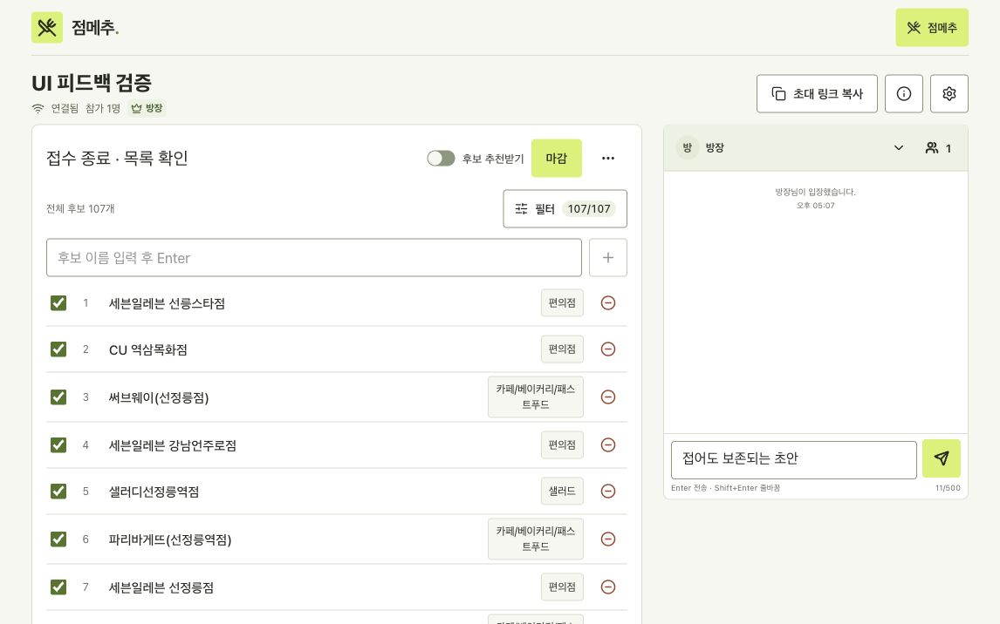

# UI 단순화 검증 기록 — 2026-11-17

진행 기준: [이슈 #73](https://github.com/acee90/random-number-generator/issues/73), [로드맵 #7](https://github.com/acee90/random-number-generator/issues/7). **로컬 구현·검증 완료, 운영 미배포.**

## 위치

- `origin/main f852b20`에서 만든 `afk/2026-11-17`. 최초 6개와 사용자 피드백 후속 작업을 포함해 총 18개 로컬 커밋.
- 작업 디렉터리: `/Users/junhee/Documents/projects/random-number-generator/.afk/worktree-2026-11-17`.
- 미리보기: http://127.0.0.1:3017 . Vite만 실행해 둡니다. 비교 서버3018·Storybook6017은 종료했습니다.
- 기존 checkout의 main과 미추적 작업은 그대로 보존했습니다. push·PR·merge·운영 배포는 하지 않았습니다.

## 사용자가 보는 변화

| 변경 | 근거와 결과 | 확인 동작 |
| --- | --- | --- |
| 공통 UI | 버튼 아래3/4px 프레임과 누를 때 이동 제거. 1px 경계·기존 컬러 토큰·4/8px 반경·44px 기본 조작으로 정리 | 버튼을 Tab으로 이동하고 기본/선택/disabled 비교 |
| 시작 화면 | 전면 라임 배경과 굵은 프레임 제거. 두 시작 행동을 같은 폭/가운데 정렬로 묶음. 홈72→44px, 생성64→44px | 홈→방 만들기 또는 혼자 추첨하기 |
| 후보 준비 | 새로 작성/불러오기112→64px, 아이콘36→20px. 목록 선택과 편집 경계도 간결화 | solo→불러오기→기본107개 선택 |
| 추첨 결과 | 제목28–48px, 큰 투표 버튼·108px 투표자 목록. 중복 제외 설정과 다음 게임을 하단 통합 | 실제 추첨→투표→다음 게임 |
| 번호 도구 | 게임 수86.8→44px, 번호 범위 입력65.5→47px. 기존 outline Button 사용, 선택 카드의 두꺼운 하단선 제거 | lotto/pension 게임 수 선택 및 번호 생성 |

각 구현은 해당 사용자 흐름을 하나의 커밋으로 보관했습니다. 공통 테마를 함께 적용하려면 첫 커밋 `945e675`가 기준입니다. 시작 `050eaa0`, 후보 `b168863`, 추첨 `2ea07bb`, 번호 `15cd7d1`.

## 축소·보류한 변경

- 처음에는 공통 크기만 바꿨으나 실제320px에서 모바일 CSS가 결과 제목/투표 숫자를 다시 키우는 것을 확인했습니다. 해당 덮어쓰기와 좁은 투표의 두 줄 강제 배치를 함께 줄였습니다. 실제 두 투표 버튼125×64px, y좌표 동일.
- 새 디자인 라이브러리·의존성·상태 관리·다크 테마는 추가하지 않았습니다. 기존 Radix/shadcn을 유지합니다.
- 기존 CORE의 룰렛 회전·투표 팝/순위는 제품 문서에 명시된 동작이라 유지했습니다. 홈 등장·화살표 이동·일반 버튼 translate 장식만 제거했습니다.

## 검증

**실제로 본 동작**

- 홈/생성/solo/number/lotto/pension/404:320·597px 전부 가로 넘침 없음. 실제6개 경로1280px 전후 캡처 및 측정. `measurements.json`, `narrow-layout.json` 참조.
- solo: 빈 시작→새로 작성→후보2개(Enter 포함)→마감→실제 난수 추첨→결과→기록/상세→Escape 두 번과 트리거 초점 복귀.
- 로컬 방: 생성/자동입장→기본107개 불러오기/편집→마감/추첨→투표 선택/집계→채팅 전송·접기→설정·종료 확인. 브라우저 검증 방2개 모두 명시 종료.
- 별도 저장소의 signed-out 입장 화면은 실제 데스크톱에서 닉네임 확인 중→사용 가능→활성 입장, 저장된 방장 재입장/권한 복원 확인.
- Storybook: 방장/참가자 편집·접수·목록 확인·입장 로딩6개 상태320/1280px, 많은 투표자29명/긴 이름·전송중·늦은입장·기록·제외200개·저장실패320px.
- Tab 포커스2px/offset2px, 선택 체크/내 선택, loading·disabled와 상태별 접근 가능한 이름 유지. 배경/글자 실제 렌더 값으로 본문14.41:1, 주 버튼11.50:1, 보조문구5.52:1, 포커스/흰색5.40:1, 입력 경계/흰색3.11:1 확인(`contrast.json`).

**자동 검사**

- 최종 `npm test -- --maxWorkers=4`:52파일/1,508개 통과.
- `npx tsc --noEmit`, 변경18파일 `npx biome check`, `git diff --check` 통과.
- `npm run build`, `npm run build-storybook` 최종 통과.
- `node scripts/release-web-check.mjs http://127.0.0.1:3017`:7경로·메타/자원/리다이렉트 통과.
- `node scripts/release-room-check.mjs --origin http://127.0.0.1:3017`:43항목·추첨2회 통과, 검증방 종료/소켓 종료 확인.
- 테스트가 tracked 파일을 바꾸지 않았음을 확인했습니다. 별도 CI workflow는 저장소에 없습니다.

**미검증/제외**

실제 iOS/Android/가상키보드, 화면 낭독기, OS reduced-motion 전환,10% 느린 재생, 실제200% 확대, RTL은 미검증입니다. reduced-motion 조건은 소스와 기존 회귀에서 확인했습니다. 서비스에는 다크 테마가 없습니다. signed-out 입장320px, 강제 라우트 오류 UI, 모든 개별 Story 조합을 수동 확인했다고 주장하지 않습니다. 운영·분석·오류 추적 서비스는 이번 로컬 UI 변경을 위해 변경하지 않았습니다. 분석 지표보다 사용자가 지적한 시각 문제와 전후 실측을 근거로 삼았습니다.

## 인터페이스 검토 범위

React19/TanStack Start, Tailwind4와 기존 shadcn/Radix/CSS. 기준 문서 AGENTS.md·CLAUDE.md·README·components.json. 실제 서비스의 UI를 범위로 하며 서버/난수 정책은 변경하지 않았습니다.

| 분야 | 본 근거 | 결과 |
| --- | --- | --- |
| 접근성 | 실제 Tab/Escape·선택·disabled, Dialog/버튼의 기존 이름·역할 | 확인 범위에서 새 차단 문제 없음. 화면 낭독기 미검증 |
| 배치 | 실제 경로320/597/1280, 방/solo/목록/결과 | 아래 조정 완료 |
| 문구 | 생성·후보·결과·확인창의 한국어 | 기존 문구와 행동 유지 |
| 타이포그래피 | 실제 제목/입력/긴 이름/숫자 카운트 | 제목·숫자 크기 위계 축소, 입력16px 이상 유지 |
| 컬러 | 실제 primary/outline/보조문구/포커스의 값과 대비 | 기존 라임 시스템 유지, 다크 제외 |
| UI 마감 | 테두리·반경·hover/선택·loading·motion guard | 일반 프레임과 이동 장식 축소, 투표 hover를 hover 지원 포인터로 한정 |

| 심각도 | 분야 | 위치 | 이전 | 이후 | 사용자 영향 |
| --- | --- | --- | --- | --- | --- |
| MEDIUM | UI | src/components/ui/primitives.css:15 | 두꺼운 하단선/큰 컨트롤 | 1px/44px 기준 | 전체 화면의 조작 밀도 통일 |
| MEDIUM | 배치 | src/components/features/lunch-home.css:17 |72px CTA와 분리된 보조 행동 |44px 같은 폭/정렬 | 시작 방식 비교 용이 |
| MEDIUM | 배치 | src/components/features/lunch-room-mobile.css:163 | 고정156px 요약·큰 제목/숫자 재정의 | 내용 높이/28–48px/작은 집계 | 모바일 결과 가독성·스크롤 개선 |
| MEDIUM | 배치 | src/styles.css:632 |86.8px 게임 선택·plain 우회 | 기존 outline/default44px | 번호 도구의 과도한 padding 제거 |

위 조정 모두 완료. **Approve — 확인한 범위에 한함.** 수동 미검증 항목은 위 제한을 따릅니다.

## 이번에 정한 것과 남긴 아이디어

- 라임을 주요 행동·선택에 유지하고 카드 바탕은 밝게 통일, 반경4/8px 사용. 일반 조작44px, 준비 선택64px. 반경/밀도는 되돌릴 수 있는 디자인 결정입니다.
- 키보드 추가 단축키: 편집 사용자용. 이미 Enter로 추가 가능해 이득 근거 없음, 소형·보류.
- 목록 교체 Undo: 방장 복구용. 기존 확인창으로 보호 중이며 기능 범위가 커 중형·검토만 유지.
- 전체 화면 추첨: 모임 발표용. 기존 #12와 중복, 중형·해당 이슈에서 별도 결정.
- 회의용 텍스트 전용 추첨: 작은 공유 화면 사용자를 위한 대안. 기존 reduced-motion과 구분할 수요 근거 부족, 중형·보류.
- 다크 테마: 야간 사용자용. 기존 시각화의 하드코딩 색까지 이행해야 하므로 중형·보류.
- 스크린샷 매트릭스 자동화: 유지보수자용. #63/#69처럼 크기 회귀가 반복된 근거가 있으나 새 자동화 의존성은 추가하지 않았음, 중형·검토.
- 문구 개작: 오류 근거 없음, 소형·제외. 작성자의 목소리를 유지.

전체22개 아이디어와 결정 기록은 원래 checkout의 `.afk/2026-11-17.md`에 로컬 보관했습니다. 검토 아이디어를 확정 개발 계획으로 취급하지 않습니다.

## 사용자 브라우저 피드백 후속 — 2026-11-17

- `ef52b31`: 후보 추천받기를 마감·목록 작업과 같은 상단 액션 그룹으로 이동했습니다. 데스크톱901px 이상은 왼쪽 체크박스로 이번 게임의 포함/제외를 바꾸고, 옆에 후보 번호, 오른쪽에 빼기 아이콘을 표시합니다. 빼기는 원본 후보 삭제이며 **되돌리기**를 입력창 아래에 표시합니다. 모바일은 관리 메뉴를 유지하며 필터를 열 때 체크박스를 표시합니다. 번호는 모바일에서도 유지합니다.
- `1dba123`: 보이는 채팅 제목과 중복 접기 조작을 제거했습니다. 화면 낭독기용 영역 제목은 유지하며, 미확인 메시지 배지는 하나 남은 접기 버튼에 통합했습니다.
- 실제 별도 로컬 방에서107개 목록→직접 제외→삭제→되돌리기(제외 상태 복원)→다시 포함→상단 추천 접수 ON/OFF를 확인했습니다. 1146×716px에서 상단 액션은 같은44px 행, 각 후보의 체크박스/번호/빼기 표시·관리 메뉴 숨김, 채팅 접기 버튼1개를 확인했습니다.
- 320/597px 가로 넘침 없음.320px에서 기본 관리 메뉴와 필터를 열었을 때의 체크박스를 확인했습니다. 채팅 접기/펼치기 뒤 입력한 초안이 그대로 남습니다. 검증용 새 방은 명시 종료했고 사용자의 원래 방 데이터는 수정하지 않았습니다.
- 최종1,496개 테스트/51파일·타입·Biome·앱/Storybook 빌드 통과. 직접 제외·삭제·되돌리기 후 원본/필터 보존을 검증하는 회귀1개를 추가했습니다. 기존 ‘필터를 열어야 체크박스가 존재’하던 단정은 새 직접 조작에 맞춰 갱신했습니다.
- 캡처: `feedback-desktop.png`, `feedback-mobile-320.png`, `feedback-mobile-597.png`. 현재도 로컬 완료·운영 미배포입니다.

## 투표·다음 게임 피드백 — 2026-11-17

**반영 완료**
- `941b2a1`: 결과 투표 버튼64→88px, 숫자28→40px, 아이콘32px, 라벨18px. 320px에서는 아이콘/숫자 위·라벨 아래로 배치하며 실제 두 버튼125×98.2px입니다. 선택 체크·내 선택·집계/순위·투표 잠금은 유지하고 읽기 전용 집계는 opacity1로 읽기 쉽게 표시합니다.
- `1fd5000`: 문구를 **다음 게임**으로 축약하고 라임 배경/반경999px/최소160×48px 주 버튼으로 강조했습니다. 기존의 대기 화면 이동과 별도 추첨 시작은 그대로입니다.
- 최종1,496개 테스트/51파일·타입·변경8파일 Biome·앱/Storybook 빌드 통과. 실제 공통 페이지 fixture1146/597/320px의 투표 전/선택 후를 확인했고, 두 자리 집계·읽기 전용은 기존 자동 회귀를 유지합니다. 브라우저에서 선택·다음 게임→대기 이동과 실제88px/40px 숫자/320px 가로넘침 없음을 확인했습니다. 캡처 `larger-votes-desktop.png`, `larger-votes-320.png`.

**배치 검토 시안 — 서비스에는 미적용**
- 하단 통합: 중복 제외와 다음 게임 버튼을 같은 하단 행에 묶고 ON이면 그 아래 제외 내역을 펼칩니다.
- 상단 접기형: 작은 ON/OFF를 결과 상단에 두고 ON일 때 내역이 펼쳐집니다. OFF에서도 저장된 내역이 있으면 개수 표시를 유지하는 시안입니다.
- 두 안 모두 다음 게임은 별도 대기 이동입니다. 배치 변경은 미확정이고 기존 중복 제외 정책/API/회차 상태는 변경하지 않았습니다. 검토를 확정 구현으로 기록하지 않습니다.
- 대화형 비교 원본: `/Users/junhee/.codex/visualizations/2026/11/17/01a1e859-3fda-7d71-aa16-655ce3fa5824/game-actions-wireframes.html`. 두 안의 ON/OFF·내역 보존 표시·투표 선택을 로컬 preview736/320px에서 확인했습니다. 일반 JS구문·정적 DOM참조 검사 통과, 외부 API 호출 없음. Tweak 조작부의 실제 호스트 패널은 수동 미검증입니다.
- 캡처 `wireframe-bottom.png`, `wireframe-bottom-320.png`, `wireframe-top.png`는 검토용으로 서비스 화면과 구분합니다. 미리보기용 서버3029·Storybook6017은 종료하고 Vite3017만 유지합니다.

## 종료된 방의 기록과 내보내기

관련 진행: [#75](https://github.com/acee90/random-number-generator/issues/75). 로컬 구현 완료 `c58c109`, 운영 미반영.

- 기존 참가자/방장의 저장된 인증으로 명시적 종료 후에도 원래 만료 시각까지 마지막 결과 포함 최근20개를 확인합니다. 신규 참가와 게임 변경은 계속 차단하고, 수명을 연장하지 않습니다.
- 종료 직후와 새로고침의 입장 화면에 동일한 기록 목록·네이티브 펼치기 상세·전체 TXT 내보내기를 제공합니다. 당시 후보·확률·참가자·투표를 포함하고 채팅/인증값은 포함하지 않습니다. 조회 실패 재시도·빈 기록·만료 처리 포함.
- 새 방 만들기와 혼자 추첨하기는 같은44px 높이/같은 폭으로, 데스크톱2열·좁은 화면1열로 묶었습니다.
- 실제 별도 로컬 방에서 후보1개→추첨→종료→TXT 다운로드→새로고침→상세 확인/Enter 접기를 검증했습니다. 실제585bytes TXT에 결과·후보·확률·참가자·투표 포함, 인증 필드 비포함 확인.320px scrollWidth320, 두 버튼250×44px. 기존 사용자 방은 변경하지 않았습니다.
- 인증 누락/위조/기존 참가자 복원·서버 재시작·TTL 불변·만료 경계·교차 출처·과대 본문 자동 검사 포함.
- 캡처: `closed-room-desktop.png`, `closed-room-mobile.png`, `closed-room-mobile-details.png`.

## 선택한 하단 통합형과 투표 목록 고정 높이

사용자가 하단 통합형을 선택해 로컬 서비스 화면에 적용했습니다. 앞 절의 미확정 시안 상태를 갱신하며, 상단 접기형은 채택하지 않았습니다. 하단 통합 `4212721`, 투표 목록 고정 `3ed8f76`.

- 결과의 중복 제외 스위치·초기화·내역과 다음 게임을 같은 하단 영역에 모읍니다. 큰 화면에서도 결과 옆의208px 사이드바를 사용하지 않고 하단으로 배치합니다. 좁은 화면의 다음 게임은 같은 영역 안에서 전체 폭으로 표시합니다.
- 투표 목록을 양쪽108px로 확보하고 넘치는 이름을 내부 스크롤합니다. 비어 있을 때도 같은 높이입니다. 목록에 Tab으로 진입해 End/PageDown 등으로 스크롤할 수 있습니다.
- 데스크톱 페이지 예제에서7→12표로 증가해도 하단 y748.594px 동일. 목록은108px 고정, 좋아요 내용만144→324px로 증가했습니다.
-320px CORE 예제의0→1→10명에서 투표 영역266.195px/목록108px가 모두 동일했습니다. 실제 페이지 조합320px는 scrollWidth320, overflow-y:auto 및 End 키로 마지막 투표자 접근 확인. 모바일의 기존 overflow:visible 덮어쓰기를 발견해 제거했습니다.
- 하단 스위치ON→현재 당첨 제외/내역 추가→다음 게임 클릭→대기 화면을 확인했습니다. 자동 재추첨 없이 기존 별도 시작을 유지합니다. 다음 게임이 정확히 한 번만 표시되고 같은 준비 영역의 스위치와 함께 동작하는 회귀 검사 추가.
- 최종1,508개/52파일 테스트, 타입·변경 Biome·앱/Storybook 빌드·diff 통과. 로컬3017만 남기고 Storybook6017은 종료합니다. 이번 배치 변경의 브라우저 검증은 실제 서비스 컴포넌트의 로컬 transport 예제이며 운영 검증과 구분합니다.
- 캡처: `result-bottom-integrated-desktop.png`, `result-bottom-integrated-mobile.png`.

## 투표 버튼 수직 정렬·노트형 목록 후속

[#73](https://github.com/acee90/random-number-generator/issues/73)의597px 사용자 피드백을 반영했습니다. 결과 버튼의 비대칭 상하 padding을12px로 맞추고 내용 행을 중앙 정렬했습니다. 문구 line-height는1.25로 정리했습니다. 좁은2행 버튼은104px를 확보해 선택 안내가 내용과 겹치거나 버튼 높이를 바꾸지 않습니다.

빈/채워진 투표자 목록에 기존 `--line`을 이용한36px 행 구분선을 넣었습니다.108px 고정 높이를 유지하며, ‘아직 없어요’를 첫 행에 배치했습니다. 모바일 투표자 행도36px로 맞춰 내부 스크롤과 구분선이 일치합니다. 장식용 빈 행을 접근성 목록 항목으로 추가하지 않았습니다.

실제 사용 중인 방을 읽기 전용으로 확인했습니다.597px에서 양쪽88px 버튼의 아이콘·문구·숫자 중심224.0390625px가 버튼 중심과 일치합니다.320px scrollWidth320, 두 버튼104px와 두 목록108px, 선택 안내가 문구 아래에 있는 것을 확인했습니다. 기존 투표/게임은 변경하지 않았습니다. 캡처: `vote-polish-320.png`.

1,508개/52파일 테스트·Biome·diff·앱/Storybook 빌드 통과. CSS만 변경해 구현을 따라 쓰는 별도 테스트는 추가하지 않았습니다. 로컬3017에서 제공하며 운영 미반영입니다.
