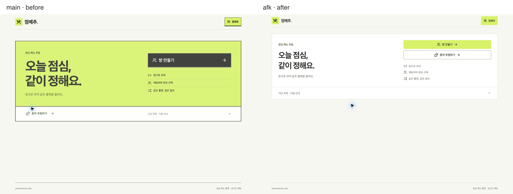

# UI 단순화 검증 기록 — 2026-11-17

진행 기준: [이슈 #73](https://github.com/acee90/random-number-generator/issues/73), [로드맵 #7](https://github.com/acee90/random-number-generator/issues/7). **로컬 구현·검증 완료, 운영 미배포.**

## 위치

- `origin/main f852b20`에서 만든 `afk/2026-11-17`. 구현 5개 + 이 기록 1개, 총 6개 로컬 커밋.
- 작업 디렉터리: `/Users/junhee/Documents/projects/random-number-generator/.afk/worktree-2026-11-17`.
- 미리보기: http://127.0.0.1:3017 . Vite만 실행해 둡니다. 비교 서버3018·Storybook6017은 종료했습니다.
- 기존 checkout의 main과 미추적 작업은 그대로 보존했습니다. push·PR·merge·운영 배포는 하지 않았습니다.

## 사용자가 보는 변화

| 변경 | 근거와 결과 | 확인 동작 |
| --- | --- | --- |
| 공통 UI | 버튼 아래3/4px 프레임과 누를 때 이동 제거. 1px 경계·기존 컬러 토큰·4/8px 반경·44px 기본 조작으로 정리 | 버튼을 Tab으로 이동하고 기본/선택/disabled 비교 |
| 시작 화면 | 전면 라임 배경과 굵은 프레임 제거. 두 시작 행동을 같은 폭/가운데 정렬로 묶음. 홈72→44px, 생성64→44px | 홈→방 만들기 또는 혼자 추첨하기 |
| 후보 준비 | 새로 작성/불러오기112→64px, 아이콘36→20px. 목록 선택과 편집 경계도 간결화 | solo→불러오기→기본107개 선택 |
| 추첨 결과 | 제목40–72px→28–48px, solo 강제 높이 제거, 다음 게임 버튼 가운데 정렬. 모바일 중복 덮어쓰기 제거로 투표 버튼64px 유지 | 실제 추첨→투표→다음 게임 |
| 번호 도구 | 게임 수86.8→44px, 번호 범위 입력65.5→47px. 기존 outline Button 사용, 선택 카드의 두꺼운 하단선 제거 | lotto/pension 게임 수 선택 및 번호 생성 |

각 구현은 해당 사용자 흐름을 하나의 커밋으로 보관했습니다. 공통 테마를 함께 적용하려면 첫 커밋 `945e675`가 기준입니다. 시작 `050eaa0`, 후보 `b168863`, 추첨 `2ea07bb`, 번호 `15cd7d1`.

## 축소·보류한 변경

- 처음에는 공통 크기만 바꿨으나 실제320px에서 모바일 CSS가 결과 제목/투표 숫자를 다시 키우는 것을 확인했습니다. 해당 덮어쓰기와 좁은 투표의 두 줄 강제 배치를 함께 줄였습니다. 실제 두 투표 버튼125×64px, y좌표 동일.
- 새 디자인 라이브러리·의존성·상태 관리·다크 테마는 추가하지 않았습니다. 기존 Radix/shadcn을 유지합니다.
- 기존 CORE의 룰렛 회전·투표 팝/순위는 제품 문서에 명시된 동작이라 유지했습니다. 홈 등장·화살표 이동·일반 버튼 translate 장식만 제거했습니다.

## 검증

**실제로 본 동작**

- 홈/생성/solo/number/lotto/pension/404:320·597px 전부 가로 넘침 없음. 실제6개 경로1280px 전후 캡처 및 측정. `measurements.json`, `narrow-layout.json` 참조.
- solo: 빈 시작→새로 작성→후보2개(Enter 포함)→마감→실제 난수 추첨→결과→기록/상세→Escape 두 번과 트리거 초점 복귀.
- 로컬 방: 생성/자동입장→기본107개 불러오기/편집→마감/추첨→투표 선택/집계→채팅 전송·접기→설정·종료 확인. 브라우저 검증 방2개 모두 명시 종료.
- 별도 저장소의 signed-out 입장 화면은 실제 데스크톱에서 닉네임 확인 중→사용 가능→활성 입장, 저장된 방장 재입장/권한 복원 확인.
- Storybook: 방장/참가자 편집·접수·목록 확인·입장 로딩6개 상태320/1280px, 많은 투표자29명/긴 이름·전송중·늦은입장·기록·제외200개·저장실패320px.
- Tab 포커스2px/offset2px, 선택 체크/내 선택, loading·disabled와 상태별 접근 가능한 이름 유지. 배경/글자 실제 렌더 값으로 본문14.41:1, 주 버튼11.50:1, 보조문구5.52:1, 포커스/흰색5.40:1, 입력 경계/흰색3.11:1 확인(`contrast.json`).

**자동 검사**

- 최종 `npm test -- --maxWorkers=4`:51파일/1,495개 통과.
- `npx tsc --noEmit`, 변경18파일 `npx biome check`, `git diff --check` 통과.
- `npm run build`, `npm run build-storybook` 최종 통과.
- `node scripts/release-web-check.mjs http://127.0.0.1:3017`:7경로·메타/자원/리다이렉트 통과.
- `node scripts/release-room-check.mjs --origin http://127.0.0.1:3017`:43항목·추첨2회 통과, 검증방 종료/소켓 종료 확인.
- 테스트가 tracked 파일을 바꾸지 않았음을 확인했습니다. 별도 CI workflow는 저장소에 없습니다.

**미검증/제외**

실제 iOS/Android/가상키보드, 화면 낭독기, OS reduced-motion 전환,10% 느린 재생, 실제200% 확대, RTL은 미검증입니다. reduced-motion 조건은 소스와 기존 회귀에서 확인했습니다. 서비스에는 다크 테마가 없습니다. signed-out 입장320px, 강제 라우트 오류 UI, 모든 개별 Story 조합을 수동 확인했다고 주장하지 않습니다. 운영·분석·오류 추적 서비스는 이번 로컬 UI 변경을 위해 변경하지 않았습니다. 분석 지표보다 사용자가 지적한 시각 문제와 전후 실측을 근거로 삼았습니다.

## 인터페이스 검토 범위

React19/TanStack Start, Tailwind4와 기존 shadcn/Radix/CSS. 기준 문서 AGENTS.md·CLAUDE.md·README·components.json. 실제 서비스의 UI를 범위로 하며 서버/난수 정책은 변경하지 않았습니다.

| 분야 | 본 근거 | 결과 |
| --- | --- | --- |
| 접근성 | 실제 Tab/Escape·선택·disabled, Dialog/버튼의 기존 이름·역할 | 확인 범위에서 새 차단 문제 없음. 화면 낭독기 미검증 |
| 배치 | 실제 경로320/597/1280, 방/solo/목록/결과 | 아래 조정 완료 |
| 문구 | 생성·후보·결과·확인창의 한국어 | 기존 문구와 행동 유지 |
| 타이포그래피 | 실제 제목/입력/긴 이름/숫자 카운트 | 제목·숫자 크기 위계 축소, 입력16px 이상 유지 |
| 컬러 | 실제 primary/outline/보조문구/포커스의 값과 대비 | 기존 라임 시스템 유지, 다크 제외 |
| UI 마감 | 테두리·반경·hover/선택·loading·motion guard | 일반 프레임과 이동 장식 축소, 투표 hover를 hover 지원 포인터로 한정 |

| 심각도 | 분야 | 위치 | 이전 | 이후 | 사용자 영향 |
| --- | --- | --- | --- | --- | --- |
| MEDIUM | UI | src/components/ui/primitives.css:15 | 두꺼운 하단선/큰 컨트롤 | 1px/44px 기준 | 전체 화면의 조작 밀도 통일 |
| MEDIUM | 배치 | src/components/features/lunch-home.css:17 |72px CTA와 분리된 보조 행동 |44px 같은 폭/정렬 | 시작 방식 비교 용이 |
| MEDIUM | 배치 | src/components/features/lunch-room-mobile.css:163 | 고정156px 요약·큰 제목/숫자 재정의 | 내용 높이/28–48px/작은 집계 | 모바일 결과 가독성·스크롤 개선 |
| MEDIUM | 배치 | src/styles.css:632 |86.8px 게임 선택·plain 우회 | 기존 outline/default44px | 번호 도구의 과도한 padding 제거 |

위 조정 모두 완료. **Approve — 확인한 범위에 한함.** 수동 미검증 항목은 위 제한을 따릅니다.

## 이번에 정한 것과 남긴 아이디어

- 라임을 주요 행동·선택에 유지하고 카드 바탕은 밝게 통일, 반경4/8px 사용. 일반 조작44px, 준비 선택64px. 반경/밀도는 되돌릴 수 있는 디자인 결정입니다.
- 키보드 추가 단축키: 편집 사용자용. 이미 Enter로 추가 가능해 이득 근거 없음, 소형·보류.
- 목록 교체 Undo: 방장 복구용. 기존 확인창으로 보호 중이며 기능 범위가 커 중형·검토만 유지.
- 전체 화면 추첨: 모임 발표용. 기존 #12와 중복, 중형·해당 이슈에서 별도 결정.
- 회의용 텍스트 전용 추첨: 작은 공유 화면 사용자를 위한 대안. 기존 reduced-motion과 구분할 수요 근거 부족, 중형·보류.
- 다크 테마: 야간 사용자용. 기존 시각화의 하드코딩 색까지 이행해야 하므로 중형·보류.
- 스크린샷 매트릭스 자동화: 유지보수자용. #63/#69처럼 크기 회귀가 반복된 근거가 있으나 새 자동화 의존성은 추가하지 않았음, 중형·검토.
- 문구 개작: 오류 근거 없음, 소형·제외. 작성자의 목소리를 유지.

전체22개 아이디어와 결정 기록은 원래 checkout의 `.afk/2026-11-17.md`에 로컬 보관했습니다. 검토 아이디어를 확정 개발 계획으로 취급하지 않습니다.
